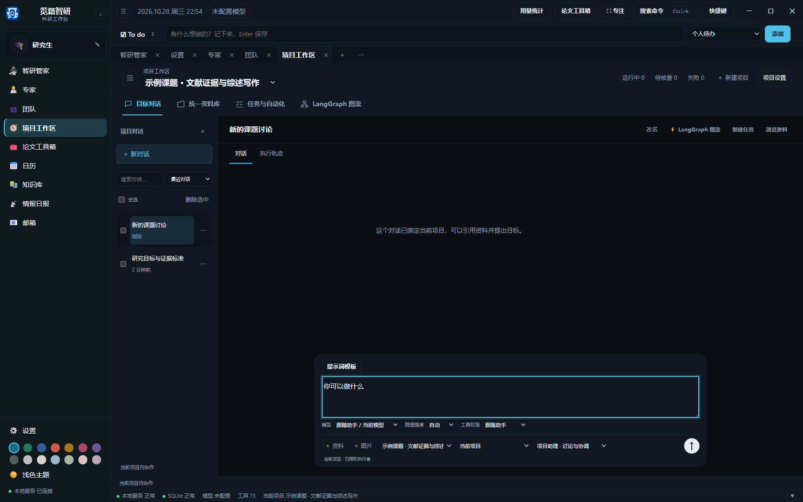
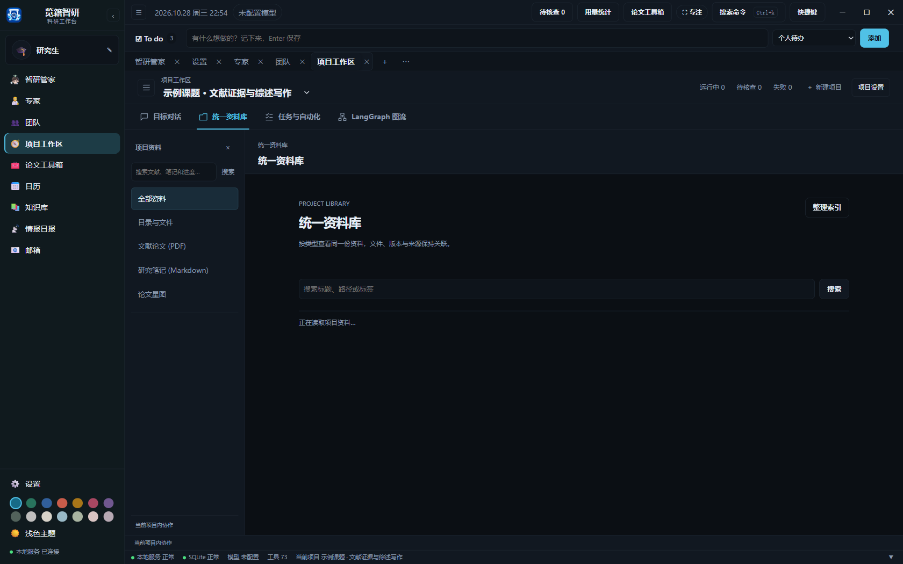
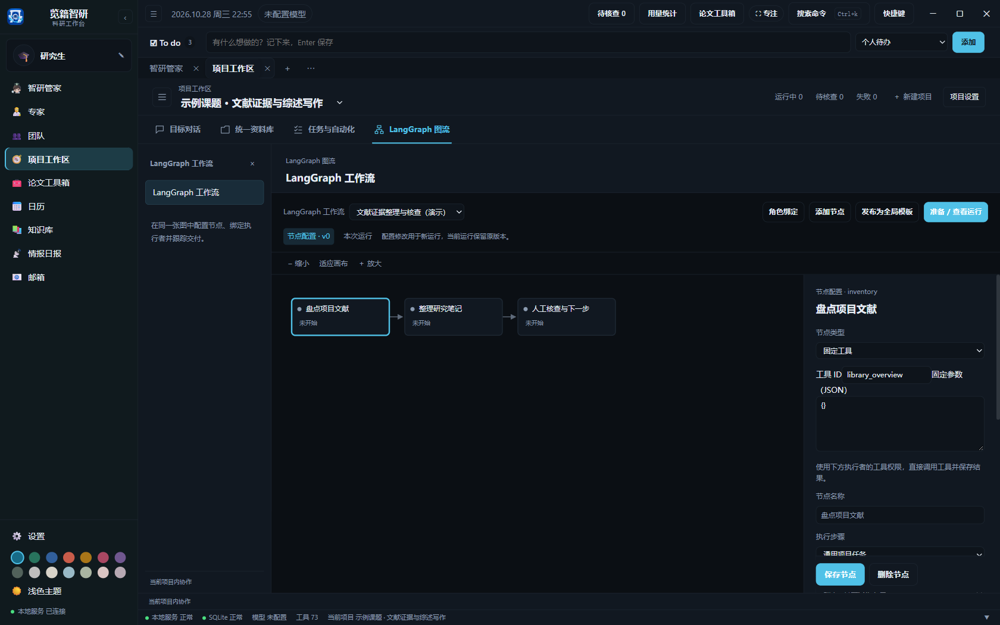

  

<h1 align="center">览籍智研</h1>

<strong>为课题定制研究流程，用专家团队协作管理科研全过程</strong>

览籍智研是本机运行的科研工作台，围绕项目管理研究问题、文献、PDF、证据、笔记、待办和论文产物。研究者可以自定义工作流、组织专家团队，并审查 AI 生成的内容。

## 界面速览

项目工作区用四个主视图组织研究。截图采集于 2026-10-28，使用独立演示项目；详细入口见[新版界面导航](doc/guide/interface-overview.md)。

| 目标对话 | 统一资料库 |
| --- | --- |
| 围绕课题讨论，引用项目材料，选择专家或团队。  | 集中查看文献、笔记、稿件和交付文件。  |
| **任务与自动化** | **LangGraph 图流** |
| 安排计划，查看实时执行与人工核查，管理自动化规则。  | 在同一张画布配置节点、依赖、执行者和审查要求。  |

## 安装

当前版本为 **0.4.0**，从 [GitHub Release](https://github.com/Jack-Liu0227/lanji-zhiyan/releases/tag/v0.4.0) 下载 [Windows 安装包](https://github.com/Jack-Liu0227/lanji-zhiyan/releases/download/v0.4.0/LanjiZhiyan-0.4.0-Setup.exe)，双击即可安装。也可以下载[免安装版](https://github.com/Jack-Liu0227/lanji-zhiyan/releases/download/v0.4.0/LanjiZhiyan-0.4.0-Portable.zip)，解压后启动其中的 览籍智研.exe。桌面版需要 Windows WebView2 运行时。

## 快速开始

1. 在“设置 → 模型列表”配置模型或本机账号。
2. 在“项目工作区”点击“＋ 新建项目”，或请智研管家按研究目标自动立项。
3. 使用已启用的专家与团队；共享配置可在各项目复用，文件和运行记录归属调用项目。
4. 在项目的 LangGraph 画布选择模板、配置节点与核查要求。
5. 在统一资料库管理材料，在“任务与自动化”查看计划、实时执行和自动化规则。

详细操作见[使用指南](doc/使用指南.md)，首次使用可先看[界面导航](doc/guide/interface-overview.md)和[安装与首次配置](doc/guide/getting-started.md)。

## 功能

- 按项目自定义工作流阶段、依赖关系、执行角色和人工审查。
- 使用专家或专家团队完成文献研究、证据整理、写作和审阅。
- 在统一资料库管理文献、PDF、论文星图、笔记、稿件、实验记录和交付文件。
- 连接本机 Zotero，逐篇选择文献并预览同步。
- 用待办计划安排目标，用实时任务看板跟踪 Agent、团队与流程，用自动化规则持续触发研究任务。
- 管理对话的模型、推理强度与权限，支持置顶、重命名、归档和删除恢复。
- 在全局论文工具箱进行图片图注、图片格式转换、中英互译、润色、引文整理、PDF 翻译与 Mermaid 图表预览。
- 在同一套提示词模板库管理分类、变量、项目模板和工具提示词。
- 在顶栏“用量统计”查看模型请求、token、缓存读取与会话汇总。

## 本机数据

Windows 安装版和源码版默认将用户数据保存在 %LOCALAPPDATA%/览籍智研；项目文件使用各自选定的目录。可通过 LANJI_ZHIYAN_HOME 指定独立数据根。更新或卸载前请备份数据库、PDF、笔记及项目文件。应用不会内置 API Key。

## 从源码运行

开发环境需要 Python 3.10 或更新版本。克隆项目后，在项目目录运行 tools/start.bat。开发验证可设置独立数据根，避免混用日常数据。

## 项目资料

- [用户使用指南](doc/使用指南.md)
- [发行与更新记录](https://github.com/Jack-Liu0227/lanji-zhiyan/releases)
- [安全说明](SECURITY.md)

更多界面截图随各篇指南提供，素材保存在 [doc/screenshots](doc/screenshots/)。
