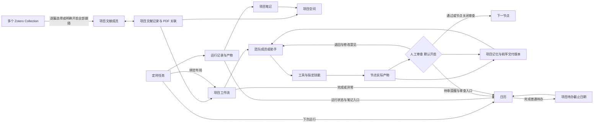

# 账号认证与项目工作流联动

所有研究内容以项目 ID 关联。工作流中的题录、项目空间的文献列表和 Zotero 同步使用同一组项目文献记录；PDF 通过持久化关联接到题录，笔记、执行产物和运行记录通过资产关系追溯来源。

## 配置账号模型

在“设置 → 模型列表”中选择 Codex、Claude Code 或 Antigravity，点击“配置”。账号窗口提供官方登录、重新检测和模型采用。默认模型 ID `auto` 跟随官方客户端设置，也可以填写账号可用的模型 ID。

| Provider | 本机客户端 | 登录入口 |
| --- | --- | --- |
| Codex | `codex` | `codex login` |
| Claude Code | `claude` | `claude auth login` |
| Antigravity | `agy` | 启动官方客户端完成 Google 登录 |

工作台复用官方客户端的账号会话，不复制 access token 或 refresh token。未安装客户端会显示安装提示。Codex 和 Claude Code 可以检测登录状态；Antigravity 的凭据由官方安全凭据管理器维护，工作台显示 CLI 安装状态并在调用时验证认证。

桌面隔离服务通过受认证的本机宿主通道调用官方客户端，登录窗口和凭据仍由官方客户端管理。切换模型不需要把账号令牌填入 API Key。

认证与无交互调用依据 [OpenAI 官方认证文档](https://developers.openai.com/codex/auth)、[Codex 无交互执行文档](https://developers.openai.com/codex/noninteractive)、[Claude Code CLI 文档](https://code.claude.com/docs/en/cli-reference)和 [Antigravity 认证文档](https://www.antigravity.google/docs/install?tab=cli)。模型输出通过工作台工具循环处理，所选助手的权限与工具启用规则继续生效。

## 关联文献

1. 打开本机 Zotero，在“设置 → Zotero 写入与同步”选择“使用本机 Zotero”。无需 Web API Key；首次写入通过 Zotero 原生窗口授权，可选择始终允许以复用本机权限。内置 MCP 使用同一授权。
2. 在“项目文献来源”点击“读取 Collections”，添加所需的多个 Collection，保存来源。默认都是“逐篇选择”；不添加来源时可从全库勾选。子 Collection 需单独添加。
3. 点击“从已保存来源选择文献”，逐篇勾选，点击“加入所选文献并预览同步 → 确认执行预览”。之后可选择仅拉取、仅推送或双向合并，也可以打开“应用运行期间自动同步”。
4. 自动同步默认每 15 秒检查一次，可设置为 10 至 3600 秒。工作流检索列表和项目空间文献页每 3 秒读取统一文献接口。

工作流“下载精读”的“Zotero 项目同步”和项目空间同步入口都打开这一配置页，并自动选择当前项目。旧的直接导出与独立新建分类入口已移除。Collection 只定义候选来源，保存来源或浏览全库不会自动把所有文献加入项目。“全部跟随”需要明确开启，会纳入该 Collection 当前和以后新增的文献；旧版已绑定的整集合同步会迁移为此模式，避免无提示改变已有配置。

例如项目 P 可从 Collection A 的 100 篇中选 3 篇，再从 B 的 50 篇中选 2 篇。若其中一篇同时属于 A、B，项目中按 Zotero Key 只计一次。项目 Q 可以使用相同 Collection 并选择不同子集。已加入项目的文献之后移到其他 Collection，仍保持项目关联；移除来源也不会撤销已经选中的文献，需要通过“移除项目关联”明确处理。

项目标签无需手工填写：选择“双向合并”，点击“预览同步 → 确认执行预览”，或开启双向自动同步，即会写入 `rw:project:<项目ID>`。仅拉取模式不写 Zotero，因此不会自动打标签。已有的普通标签保持原样。

有 DOI 的题录按规范化 DOI 识别同一文献。两个项目可以复用同一个 Zotero 条目，各自添加自己的项目标签，保留条目原有的全部 Collection 归属。新配置推送新建条目时存入文献库根目录并打项目标签；旧配置保留原来的新建条目目标 Collection。没有 DOI 的 Zotero 文献按 Key 保持独立；同时选中 DOI 相同而 Key 不同的记录时会提示解除多余关联，避免反复覆盖。更新题录会同步关联 PDF 的显示元数据。Zotero 导入的 PDF 使用项目副本，原附件保持原位。

双向同步自动为项目成员添加稳定标签 `rw:project:<项目ID>`，项目改名不改变关联；未选中的候选文献保持原样。修改标题时保留完整日期、结构化作者、编辑者和其他未修改字段；其他项目增加标签不会被误判为题录冲突。双端修改、条目删除或匹配歧义会保留两端内容并显示冲突。自动同步可以继续处理无冲突条目；手动预览列出两端内容，可选择采用项目或 Zotero 版本。比较后任何一端变化都会要求重新读取。

“按项目标签批量移除关联”先列出文献、其他项目和历史引用，支持勾选部分条目，包括仅拉取、尚未打标签的项目成员。确认后只移除当前项目标签及项目成员关系，从该项目文献列表隐藏；保留 Zotero 原条目、全部 Collection 归属、其他项目关联、PDF 和历史笔记。持久化排除记录防止下次同步自动加回。操作记录支持重试失败项和恢复本次关联；恢复时保留之后增加的其他标签。更换来源不影响成员操作，换到不同 Library 则禁止应用旧批次。可以在候选列表明确重新加入；重新加入后，旧移除批次不能覆盖新选择。

同步不会自动删除 Zotero 条目，也不会把项目笔记或 PDF 附件自动上传。MCP 的显式新建条目、带版本更新和挂载笔记操作同样通过本机接口完成。

本机同步直接读取桌面 Zotero，增量检查版本，并检测本机条目删除；不依赖云端 API Key。它是默认 15 秒的轮询同步，并非零延迟推送。限流和暂时错误会延后重试；关闭工作台后停止轮询。手动预览有效期间后台等待，避免改动正在审阅的计划。Web API 仅作为可选兼容模式保留在折叠配置中。

## 执行有记忆的工作流

在“设置 → 工作流”展开节点的“执行与审查”，配置执行助手、团队、成员、节点任务、工具和技能。没有指定成员时，按环节匹配团队成员，找不到则使用 Leader。团队必须属于当前项目或是未绑定项目的通用团队。

默认每个节点都需要人工审查。取消某个节点的审查勾选后，系统仍检查实际产物与上游版本，检查通过才自动交付。工具白名单可以进一步缩小助手可用的工具，无法绕过助手已禁用的工具。

在项目工作流页点击“顺序执行整个工作流”，可以填写本次目标并启动。执行器按已保存的依赖顺序一次执行一个节点。每个节点持久化保存：

- 本次目标、项目记忆、执行助手、团队成员和指定技能内容版本。
- 直接上游的已验收交付快照和输入资产。
- 本次运行中此前节点的结果、交付 ID 和人工反馈。
- 当前节点的实际产物快照、执行记录、产出资产和审查意见。

节点完成后，在运行窗口查看产物并选择“通过并继续”或“退回修改”。通过后会自动执行下一节点；退回时必须填写意见，重试会带入这份意见。先前已交付节点不重复执行。

上游产物或工作流定义变化时，旧输入无法继续验收。修改上游后应停止旧运行，再按新定义重新开始。待审产物发生变化也需要重试节点，避免审查的内容与后续实际使用的内容不一致。

运行与完整上下文保存在 SQLite，切换页面不影响执行。长内容在模型输入中节选，可用 `workflow_context_read` 按节点和章节分页读取原文。节点显式限制工具时，需要允许这个读取工具才能继续处理超长历史。

服务重启保留待审节点和已交付节点。模型请求失败后可以“从已保存进度继续”，复用已成功的工具结果；工具执行中断且结果不明时，先核对产物，再显式“重新执行当前节点”。后者可能再次调用写入工具。上游、执行角色或配置变更后不复用旧工具进度。

顶栏“待审查”集中列出各项目待审节点，保留最初收到时间，支持设置截止时间和稍后提醒。提醒只影响提示时间；实际审批仍需打开节点检查产物。截止日期同步投影到日历。

## 定时任务结果进入笔记

定时任务可以选择单个专家，或在编辑器的“执行完整工作流”中绑定一个布局。到点后冻结本次任务目标与工作流配置，按节点设置调用团队、助手、工具和技能。待审状态不会记为完成，也不会提前归档成功笔记；同一任务还有未完成工作流时，下一次触发不会重复启动。项目已有其他进行中工作流时会报告阻断，避免混用运行。

完整工作流的所有节点交付后，才按输出目录生成 Markdown 并归档项目笔记，包含节点结果、人工反馈、产物引用和最终内容。每次运行使用固定笔记 ID，重复归档不会再建一篇，也不会覆盖用户对已归档笔记的修改。运行记录清理会阻止删除仍在执行或待审的工作流关联。

运行记录提供“打开笔记”。同一笔记可以从项目笔记列表、项目空间和统一搜索找到。笔记保留定时任务 ID、运行 ID、关联工作流运行 ID，并通过 `derived_from` 关系链接源产物。失败和空结果不会生成成功笔记。

## 从日历处理研究任务

日历同时展示手动日程和以下关联内容：

| 来源 | 日历中的行为 | 打开后的位置 |
| --- | --- | --- |
| 项目待办 | 展示截止日期，修改日期后自动移动；普通待办可勾选完成并回写项目 | 项目任务编辑器 |
| 定时任务 | 展示下一次运行；暂停、修改或删除规则后同步变化 | 对应定时规则 |
| 定时运行记录 | 展示运行状态；成功结果提供笔记入口 | 本次运行的项目笔记 |
| 工作流人工审查 | 有截止日期时显示在期限当天，否则保留在今日待办；保留最初收到时间 | 对应运行的产物与审查窗口 |
| 工作流结果 | 展示完成、停止或需要处理的状态 | 对应工作流运行 |

日历读取项目任务、定时规则和工作流记录，不为这些内容另建一份可独立修改的日程。删除源任务后不会留下孤立日程；删除定时规则会一并移除它的关联运行日程，已经归档的项目笔记仍然保留。

工作流节点、关联环节的待办和运行记录不能用日历勾选代替验收。点击“审查节点”后查看实际产物，再选择通过或退回；已经在节点设置中关闭人工审查的节点继续按自动交付规则运行。

日历页面每 3 秒刷新关联内容，保留正在输入的快速添加内容。定时规则目前只显示下一次运行，历史展示最近 2000 条运行记录；不会提前铺满整月的重复日程。时间使用本机时区，应用关闭期间不执行定时任务。

## 开发与验证

迁移 `012_connected_research.sql` 保存题录与 PDF 关联以及工作流布局快照；`013_collaboration_completion.sql` 保存全库条目缓存、项目成员关系与排除记录、可恢复操作批次、定时工作流关联和审查提醒。工作流执行复用 `workflow_runs`、`workflow_nodes`，节点输入、工具进度、结果及反馈保存在 `checkpoint`，人工验收复用既有交付指纹校验。

行为测试包括 `test_account_providers`、`test_schedule_notes`、`test_project_library`、`test_workflow_execution`、`test_calendar_links`；浏览器测试 `test_connected_research_runtime` 使用临时数据库及本地模拟模型，覆盖设置持久化、人工审查后自动继续、前序记忆进入下一次模型请求、文献视图刷新、笔记入口和日历操作。

新增行为测试 `test_zotero_collaboration`、`test_schedule_workflows`、`test_workflow_continuity`，浏览器验收为 `test_collaboration_completion_runtime`。自动回归使用隔离数据库与模型/接口夹具，不调用个人账号。

本机真实 Zotero 和账号模型的独立验收结果见 协同补齐验收记录（本地记录）。Antigravity 适配采用官方 [stdin 流式协议](https://www.antigravity.google/docs/cli/headless/)，避免将完整工作流上下文放进命令行参数。
