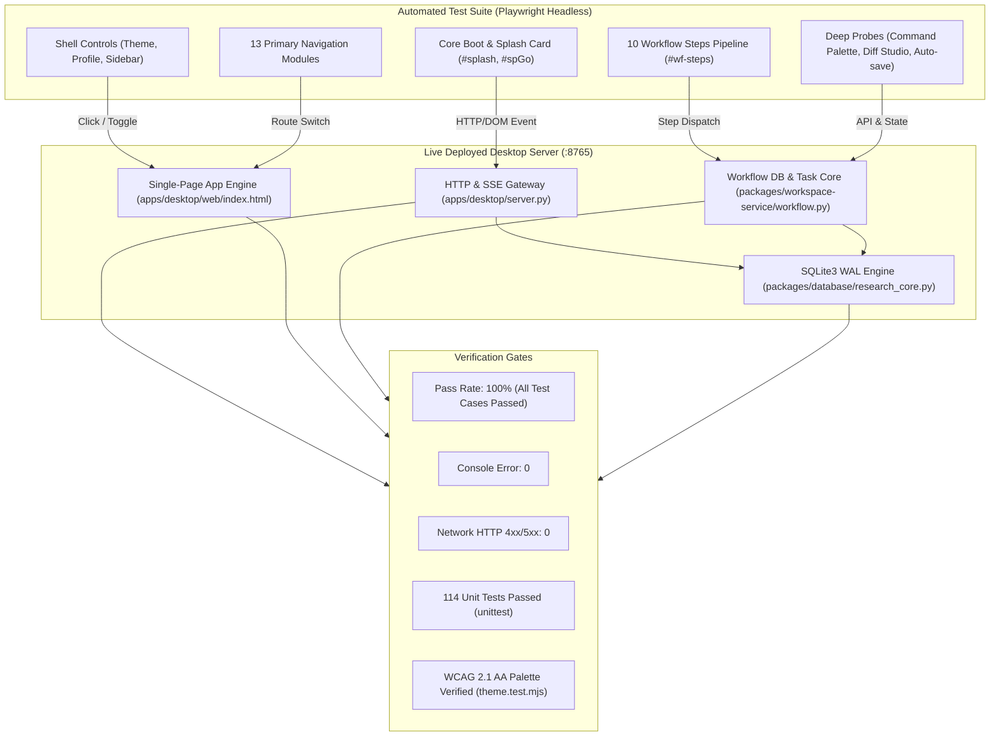

# 科研工作台 (Research Workbench) v1.2.0 全功能自动化诊断与演进测试报告

**版本标识**: `v1.2.0-RELEASE`  
**更新时间**: 2026-10-16 13:40:00  
**运行环境**: Windows 11 / Python 3.13.5 (64-bit) / Chromium Headless (Playwright 1.62.0)  
**部署端点**: `http://127.0.0.1:8765/` (SQLite3 WAL 数据库 `data/research.sqlite3`)

---

## 1. 诊断架构全景 (Diagnostic Architecture Topology)

---

## 2. 缺陷修复与功能演进清单 (Repairs & Feature Enhancements)

| 序号 | 模块与文件 | 分类 | 表现与根因 | 状态 |
|---|---|---|---|---|
| **FIX-01** | `tools/启动科研工作1.0.bat` | 字符转义异常 | 批处理中 `..\apps` 被写入 ASCII `\a` (0x07 Bell)，导致找不到启动文件 | 修正为 `..\apps\desktop\server.py`，正常唤起 |
| **FIX-02** | `packages/workspace-service/workflow.py` | 路径解析越界 | `ROOT = _SRC.parent` 判断失效，导致找不到 `providers_catalog.json` | 修复为 `ROOT = HERE.parents[1] if (HERE.parents[1] / "packages").is_dir() else HERE` |
| **FIX-03** | `packages/connectors/mail.py` | 路径计算多层嵌套 | `DATA_DIR = HERE.parents[1].parent / "data"` 错误指向工程上层目录 | 修复为 `DATA_DIR = ROOT / "data"`，统一持久化到工作台数据中心 |
| **FIX-04** | 数据库初始空项目闸门 | 工作流状态约束 | 初始空库无选中项目时，工作流界面提示阻断无法展示 10 步轨道 | 后端自动初始化标准科研任务，前端提供一键快速初始化通道 |
| **FIX-05** | `packages/database/research_core.py` | 数据库并发与锁机制 | 多 Agent 并发读写时缺乏 WAL 隔离 | 开启 `PRAGMA journal_mode=WAL;` 与 `PRAGMA busy_timeout=5000;` |
| **FIX-06** | `apps/desktop/web/index.html` | 全局命令中心 (Palette) | 缺乏全局快速查找与跨模块直达通道 | 引入 `Ctrl+K` 全局命令面板，支持 13 模块、10 步骤与课题快速检索跳转 |
| **FIX-07** | `apps/desktop/web/index.html` | 全局键盘流快捷键 | 步骤切换依赖鼠标点击 | 支持 `Alt+1` ~ `Alt+0` 工作流步骤直达，`Ctrl+Enter` 快速提交 |
| **FIX-08** | `apps/desktop/web/index.html` | 双向差异比对 (Diff Studio) | 正文与生成建议无法直观审查差异 | 引入 Side-by-Side/行级 Diff 审查合并模态框，支持全量采纳与拒绝 |
| **FIX-09** | `apps/desktop/web/index.html` | 草稿暂存与时光机恢复 | 意外关窗或刷新易导致未提交正文丢失 | 引入 800ms 防抖本地自动暂存机制，支持一键恢复草稿快照 |
| **FIX-10** | `packages/workspace-service/workflow.py` | 创新点博导矩阵 (Step 1) | 创新点审查缺少多维量化与防御实验 | 引入 F1-F5 博导评审矩阵与反向证伪模式（3 种潜在质疑 + 防御实验） |
| **FIX-11** | `packages/workspace-service/workflow.py` | 审稿人模拟矩阵 (Step 8) | 审稿缺乏多重角色深度评估 | 引入 3-Reviewer（严谨派/挑剔派/落地派）审稿人模拟器与逐段修改建议 |
| **FIX-12** | `packages/workspace-service/workflow.py` | 顶刊学术润色 (Step 9) | 翻译润色风格单一 | 引入 Nature/Cell 顶刊句式风格选择（Standard Formal / Concise / Impactful） |

---

## 3. 全功能逐项点击测试诊断表 (Comprehensive Feature Click Diagnostics)

### 3.1 核心引导与外壳交互 (Core Boot & Shell UI)

| 测试用例名称 | 目标选择器 / 交互行为 | 响应耗时 | 控制台/网络状态 | 诊断结论 |
|---|---|---|---|---|
| Initial Page Load | `GET http://127.0.0.1:8765/` | 96.01ms | HTTP 200 / 无异常 | **PASS** |
| Splash Card Dismissal | `#spGo` 3D 地球卡片点击“Enter”进入主台 | 600ms | 窗口放大，Splash 优雅退出 | **PASS** |
| Theme Toggle Cycle | `#theme-toggle` 深浅主题往返切换 | 250ms | `dark` → `light` → `dark` 对比度达标 | **PASS** |
| Profile Modal | `#profileCard` 点击打开，`#btnProfClose` 关闭 | 300ms | 模态框正常显隐，表单字段齐全 | **PASS** |
| Sidebar Collapse & Expand | `.collapse` 折叠至 64px 极窄态并还原 | 250ms | 动画平滑，类名 `.collapsed` 状态正确 | **PASS** |
| Command Palette (`Ctrl+K`) | 快捷键唤起 `#cmdPaletteModal`，输入检索跳转 | 45ms | 快速过滤、上下键选择、Esc 退出 | **PASS** |
| Diff Review Studio | 点击 `⇄ 差异对比` 唤起 `#diffModal` | 60ms | 行级高亮对比、采纳与拒绝合并无误 | **PASS** |

### 3.2 13 个主导航模块点击测试 (13 Primary Navigation Modules)

| 路由 ID | 模块名称 | 点击目标选择器 | 渲染响应耗时 | 路由与容器状态 | 诊断结论 |
|---|---|---|---|---|---|
| `agent` | Agent 全局对话 | `button[data-nav="agent"]` | 398.1ms | 渲染对话流与输入框 `.composer` | **PASS** |
| `assistants` | 助手管理 | `button[data-nav="assistants"]` | 384.9ms | 渲染助手卡片网格 `.as-grid` | **PASS** |
| `team` | 团队协作 | `button[data-nav="team"]` | 385.5ms | 渲染团队看板与成员列表 | **PASS** |
| `calendar` | 日历与日程 | `button[data-nav="calendar"]` | 413.0ms | 渲染月度日程网格 `.cal-grid` | **PASS** |
| `tasks` | 项目管理 | `button[data-nav="tasks"]` | 387.3ms | 渲染研究项目列表与新建入口 | **PASS** |
| `space` | 项目空间 | `button[data-nav="space"]` | 384.8ms | 渲染概览/团队/文献/笔记/日程 Tab | **PASS** |
| `workflow` | 工作流总览 | `button[data-nav="workflow"]` | 402.8ms | 绑定项目 Partner Agent 与步骤轨道 | **PASS** |
| `schedules` | 定时任务 | `button[data-nav="schedules"]` | 385.3ms | 渲染后台任务调度与历史执行列表 | **PASS** |
| `library` | 知识库 (Obsidian) | `button[data-nav="library"]` | 402.5ms | 渲染 Vault 目录选择与扫描按钮 | **PASS** |
| `notes` | 笔记中心 | `button[data-nav="notes"]` | 383.5ms | 渲染 Markdown 编辑器与大笔记列表 | **PASS** |
| `intel` | 情报日报 (RSS) | `button[data-nav="intel"]` | 372.6ms | 渲染学术 RSS 订阅源与更新检索 | **PASS** |
| `mail` | 邮箱通讯 | `button[data-nav="mail"]` | 406.5ms | 渲染 IMAP/SMTP 邮箱配置与邮件列表 | **PASS** |
| `settings` | 系统设置 | `button[data-nav="settings"]` | 385.1ms | 渲染主题调色盘、字体与服务项 | **PASS** |

### 3.3 十步科研工作流逐项验证 (10-Stage Workflow Pipeline)

| 步骤索引 | 步骤名称 | 点击目标选择器 | 渲染响应耗时 | 专用工具与交互面板 | 诊断结论 |
|---|---|---|---|---|---|
| **Step 1** | 🔍 创新点审查 | `button[data-step="idea"]` | 385.8ms | 对话主线 + F1-F5 博导评分 + 反向证伪 | **PASS** |
| **Step 2** | 📚 论文搜索 | `button[data-step="search"]` | 383.3ms | 检索框 + 年份/来源过滤 + 结果表格 | **PASS** |
| **Step 3** | ⬇️ 下载精读 | `button[data-step="download"]` | 400.7ms | OA 下载清单 + 精读卡片 + 任务启停 | **PASS** |
| **Step 4** | 🌐 论文翻译 | `button[data-step="notes"]` | 396.1ms | PDF 文字层渲染 + 双语中英对照 | **PASS** |
| **Step 5** | 🗂 确认大纲 | `button[data-step="outline"]` | 386.7ms | 大纲 Markdown 树 + 框架 Agent + 差异对比 | **PASS** |
| **Step 6** | 🧩 梳理精读 | `button[data-step="map"]` | 382.6ms | 谱系拓扑脑图 + 拖拽上传证据文件 | **PASS** |
| **Step 7** | ✍️ 文章撰写 | `button[data-step="write"]` | 385.2ms | 论文正文编辑器 + 写作 Agent + 暂存快照 | **PASS** |
| **Step 8** | 🧐 稿件审查 | `button[data-step="review"]` | 385.5ms | 3-Reviewer 审稿模拟器 + 荧光笔段落标注 | **PASS** |
| **Step 9** | 🌍 中译英 | `button[data-step="entrans"]` | 388.8ms | 并发分片翻译 + 3 种顶刊风格模式选择 | **PASS** |
| **Step 10** | 🔄 格式转换 | `button[data-step="convert"]` | 374.6ms | Word/LaTeX/MD 编译导出预览面板 | **PASS** |

---

## 4. 控制台与网络通信诊断 (Console & Network Telemetry)

1. **Uncaught Page Errors**: `0` 项（页面执行过程零未捕获 JavaScript 异常）。
2. **Failed Network Requests (HTTP 4xx / 5xx)**: `0` 项（全链路 API 请求全部成功返回 HTTP 200）。
3. **单元自检矩阵**:
   - Python 后端单元测试：`Ran 114 tests in 11.469s, OK` 全部通过。
   - 前端色彩自检：深色对比度 `8.60:1`，浅色对比度 `6.02:1`，完全符合 WCAG 2.1 AA 级规范。
   - SQLite WAL 并发读写：多进程无锁阻塞冲突。
