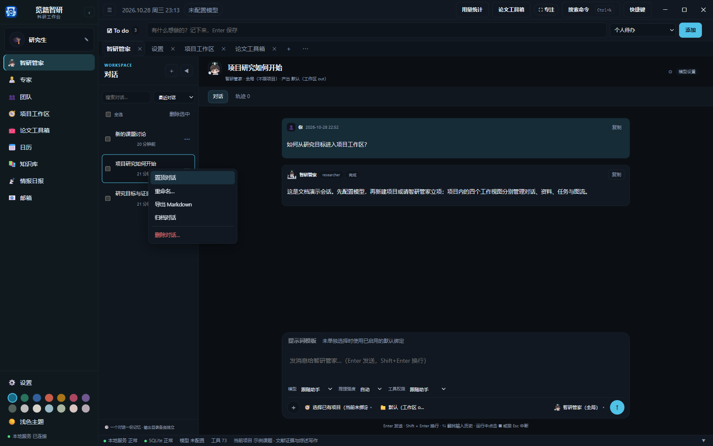
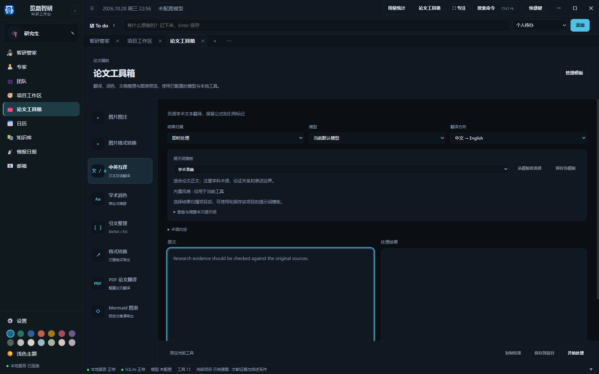
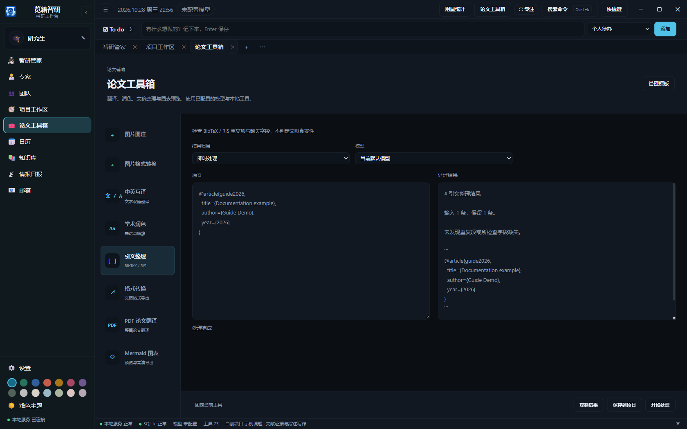
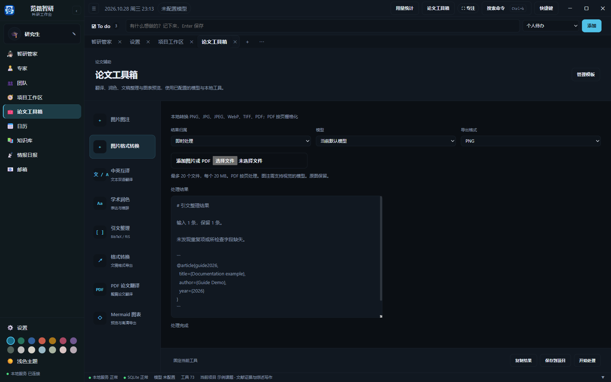
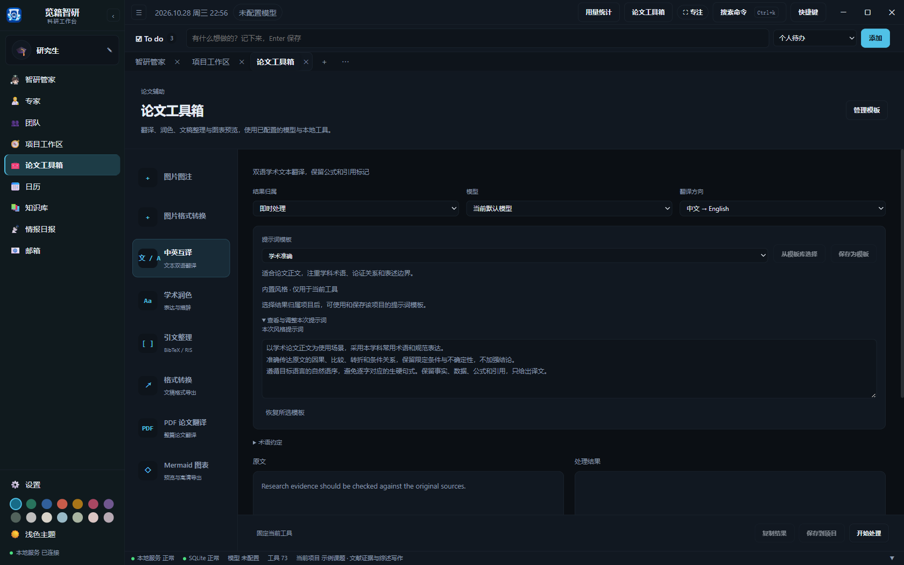
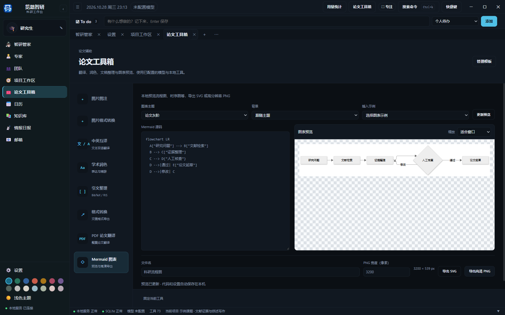

# 对话历史与论文工具箱

## 管理对话

智研管家、项目工作区和团队对话共用历史管理交互。右键点击记录，或点击记录右侧的更多按钮，可置顶、重命名、导出 Markdown、归档和删除，也可批量选择处理。支持搜索标题和切换“当前对话”“已归档”“最近删除”。

删除先移入“最近删除”，消息仍保留，可恢复后继续对话。永久删除须在“最近删除”中另行确认。删除会话不会删除项目文件、文献或任务产物。运行中的对话须先停止并等待执行结束，才能归档或删除。

每段会话保留自己的模型、推理强度、工具权限和草稿。调整会话设置作用于下一次发送，不修改正在执行的请求，也不改变系统默认模型。

消息中的工具调用默认折叠，摘要显示工具名称、状态与耗时。展开后可查看输入参数和执行结果，便于核对 Agent 使用了哪些资料与操作。论文工具箱左侧也可搜索工具名称和用途。

项目对话输入框底部可直接选择所属项目，与工作区顶部项目选择保持同步。切换时分别保留各项目的草稿和对话，原项目中正在执行的 Agent 继续运行，可回到该项目的实时任务看板查看。这里的项目选择与“当前项目 / 当前工作流”发送范围分别设置。

## 任务和工作流对话

派发给专家或团队的每项任务都会建立专属对话；每次准备工作流也会建立总对话。可从项目对话列表、实时看板或工作流调用卡片中的“工作流对话”进入。重复查看和恢复同一次执行会回到已有对话，历史任务会自动补齐关联。

对话显示目标、真实执行状态、各次尝试的回复，以及默认折叠的工具调用。每条回复显示本次执行使用的专家姓名；团队任务还显示团队和成员职责。切换专家后，旧回复保留原专家姓名。顶部状态按钮可回到执行进度与操作区。

任务需要人工核查时，点击“查看产物”或“任务与产物”进入文件审查。工作流在总对话中列出节点，点击“审查 · 节点名称”进入对应任务；也可展开“工作流节点”查看单个节点对话。审查通过后，流程按依赖继续执行；退回后保留原尝试和反馈。

可以在任务对话继续追问，专家会收到关联任务要求和近期结果。追问不会代替人工批准，也不会自动重跑已交付任务。工具详情展开状态在进度刷新时保留；刷新页面后重新默认折叠。

删除对话会同步清理主看板关联卡片；单独从看板删除卡片会保留对话。任务和工作流产物仍保存在项目内。对话的 Markdown 导出包含已保存的执行回复及专家姓名。

## 使用论文工具箱

点击应用最外层左侧导航的“论文工具箱”，即可打开独立工具页面，无需先选择项目。左侧工具栏提供图片图注、图片格式转换、中英互译、学术润色、引文整理、格式转换、PDF 翻译和 Mermaid 图表，共 8 项。顶部“论文工具箱”按钮可在研究页面旁打开快捷面板，两个入口共用草稿、模型配置和处理记录。

工具箱右上角的“管理模板”直接打开[提示词模板库](notes-and-templates.md)，可切换项目并新增、编辑、复制、删除或停用模板，以及管理分类和标签。此入口始终可见，不依赖工具箱的结果归属是否已选择项目；没有项目时可查看内置模板。

可以固定常用工具、粘贴原文、选择已有模型和结果归属，在左右两栏比较原文与结果。工具箱复用设置中的模型与凭据，无需另配一套接口。

每个工具都可将文件拖入工具面板，也可点击“选择文件”。文件按当前工具处理，不会因拖拽而切换到其他工具；不支持的文件类型会显示提示。

| 当前工具 | 可导入文件与行为 |
| --- | --- |
| 图片图注、图片格式转换 | PNG、JPG、JPEG、WebP、TIFF、PDF；添加到图片列表，每批最多 20 个，PDF 最多 30 页 |
| 中英互译、学术润色、格式转换 | TXT、Markdown、LaTeX、DOCX、文字型 PDF；在本机提取文本并追加到原文，保留已有草稿 |
| 引文整理 | BibTeX（.bib / .bibtex）、RIS、TXT；追加到原文，请保持同一种引文格式 |
| PDF 翻译 | 先选择结果归属项目，再拖入 PDF；文件导入项目文献并自动选中，点击“开始处理”后启动翻译。批量导入后可在项目文献下拉框选择要翻译的一篇 |
| Mermaid 图表 | .mmd、.mermaid、.md、.txt；每次 1 个文件，导入后替换当前图表源码并更新预览 |

每个文件最多 20 MB，除 Mermaid 外每批最多 20 个。文本原文合计最多 200000 字符；文本提取及整篇翻译导入的 PDF 最多 500 页。扫描 PDF 无可提取文字时会提示先 OCR 或使用 PDF 翻译。DOCX 提取正文段落和表格文本，不保留原排版；文本导入本身不调用模型。文件夹、空文件、超限文件和不适用的格式会被拒绝，批量导入中已成功的文件会保留。

翻译和润色可选择“提示词模板”调整风格，模板按用途分组并显示适用说明。展开“查看与调整本次提示词”可查看完整指令、编辑本次内容，或恢复所选模板。各工具分别保留自己的模板与修改，独立页面和顶部快捷面板共用这些设置。

| 工具 | 模板分类 | 内置模板 |
| --- | --- | --- |
| 中英互译 | 学术写作 | 学术准确、摘要翻译 |
| 中英互译 | 对照与术语 | 忠实直译、术语一致 |
| 中英互译 | 阅读与交流 | 自然流畅 |
| 学术润色 | 学术表达 | 学术规范、论述严谨 |
| 学术润色 | 清晰与简洁 | 简洁凝练、自然表达 |
| 学术润色 | 投稿与沟通 | 摘要精炼、审稿回复措辞 |

选择结果归属项目后，可从同一项目的提示词模板库选择模板，填写变量、预览后用于当前工具；“保存为模板”会将当前风格指令另存到项目模板库，也可在研究笔记和 Agent 对话中复用。另存内置模板时附带工具与用途标签，另存项目模板时保留来源标签。切换项目会重置来自原项目的模板。模板的分类、标签、变量和停用状态仍在[项目笔记与提示词模板](notes-and-templates.md)中统一管理。

启动时固定本次模板版本、变量和修改后的指令，之后修改模板不影响已提交的处理。可从工具处理记录展开“本次提示词”查看实际使用的内容；项目模板的使用记录也会保留本次修改。风格指令用于调整表达，翻译方向、事实、公式与引用保护规则仍然生效。引文整理和格式转换使用固定规则，PDF 翻译使用既有整篇翻译服务，这些工具不显示文本风格选项。

| 工具 | 用途 |
| --- | --- |
| 图片图注 | 上传科研图片，使用支持视觉的已配置模型生成或润色图注，核对事实后再使用 |
| 图片格式转换 | 在本机转换 PNG、JPG、JPEG、WebP、TIFF 与 PDF；PDF 按页栅格化 |
| 中英互译 | 选择中译英或英译中，可补充术语约定，检查并保留受保护的公式与引用标记 |
| 学术润色 | 改进表达，要求模型保留事实、数字、公式和引用；完成后仍需研究者核对 |
| 引文整理 | 整理 BibTeX 或 RIS，合并重复项并报告缺失字段；不核验文献是否真实发表 |
| 格式转换 | 导出 Markdown、HTML、Word；PDF 使用已有项目转换服务，需要选择项目 |
| PDF 论文翻译 | 选择项目中已入库的 PDF，复用原有整篇翻译和进度服务 |
| Mermaid 图表 | 本地预览流程图、时序图、甘特图等，导出 SVG 或高分辨率 PNG，无需模型和联网服务 |

图片工具支持一次添加最多 20 个文件，每个文件不超过 20 MB。图片图注需要支持视觉的模型；图片格式转换在本机处理，原图保留。选择结果归属项目后，可在该项目中继续管理输出文件。

在“Mermaid 图表”粘贴代码，或插入科研流程、协作时序、研究甘特图示例，预览会自动更新。支持带 `mermaid` 标记的 Markdown 代码块。可切换论文灰阶、经典配色、森林绿和深色主题，选择跟随主题或透明背景，并独立调整预览缩放。

“导出 SVG”生成可无损缩放的矢量文件；“导出高清 PNG”按设置的像素宽度输出，默认 3200 像素，并显示实际长宽。预览缩放不改变导出尺寸。PNG 宽度范围为 320 至 16000 像素；高度超过 16000 像素或总像素超过 4000 万时会提示降低宽度。语法错误时，先修正代码再导出，避免导出先前的旧图。代码与设置会保留在当前浏览器，切换工具不会覆盖翻译草稿。

文本处理可关闭面板后继续运行，重新打开会恢复进度和结果；输入与结果草稿保存在当前浏览器中。可停止文本运行、复制结果、打开转换文件，或将已完成结果保存为项目笔记。若处理时已指定项目，结果仅能保存到该项目。PDF 翻译结果在项目文献中查看。

智研管家与专家也可调用同一套 `paper_tool` 工具。工具调用仍受当前项目和权限范围控制。

## 图片图注与格式转换

“图片图注”支持上传或拖入单张、批量图片，可补充研究背景或已有图注，选择支持视觉的模型后开始。内置模板要求给出英文 caption、中文说明及待补充信息；无法从图像确定的方法、样本量和统计显著性应由研究者补充。也可选择项目模板或修改本次提示词。

“图片格式转换”在本机转换 PNG、JPG、JPEG、WebP、TIFF 和 PDF，不调用模型。PDF 按页栅格化输出；转为 JPEG 或 PDF 时透明区域填白。每批最多 20 个文件，每个最多 20 MB；PDF 最多 30 页。多页 TIFF 当前处理首页。

上传后逐个处理，部分失败会分别列出错误，已成功的结果仍保留。可逐个下载文件，图注还会生成 Markdown 文档。输入与输出位于所选项目“其余 / 图片工具”；即时处理则保存在应用数据目录。切换结果归属项目后需重新选择输入，避免跨项目混用。

[返回使用指南](../使用指南.md)
