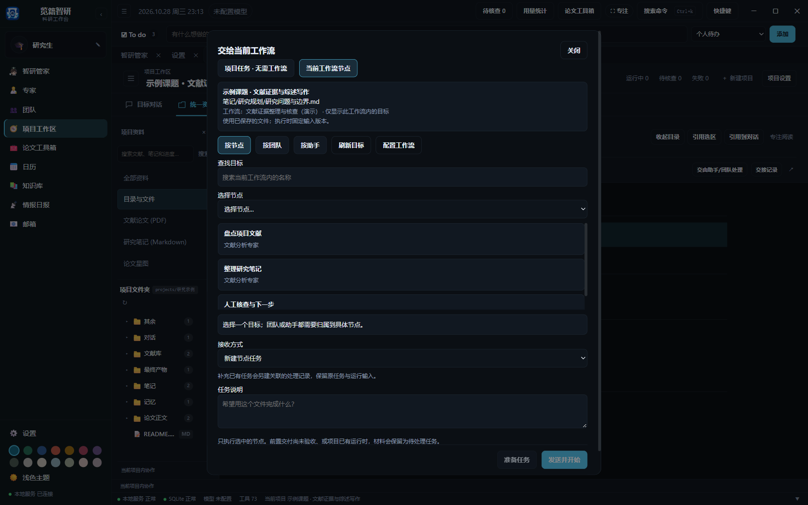
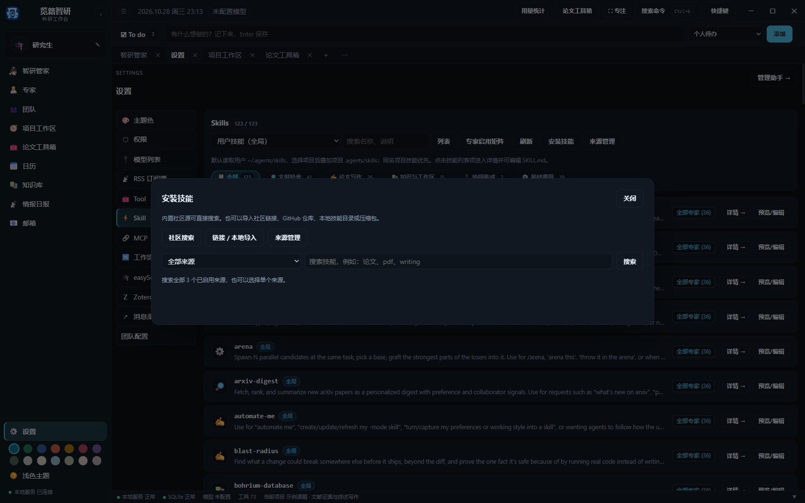

# 将文件交给工作流或项目任务

智研管家可通过 Skill 组织研究方法，再调用项目、专家、团队、工作流、资料和自动化工具执行。可以要求“新建一个研究项目，选择已安装的文献检索和写作技能，装配专家与团队，启动研究，并每天九点更新文献”。管家返回真实项目和运行状态，定时规则归属该项目，所有产物进入统一资料库。

Skill 提供方法与步骤，实际权限由当前会话、专家和项目授权决定。未安装的技能、未连接的 MCP 或不可用的模型会提示处理；配置完成不会被当作研究完成。生成实验方案与记录不等于已经开展实体实验。

在“项目工作区 → 统一资料库 → 目录与文件”的预览工具栏点击“交由专家/团队处理”；部分资料位置显示“创建任务”，也可从文件、笔记列表的右键菜单进入。选定节点、团队或专家以及接收阶段后，先选择“准备任务”保存文件和要求；“发送并开始”才会运行节点。交接一次处理一个文件，未保存的文件会先尝试保存，保存失败时不会开始任务。

选择“项目任务”可直接交给已启用的全局专家或团队，产物写入当前项目；选择“当前工作流”只列本流程配置的节点、团队和专家。未保存文件仍须先成功保存。

文件列表和文件编辑器也可按 Alt+Shift+H 打开交接面板。交接任务会保留当次文件内容和目标阶段。收到产物后仍需按工作流规则验收；团队任务完成本身不代表阶段已通过。运行记录和交接回执可用于查看结果、意见和后续重试。

打开“设置 → Skill → 安装技能”，在社区来源搜索技能，预览说明后选择用户级或项目级安装。安装只会保存技能文件，不会自动把技能分配给专家；请在专家或技能启用矩阵中配置使用范围。项目级安装需要先设置项目文件夹。

[返回使用指南](../使用指南.md)
