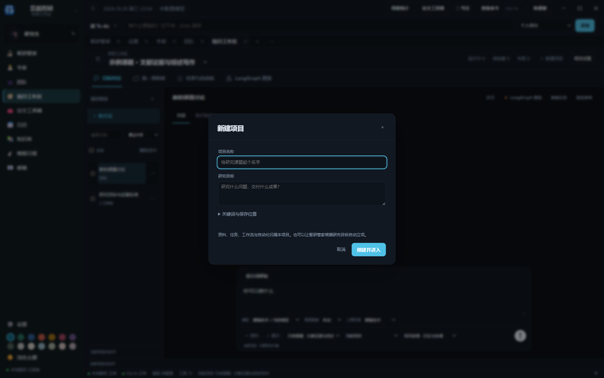
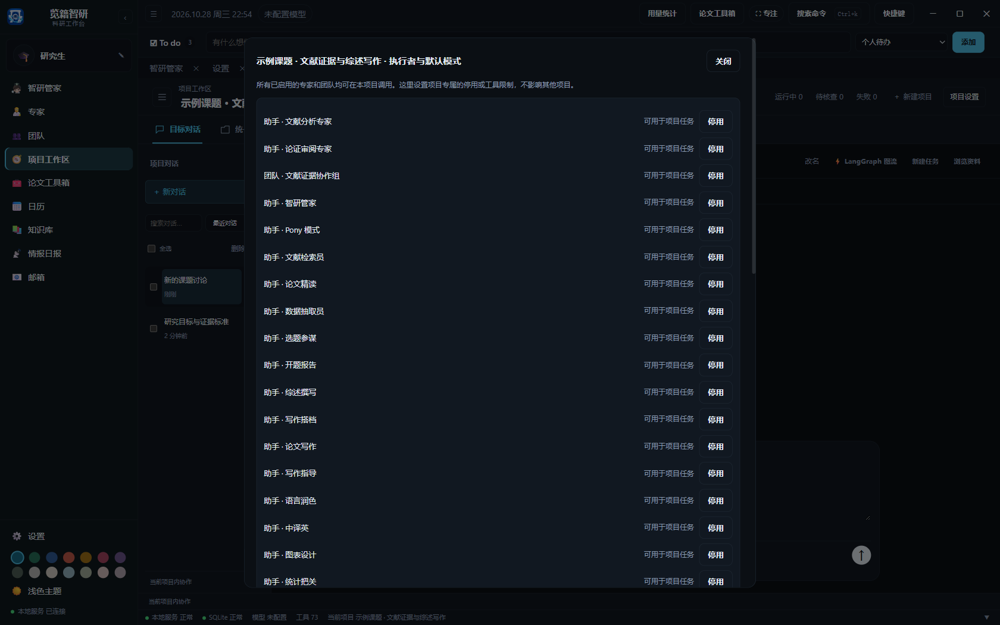

# 安装与首次配置

本指南说明 Windows 桌面版的安装、首次配置和常见研究操作。应用数据保存在本机；模型生成内容应由研究者核对后再用于研究或投稿。

先看[界面导航](interface-overview.md)，了解侧栏 10 个入口和项目内四个主视图。本文与配图对应当前源码界面。

从[项目 Releases 页面](https://github.com/Jack-Liu0227/lanji-zhiyan/releases)下载 Windows 安装包，双击安装器完成安装。免安装版可解压后直接启动 览籍智研.exe。桌面版需要 Windows WebView2 运行时。

安装版的用户数据位于 %LOCALAPPDATA%/览籍智研。卸载或更新程序前，先备份该目录中的数据库和项目文件。应用启动后会打开本机桌面窗口；关闭窗口会同时停止本机服务。

开发者可以在项目目录运行 tools/start.bat 启动源码版。源码版与安装版默认使用同一个 %LOCALAPPDATA%/览籍智研 数据根；需要隔离开发数据时，在启动前设置 LANJI_ZHIYAN_HOME。项目资料仍保存在用户选择的项目文件夹。

1. 打开“设置 → 模型列表”，添加 API 模型，或配置 Codex、Claude Code、Antigravity 等支持的本机账号登录。
2. 点击项目工作区顶部“＋ 新建项目”，填写名称和研究目标；也可直接让智研管家根据研究目标自动立项、装配团队并开始研究。
3. 需要调整配置时，打开“项目工作区 → 项目设置 → 管理专家”，选择模型并配置工具和技能。
4. 从项目工作区的“团队与成员”组织项目团队，通过“项目执行者与模式”授权执行者。按需要在“工作流”中绑定角色；模板顺序、依赖与审查要求在“设置 → 工作流”编辑。

API Key 和项目资料保存在本机。不要把密钥写入项目文档或提交到版本库。

[返回使用指南](../使用指南.md)
