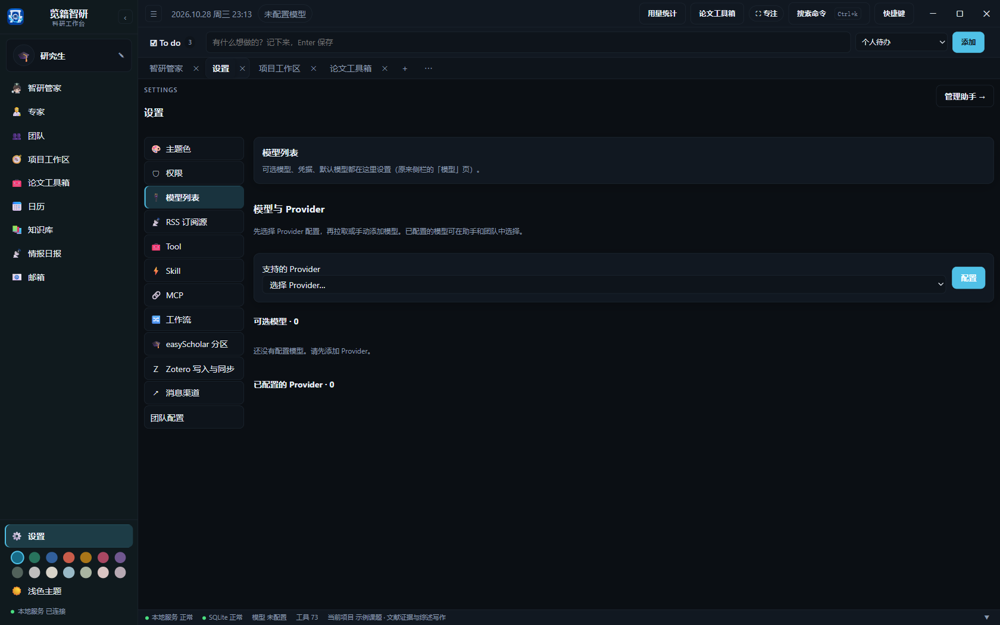
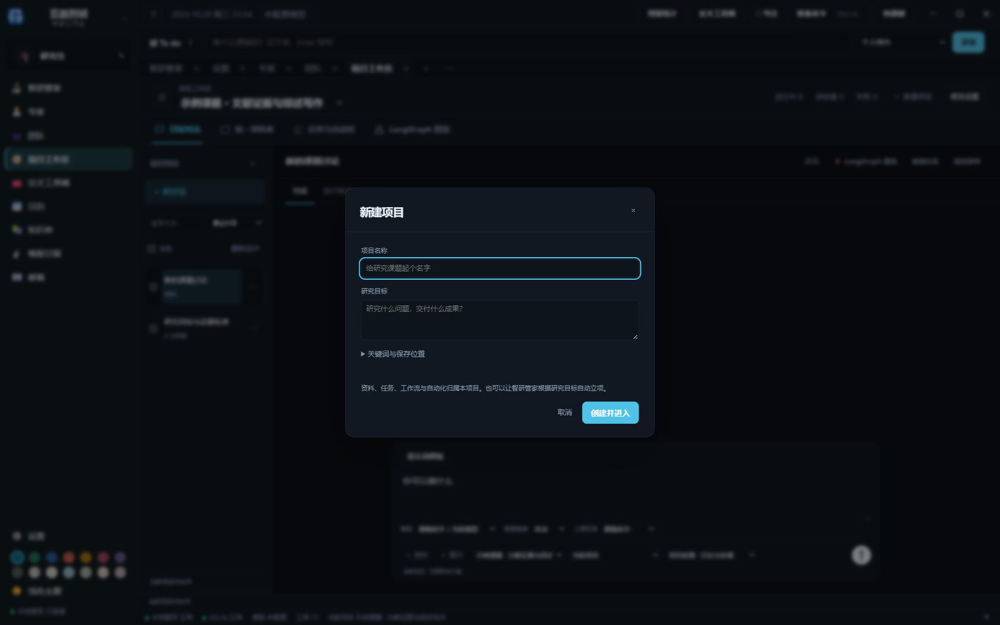
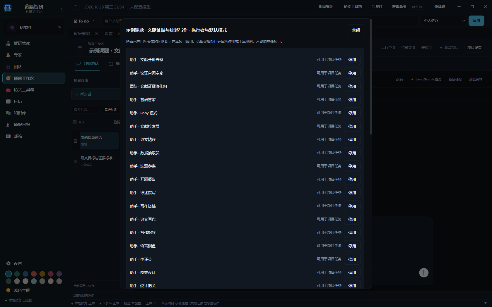

# 安装与首次配置

本指南说明 Windows 桌面版的安装、首次配置和常见研究操作。应用数据保存在本机；模型生成内容应由研究者核对后再用于研究或投稿。

先看[界面导航](interface-overview.md)，了解侧栏 10 个入口和项目内四个主视图。本文与配图对应当前源码界面。

从[项目 Releases 页面](https://github.com/Jack-Liu0227/lanji-zhiyan/releases)下载 Windows 安装包，双击安装器完成安装。免安装版可解压后直接启动 览籍智研.exe。桌面版需要 Windows WebView2 运行时。

安装版的用户数据位于 %LOCALAPPDATA%/览籍智研。卸载或更新程序前，先备份该目录中的数据库和项目文件。应用启动后会打开本机桌面窗口；关闭窗口会同时停止本机服务。

开发者可以在项目目录运行 tools/start.bat 启动源码版。源码版与安装版默认使用同一个 %LOCALAPPDATA%/览籍智研 数据根；需要隔离开发数据时，在启动前设置 LANJI_ZHIYAN_HOME。项目资料仍保存在用户选择的项目文件夹。

若 WebView2 桌面窗口启动失败，应用会尝试以 Edge 应用窗口打开；仍无法创建窗口时会提示安装 WebView2 Runtime，并给出诊断日志位置。

启动脚本运行当前检出目录的代码，不会自动拉取 GitHub 更新。拉取或合并后，关闭旧窗口再运行 `tools/start.bat`。

安装版和免安装版可在“设置 → 版本与更新”点击“检查更新”，发现更高版本后点击“下载并安装更新”。下载和校验完成后，安装器会关闭旧程序、替换程序文件，再启动新版。下载期间页面显示“正在下载并准备安装”；“安装程序已启动”表示已经交给安装器处理。若没有完成安装，可查看页面给出的 `installer.log`，默认位于 `%LOCALAPPDATA%/览籍智研/data/cache/updates/`。源码版只显示本地版本，不支持自动安装。

1. 打开“设置 → 模型列表”，添加 API 模型，或配置 Codex、Claude Code、Antigravity 等支持的本机账号登录。
2. 点击项目工作区顶部“＋ 新建项目”，填写名称和研究目标；也可直接让智研管家根据研究目标自动立项、装配团队并开始研究。
3. 需要调整配置时，打开“项目工作区 → 项目设置 → 管理专家”，选择模型并配置工具和技能。
4. 从项目工作区的“团队与成员”组织项目团队，通过“项目执行者与模式”授权执行者。按需要打开项目工作区的 DAG 工作流，绑定节点角色并编辑模板顺序、依赖和审查要求。

API Key 和项目资料保存在本机。不要把密钥写入项目文档或提交到版本库。

在「设置 → 模型列表」为模型运行一次「测试生成」。能拉取模型名称只说明列表接口有响应。文本、工具调用和图片输入分别测试；测试不会切换系统默认模型。更换 Provider 域名时同时填写新 Key；停用 Provider 后，其模型不再接受新请求，恢复启用会保留原有引用。账号模式的推理强度跟随官方客户端。

同一页的「配置语义检索」管理嵌入模型，与对话模型分开。保存端点后可以测试连接，再重建索引。资料尚未建立向量索引或嵌入服务暂时不可用时，知识检索仍可使用关键词。

模型卡片会显示上下文窗口及其来源。已收录的官方模型按对应接口的容量目录自动选择；自定义网关或容量未知的模型使用标明来源的保守估算。点击「上下文设置」可以按服务商规格覆盖窗口和最大输出，留空或点击「恢复自动」使用自动值。接口地址、协议或模型变化后，原覆盖会失效，需要重新核对。窗口设置不能增加服务端实际容量。

对话与自编排工作流根据模型容量和本轮输出预算自动决定压缩时机，摘要和近期保留量也自动计算，无需逐项设置比例。模型切换后重新计算；文件版本、读取位置和原始检查点继续保留。服务端明确提示上下文超限时，执行器至多尝试一次更小的请求；无法保留必需约束时会报告错误。设置页的历史字符预算默认是 0，表示自动；也可填写正整数作为个人历史选择偏好，没有原先的 400,000 字上限。

工作流输出优先采用模型已知或手动配置的最大输出容量。输出容量未知时，按当前窗口的四分之一估算，仍受总窗口与安全预留约束。未知网关的 65,536 Token 窗口是估算值，可以按服务商实际规格配置；修改设置无法提高服务端容量。

[返回使用指南](../使用指南.md)
