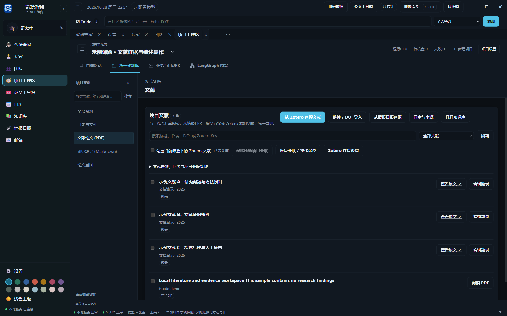
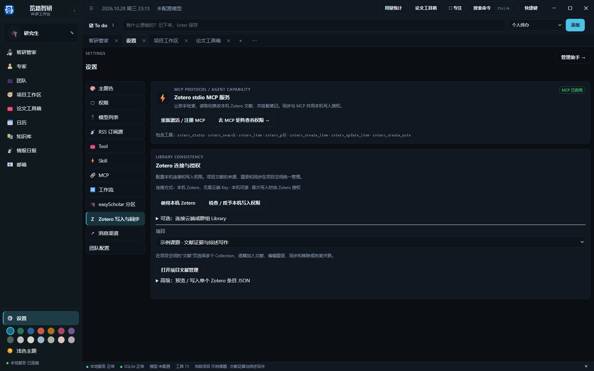
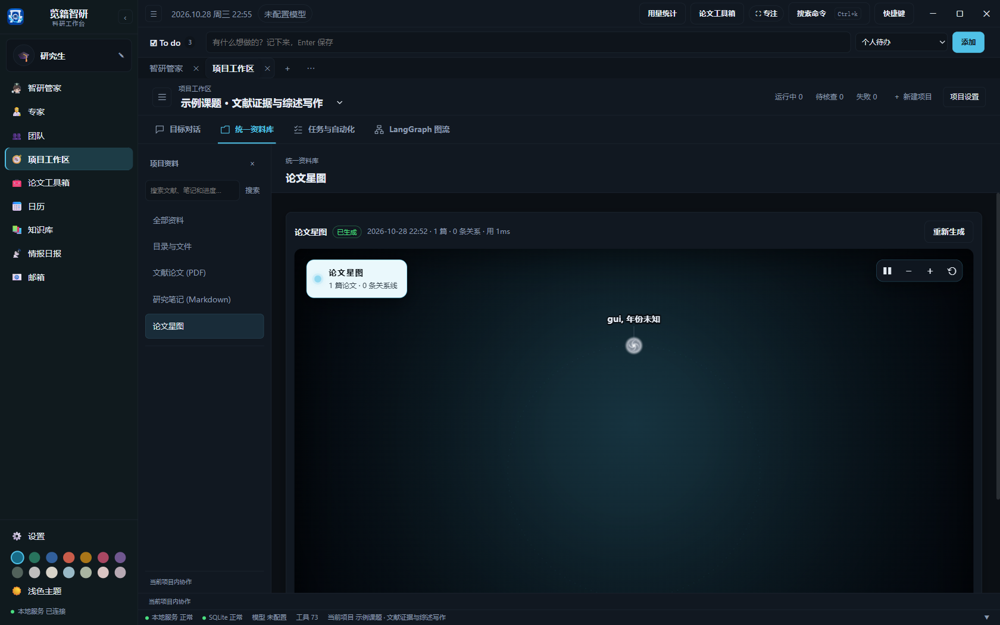

# 管理项目文献与 Zotero

1. 在“设置 → Zotero 写入与同步”连接本机 Zotero。选择本机 Zotero 时，由 Zotero 桌面程序处理授权，无需填写 Web API Key。
2. 打开“项目工作区 → 统一资料库 → 文献论文 → 从 Zotero 选文”。在“来源与选文”保存一个或多个 Collection 作为候选来源；浏览和筛选父 Collection 时也会显示子 Collection 的文献。不添加来源时可浏览全库。
3. 筛选并勾选所需文献，然后点“加入所选”。搜索、翻页或切换 Collection 会保留勾选，点“仅显示已选”可检查清单。“一次加入整个 Collection”和“全部跟随”只处理该 Collection 的直属文献；要执行整组操作，请选择对应的子 Collection。
4. 本机可读的 PDF 以只读引用加入项目，原件留在 Zotero。点“阅读 PDF”在项目内预览，或点“在 Zotero 中打开”定位条目。附件未下载时先在 Zotero 中下载，再点“引用本机 PDF”。

文献页可以搜索题名、作者、DOI 或 Zotero Key，按 Zotero 关联和 PDF 状态筛选。后台刷新会保留编辑中的题录和已选文献。已关联 Zotero 的项目副本可点“改用 Zotero 原件”，文件内容一致时切换读取来源；旧文件和笔记保留。解除关联只影响当前项目，可在操作记录中恢复。

题录发生并发修改时，保存会提示重新读取，避免覆盖另一端的更改。Zotero 同步是本机轮询；关闭应用后停止。移除来源不会自动移除已加入项目的文献。

## 文献冲突处理与智能去重合并

工作流自动检索与用户手动导入时遵循严格的去重合并（Conflict Merge）规范：

1. **跨源去重与智能补充**：检索结果统一依据标准化 DOI（忽略大小写与前缀）和标准化题名跨源去重。若项目中已存在该文献实体且缺少开放获取直链（`pdf_url`）或摘要较短，新检索到的有效 OA 直链、DOI 或完整摘要会自动合并补充至既有记录中，不会制造重复记录，更不会破坏或覆盖用户已有的精读笔记与星图标签。
2. **下载去重与哈希复用**：下载或手动上传 PDF 时，系统基于文件的 SHA256 哈希值进行校验。如果项目中已存在相同哈希的文献，系统会自动复用该文件实体并更新当前任务关联，避免磁盘产生多个重复的 PDF 副本。
3. **403 防拦截与非 PDF 落地页解析**：下载模块深度仿真桌面 Chrome 请求头（含 User-Agent、Accept、Accept-Language 与 Referer）。对于 arXiv 文献，自动将摘要页（`/abs/`）转换为真实直链（`/pdf/`）并支持 `export.arxiv.org` 备用镜像源；遭遇返回 HTML 落地页的开放获取资源时，系统自动提取 `<meta name="citation_pdf_url">` 等元标签中的真实直链进行二次跳转下载，显著规避 403 Forbidden 与非 PDF 拦截问题。

## 下载与 Zotero 暂存导入

在“管理 Zotero → 来源与选文 → 默认保存到”选择已有 Collection，或新建项目同名分类。选文来源和默认写入目标分别设置。

在文献页点单篇“保存到 Zotero”，或勾选多篇后点“保存所选”。单次保存可以改选目标分类。预览会显示新建、复用和附件处理；已有条目加入目标分类时保留原分类。只保存题录也可以。

要取得新的 PDF，可在保存面板点“下载所选开放获取 PDF”。这次下载先暂存，确认保存后由 Zotero 接管；项目能读回原件并建立引用后才清理暂存文件。保存失败可重新预览并重试。从项目本地 PDF 保存时，原有项目文件会保留。

也可以请 Agent 预览所选文献，再在工具结果上确认保存。普通 `paper_download` 仍下载到项目。自动同步只处理题录和现有来源，推送或双向合并不会替尚未确认的项目文献创建 Zotero 条目。

PDF 翻译使用 BabelDOC，首次运行需要下载引擎、版式模型和字体。源码环境运行 `python tools/check_literature_env.py --warmup` 初始化；缺少引擎时会在应用数据根的 `executors/babeldoc` 安装专用运行环境，并使用兼容的 `bitstring<5` 依赖。桌面服务直接启动该引擎，避免低权限进程写入全局 uv 缓存时被系统拒绝。初始化后，已运行的服务也能识别新引擎。直接运行 `python tools/check_literature_env.py` 可检查相关依赖。应用使用的模型和字体缓存位于数据根下的 `data/cache/lowtmp/home/.cache/babeldoc`。

先选择能通过实际生成测试的模型，再尝试翻译少量页面。翻译完成后应检查中文内容和版式；生成 PDF 文件本身不能证明翻译成功。

[返回使用指南](../使用指南.md)

## 摘要初筛、定向精读和按页翻译

入库后先从本地 PDF 的索引中提取摘要。找不到摘要的论文会标为待核查。创新点审查和大纲设计可以围绕具体主张搜索相关原文，登记物理页码和原句后按证据 ID 复用。需要逐页笔记时可以在对话中明确要求全文精读。

在 PDF 翻译面板选择当前页、页码范围或全文，并可选择已配置的翻译模型。BabelDOC 复用同一文献与翻译设置下已完成的页面，只补译所选范围里的缺页。
