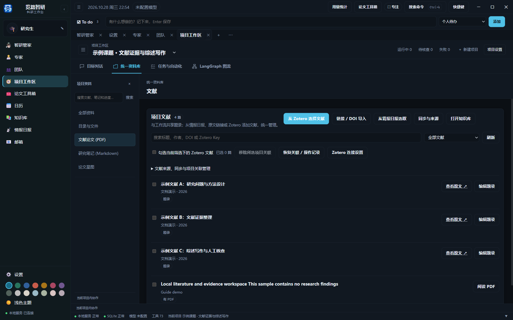
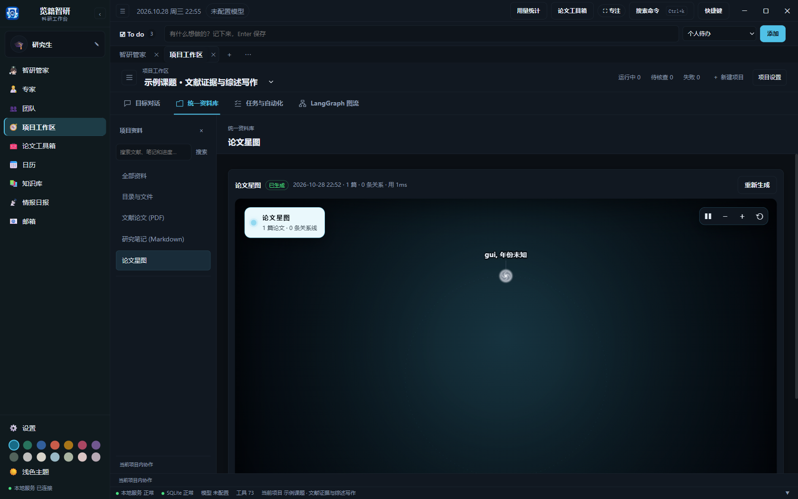

# 管理项目文献与 Zotero

1. 在“设置 → Zotero 写入与同步”连接本机 Zotero。选择本机 Zotero 时，由 Zotero 桌面程序处理授权，无需填写 Web API Key。
2. 打开“项目工作区 → 统一资料库 → 文献论文 → 从 Zotero 选择文献”，读取并保存一个或多个 Collection 作为候选来源。子 Collection 需要单独添加。
3. 从候选文献中逐篇勾选并加入项目，再预览同步内容并确认。仅保存来源不会把 Collection 中的所有文献加入项目。
4. 选择仅拉取、仅推送或双向合并；自动同步只在应用运行期间工作。启用“全部跟随”后，该来源当前和以后新增的文献才会自动加入项目。

文献页可以搜索题名、作者、DOI 或 Zotero Key，按 Zotero 关联和 PDF 状态筛选，编辑题录、导入本机 PDF、打开项目 PDF 副本。后台刷新不会清除正在编辑的题录或已选文献。导入 PDF 会保留尚未推送到 Zotero 的本地题录修改。移除项目关联只会解除当前项目的关联，不会删除 Zotero 条目、PDF 或其他项目的关联；可在操作记录中恢复。

题录发生并发修改时，保存会提示重新读取，避免覆盖另一端的更改。Zotero 同步是本机轮询；关闭应用后停止。移除来源不会自动移除已加入项目的文献。

PDF 翻译使用 BabelDOC，首次运行需要下载引擎、版式模型和字体。源码环境运行 `python tools/check_literature_env.py --warmup` 初始化；缺少引擎时会在应用数据根的 `executors/babeldoc` 安装专用运行环境，并使用兼容的 `bitstring<5` 依赖。桌面服务直接启动该引擎，避免低权限进程写入全局 uv 缓存时被系统拒绝。初始化后，已运行的服务也能识别新引擎。直接运行 `python tools/check_literature_env.py` 可检查相关依赖。应用使用的模型和字体缓存位于数据根下的 `data/cache/lowtmp/home/.cache/babeldoc`。

先选择能通过实际生成测试的模型，再尝试翻译少量页面。翻译完成后应检查中文内容和版式；生成 PDF 文件本身不能证明翻译成功。

[返回使用指南](../使用指南.md)
