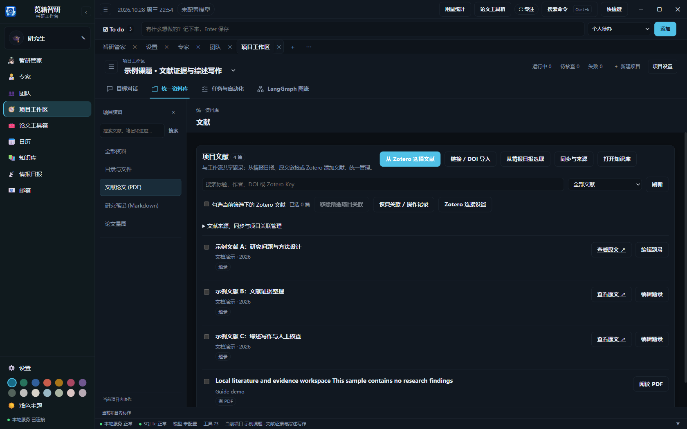
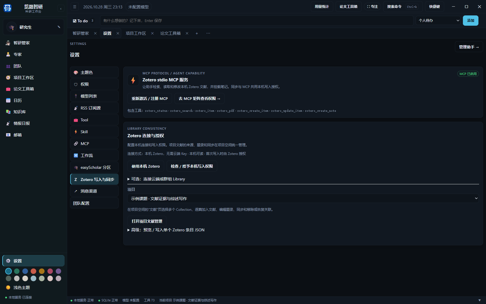
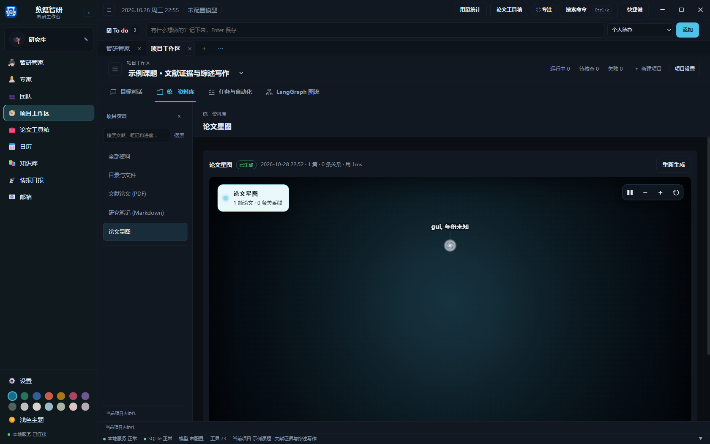

# 管理项目文献与 Zotero

1. 在“设置 → Zotero 写入与同步”连接本机 Zotero。选择本机 Zotero 时，由 Zotero 桌面程序处理授权，无需填写 Web API Key。
2. 打开“项目工作区 → 统一资料库 → 文献论文 → 从 Zotero 选择文献”，读取并保存一个或多个 Collection 作为候选来源。子 Collection 需要单独添加。
3. 从候选文献中逐篇勾选并加入项目，再预览同步内容并确认。仅保存来源不会把 Collection 中的所有文献加入项目。
4. 选择仅拉取、仅推送或双向合并；自动同步只在应用运行期间工作。启用“全部跟随”后，该来源当前和以后新增的文献才会自动加入项目。

文献页可以搜索题名、作者、DOI 或 Zotero Key，按 Zotero 关联和 PDF 状态筛选，编辑题录、导入本机 PDF、打开项目 PDF 副本。后台刷新不会清除正在编辑的题录或已选文献。导入 PDF 会保留尚未推送到 Zotero 的本地题录修改。移除项目关联只会解除当前项目的关联，不会删除 Zotero 条目、PDF 或其他项目的关联；可在操作记录中恢复。

题录发生并发修改时，保存会提示重新读取，避免覆盖另一端的更改。Zotero 同步是本机轮询；关闭应用后停止。移除来源不会自动移除已加入项目的文献。

## 文献冲突处理与智能去重合并

工作流自动检索与用户手动导入时遵循严格的去重合并（Conflict Merge）规范：

1. **跨源去重与智能补充**：检索结果统一依据标准化 DOI（忽略大小写与前缀）和标准化题名跨源去重。若项目中已存在该文献实体且缺少开放获取直链（`pdf_url`）或摘要较短，新检索到的有效 OA 直链、DOI 或完整摘要会自动合并补充至既有记录中，不会制造重复记录，更不会破坏或覆盖用户已有的精读笔记与星图标签。
2. **下载去重与哈希复用**：下载或手动上传 PDF 时，系统基于文件的 SHA256 哈希值进行校验。如果项目中已存在相同哈希的文献，系统会自动复用该文件实体并更新当前任务关联，避免磁盘产生多个重复的 PDF 副本。
3. **403 防拦截与非 PDF 落地页解析**：下载模块深度仿真桌面 Chrome 请求头（含 User-Agent、Accept、Accept-Language 与 Referer）。对于 arXiv 文献，自动将摘要页（`/abs/`）转换为真实直链（`/pdf/`）并支持 `export.arxiv.org` 备用镜像源；遭遇返回 HTML 落地页的开放获取资源时，系统自动提取 `<meta name="citation_pdf_url">` 等元标签中的真实直链进行二次跳转下载，显著规避 403 Forbidden 与非 PDF 拦截问题。

## 下载与 Zotero 暂存导入

Agent 调用 `paper_download` 时，只会把 OA PDF 保存到当前项目的文献暂存目录，并更新项目内的下载记录；它不会自动创建或修改 Zotero 条目。这样可以先批量筛选、阅读和去重，再决定哪些文献进入 Zotero。

项目文献页中，带有 PDF 且尚未写入 Zotero 的记录会显示“暂存待写入 Zotero”。点击该记录的“写入 Zotero”后，系统先生成一次导入预览：匹配到 DOI 或完全相同题名时复用候选条目，出现多个候选或缺少文件时停止并显示冲突。确认预览后才执行写入。

执行导入时，题录写入 Zotero，PDF 使用 `imported_file` 流程上传为 Zotero 存储附件，再交给已安装的附件管理插件处理。暂存目录中的原始 PDF 会保留；如果题录或附件上传失败，记录会标记为“Zotero 待重试”，可以再次执行导入。

“文献来源、同步与项目关联管理”中的旧 Zotero Collection 同步仍用于已有来源的兼容流程。它不负责把项目暂存下载自动写入 Zotero；暂存文献请使用每条记录的“写入 Zotero”按钮，或让 Agent 在收到明确写入指令后先调用 `zotero_staged_import` 预览。

PDF 翻译使用 BabelDOC，首次运行需要下载引擎、版式模型和字体。源码环境运行 `python tools/check_literature_env.py --warmup` 初始化；缺少引擎时会在应用数据根的 `executors/babeldoc` 安装专用运行环境，并使用兼容的 `bitstring<5` 依赖。桌面服务直接启动该引擎，避免低权限进程写入全局 uv 缓存时被系统拒绝。初始化后，已运行的服务也能识别新引擎。直接运行 `python tools/check_literature_env.py` 可检查相关依赖。应用使用的模型和字体缓存位于数据根下的 `data/cache/lowtmp/home/.cache/babeldoc`。

先选择能通过实际生成测试的模型，再尝试翻译少量页面。翻译完成后应检查中文内容和版式；生成 PDF 文件本身不能证明翻译成功。

[返回使用指南](../使用指南.md)
