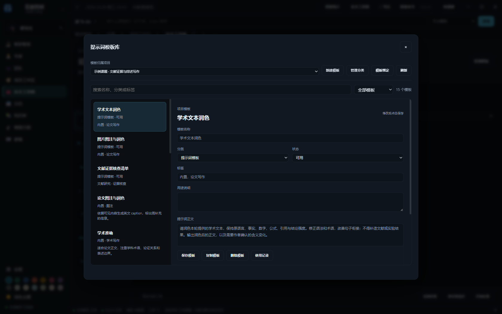
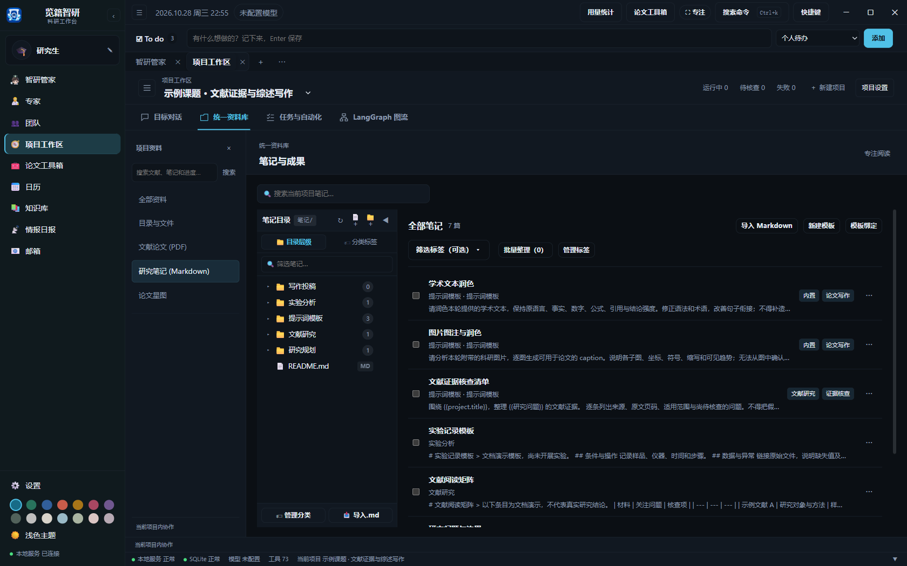

# 项目笔记与提示词模板

点击“论文工具箱”右上角的“管理模板”，打开提示词模板库。独立工具页面和顶部快捷面板都提供这个按钮。管理窗口顶部可选择模板归属项目，左侧列出项目模板和内置模板，右侧查看或编辑内容；支持搜索和按来源筛选，无需进入笔记页面寻找模板操作。

点击“新建模板”，填写名称、正文、分类和标签后“保存模板”；选中已有项目模板可编辑、复制、停用或删除。删除会解除该模板的默认绑定，已提交任务和历史记录保留。内置模板可查看全文并“复制为自定义模板”，保存到所选项目后编辑。草稿和停用模板仍能在管理窗口打开，但不能用于执行。

“管理分类”提供新增、编辑和迁移删除，分类与项目笔记共用；删除分类会将其中的笔记和模板迁移到指定分类，文件保留。编辑时会保留未保存内容，并在关闭或切换模板前提示；若文件已被其他操作修改，保存会报冲突，保留当前编辑供合并。

项目工作区的统一资料库仍可查看模板对应的 Markdown 笔记。默认分类包括研究规划、文献研究、实验分析、写作投稿和提示词模板；笔记分类、标签与模板库同步。

创建提示词模板，或将普通笔记复制为模板。在模板正文中使用 {{变量名}}；project.title 自动使用项目名称，project.question、research_question 和 研究问题 可使用项目研究问题。应用模板前可以填写其他变量并预览。模板可以绑定项目、工作流阶段、专家、团队成员或日程；后续模板修改不会改变已排队任务保存的内容。

新建变量自动按文本类型识别；可展开管理窗口中的“变量设置”配置类型、默认值和枚举选项。选中可用项目模板后，点击“用于当前工具”，填写变量并预览，即可将模板带回当前翻译或润色工具。“模板绑定”管理项目内的默认绑定。

在笔记中选择“应用到 Agent”，模板会回到当前项目的对话输入区。也可直接点击输入区的“提示词模板”，填写变量并预览后，用于讨论或派发任务；草稿会保留所选模板。模板输出仍是模型生成内容，需要人工检查。

[论文工具箱](conversations-and-toolbox.md)的翻译和润色也复用这个模板库。选择结果归属项目后，可引用同一项目的模板、填写变量，并按本次处理需要调整提示词；也可将工具箱中的风格指令保存为新模板。模板正文与本次修改分别记录，原模板不会被本次调整覆盖。

[返回使用指南](../使用指南.md)
