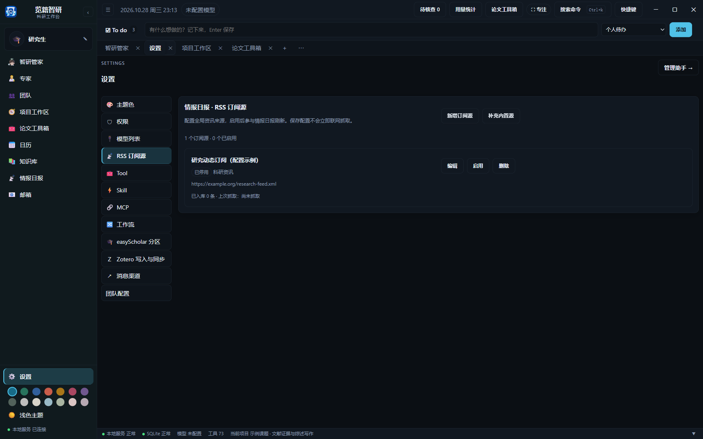
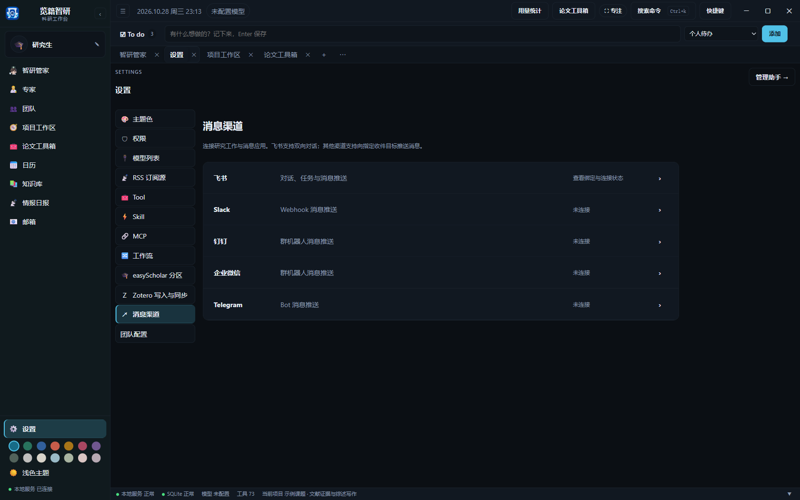

# 其他页面

侧栏与项目内入口的完整对照见[界面导航](interface-overview.md)。本文配图使用独立演示项目；邮箱和消息渠道保持未连接状态。

- **智研管家**：进行跨项目对话、查看工具过程和研究产物。
- **专家**：保留系统专家和自定义专家，可新建、编辑、启用或停用。已启用的专家可供所有项目调用；项目可单独停用或限制工具。
- **团队**：按项目选择团队，查看负责人和成员。“编辑团队”编辑当前选中的团队，“进入研讨室”进入该团队对话；未发送的文字按团队和会话保留，刷新或发送失败后可继续编辑。
- **任务与自动化**：在项目工作区管理待办计划、实时任务看板、人工核查和自动化规则。外层重复入口已合并；跨项目查看进展可询问智研管家。普通待办保存在顶部 To do。
- **知识库**：浏览已授权知识源中的 Markdown 内容和关联关系。知识库不会写入 Obsidian 的 .obsidian/ 配置目录。
- **情报日报**：查看已配置 RSS 来源的研究资讯，并按来源、关键词或年份筛选。展开“摘要与详情”预览内容，点击“查看原文”在浏览器打开文章，也可复制链接。选择目标项目后可逐条或批量导入题录；确认窗口显示导入、已存在和失败条目，相同 DOI 或链接会跳过，重复导入保留已有编辑。点击“订阅源设置”可直接进入配置。

情报日报和“项目文献”均提供“链接 / DOI 导入”，可填写原文链接或 DOI，补充标题、作者、年份和摘要。导入保存到同一份项目文献库和资料索引，工作流可继续使用；题录入库不代表已经下载 PDF。项目文献卡片也提供“查看原文”入口，已有本地 PDF 时仍可直接阅读。
- **邮箱**：连接后集中查看科研邮箱；连接方式和范围在设置中管理。
- **设置**：管理模型、权限、工具、技能、MCP、工作流、主题、RSS 订阅源和外部服务连接。

在“设置 → RSS 订阅源”新增或编辑名称、RSS 地址和分类，也可启用、停用或删除来源。保存仅更新本地配置，返回情报日报点击“刷新”时才抓取已启用的来源。停用和删除都保留已经入库的资讯。

“补充内置源”只添加缺失的内置地址，不覆盖已有名称和启用状态，也不删除自定义源。主动删除所有来源后，刷新不会重新补回；首次尚未配置来源时，仍会按内置来源初始化。各来源显示已入库条数、上次抓取时间和失败信息，便于检查地址是否有效。

项目创建使用工作区顶部“＋ 新建项目”，信息编辑在项目设置中。任务、核查和自动化规则共用项目内“任务与自动化”。专业研究能力由专家、团队和 LangGraph 节点调用，产物在统一资料库和任务详情中查看。

- 文献搜索和 PDF 下载受来源许可与开放获取状态限制；应用不会绕过付费墙。
- 证据提取、精读、审稿和写作结果是候选内容或草稿，应对照原文核查。
- 团队成员按任务逐个执行，不是并行运行。
- 定时任务、Zotero 自动同步和页面刷新均依赖应用运行。
- 源码版与安装版默认使用 %LOCALAPPDATA%/览籍智研。通过 LANJI_ZHIYAN_HOME 或 RW_HOME 可指定独立数据根；项目文件仍保存在各自选定的项目文件夹。备份时同时考虑数据库、PDF、笔记和项目文件。

- **启动失败**：先确认 Windows WebView2 运行时已安装。源码版可按终端错误安装 requirements.txt 中的依赖，并查看 data/startup.log。
- **模型调用失败**：检查“设置 → 模型列表”中的登录状态、API 地址和可用模型，再确认所选专家已启用所需工具。
- **Zotero 没有同步**：确认 Zotero 桌面程序正在运行、项目已选择文献，并检查同步模式。自动同步只在工作台打开时运行。
- **看不到新产物**：返回对应项目和工作流，检查运行状态；待审节点需要人工验收，失败节点可从保存进度继续或根据提示重试。

邮箱账户的“连接测试”分别检查 IMAP 收信和 SMTP 发信登录，不会投递测试邮件。编辑已有账户时，授权码留空会继续使用已保存的授权码。收信通过、发信失败会分开显示，不再统一显示连接成功。

邮件部分收件人被拒收时，窗口会提示已接受的数量，并在草稿中仅保留被拒收地址；检查地址后再发送，避免给已接受的收件人重复投递。切换页面后返回邮箱会恢复列表和当前邮件；发送期间新开的草稿不会被上一封邮件的返回结果关闭。

打开写信窗口后，点击或切换到正文输入不会再被自动聚焦打断。

飞书配置按专家保存。扫码期间切换专家，二维码仍归属于原专家；发送测试消息的确认期间切换专家会取消本次发送，需要重新核对。中国大陆飞书和国际版 Lark 使用各自的连接地址。

在“设置 → 消息渠道”选择飞书、Slack、钉钉、企业微信或 Telegram。飞书提供双向对话与任务消息，其余入口用于向指定目标推送消息。保存配置只写入本机；点击“发送测试消息”会向已配置的真实收件目标发送消息。Webhook、Bot token 与加签密钥在本机加密保存。

## 其他界面参考

| 界面 | 截图 |
| --- | --- |
| 智研管家与跨项目会话 | [查看截图](../screenshots/agent.png) |
| 专家目录 | [查看截图](../screenshots/experts.png) |
| 团队与成员 | [查看截图](../screenshots/team.png) |
| 授权知识库与关联关系 | [查看截图](../screenshots/knowledge-base.png) |
| 主题与字体 | [查看截图](../screenshots/settings.png) |
| 权限与上下文预算 | [查看截图](../screenshots/settings-permissions.png) |
| Tool 能力目录 | [查看截图](../screenshots/settings-tools.png) |
| MCP 连接 | [查看截图](../screenshots/settings-mcp.png) |
| 全局工作流模板 | [查看截图](../screenshots/settings-workflows.png) |

模型能读取列表不代表具体模型能生成。如果提示“模型网关当前没有该模型的可用渠道”，可在“设置 → 模型列表”测试并选择其他已配置的模型，或让网关管理员检查模型分组和渠道。应用会保留配置，不会自动换用另一套模型。

团队办公室、成员列表和团队对话共用实际运行状态，显示运行中、排队、待审查、等待输入或休眠。团队对话中的“团队通信与交付”可查看成员调用、反馈和交付记录；全局团队模板汇总其项目实例的活动。

专家目录可以搜索名称、专长和模型；团队页可搜索团队或成员。设置页可搜索设置入口，模型提供商、已采用模型、消息渠道、RSS 订阅源和工作流模板各有独立的列表搜索。搜索结果会显示匹配数量；清空或按 Esc 恢复列表。按 Ctrl+K 可搜索项目和功能入口。

本地模型地址使用 localhost、127.0.0.1 或本机 IPv6 回环地址时，可以在无需密钥的服务上直接调用；账号登录型提供商使用其登录状态。远程 API 模型仍需在模型设置中配置服务所要求的凭据。

飞书已归入“设置 → 消息渠道”，原有按专家保存的绑定和双向对话继续使用。Slack、钉钉、企业微信可配置官方机器人 Webhook；Telegram 可配置 Bot token 与收件 chat_id，用于消息推送。可展开“向已保存的收件目标发送消息”手动投递研究摘要。新增渠道目前不接收外部聊天或自动创建任务。保存配置不发送消息，点击“发送测试消息”才向已保存的收件目标发送。未测试的配置显示“待验证”，不能据此判断已经连通；断开连接会清除该渠道的本地配置。

顶栏的“用量统计”提供概览、请求、会话和上下文，详见[用量统计](usage.md)。

知识库顶部可搜索项目名称或研究问题并进入对应星图。星图画布保持深色配色，浅色应用主题下也可直接查看。

[返回使用指南](../使用指南.md)
