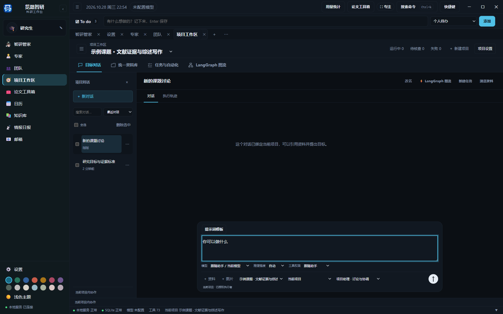
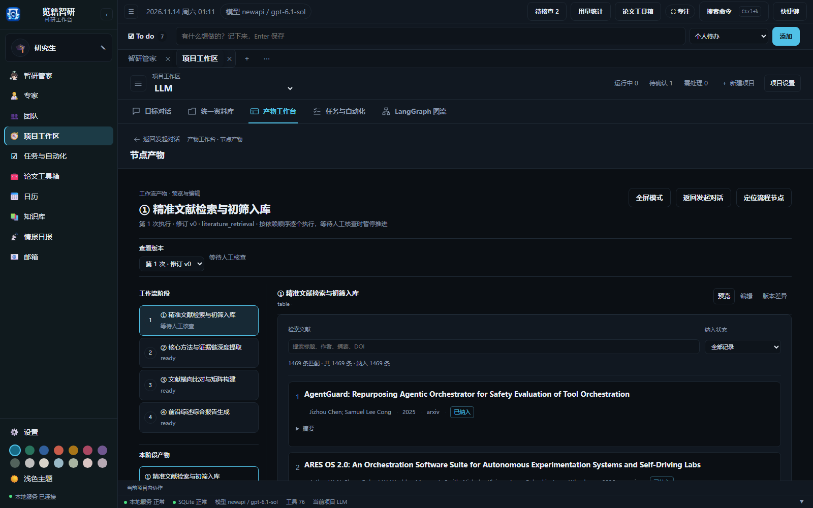
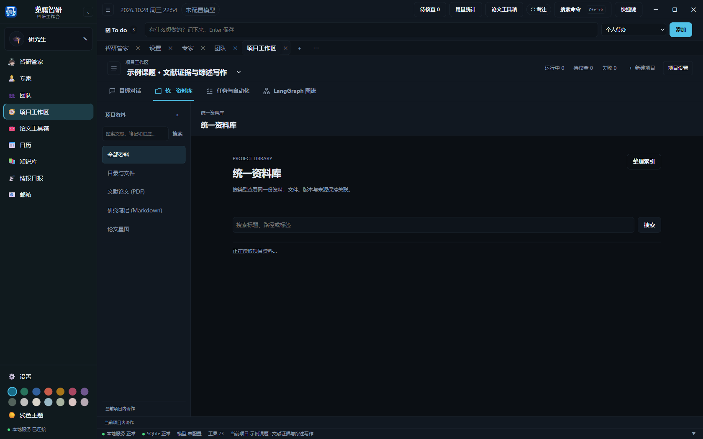
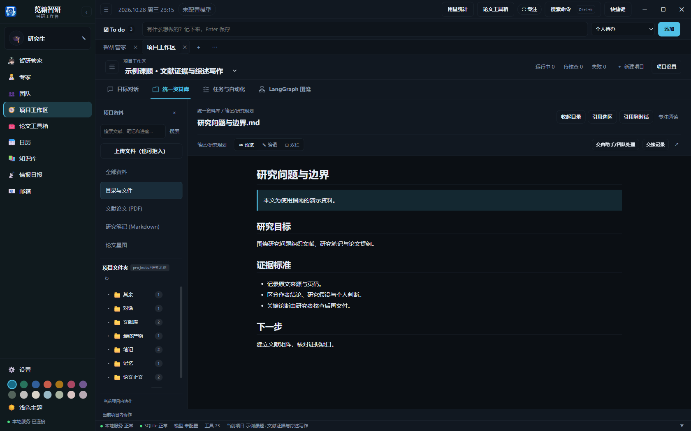
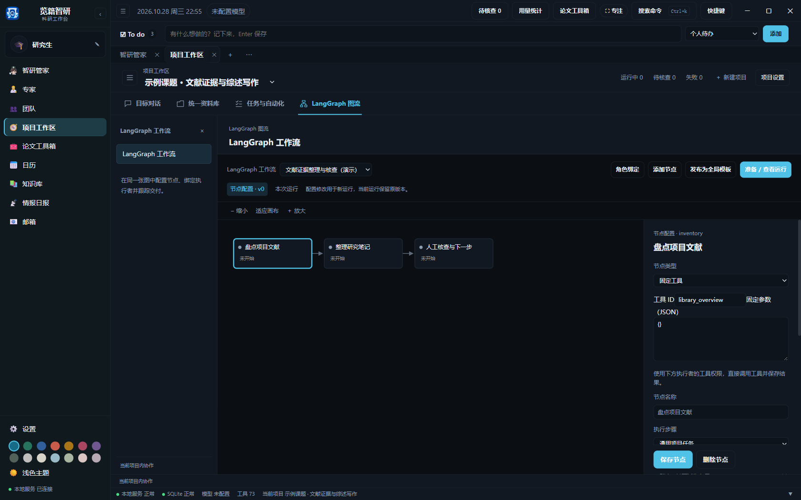
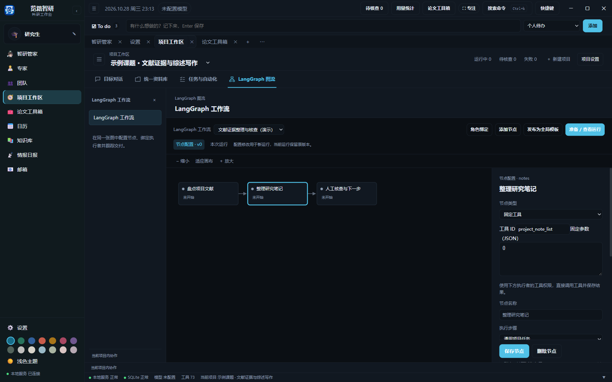
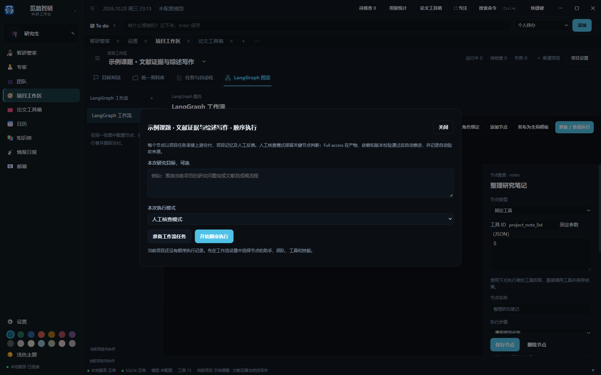
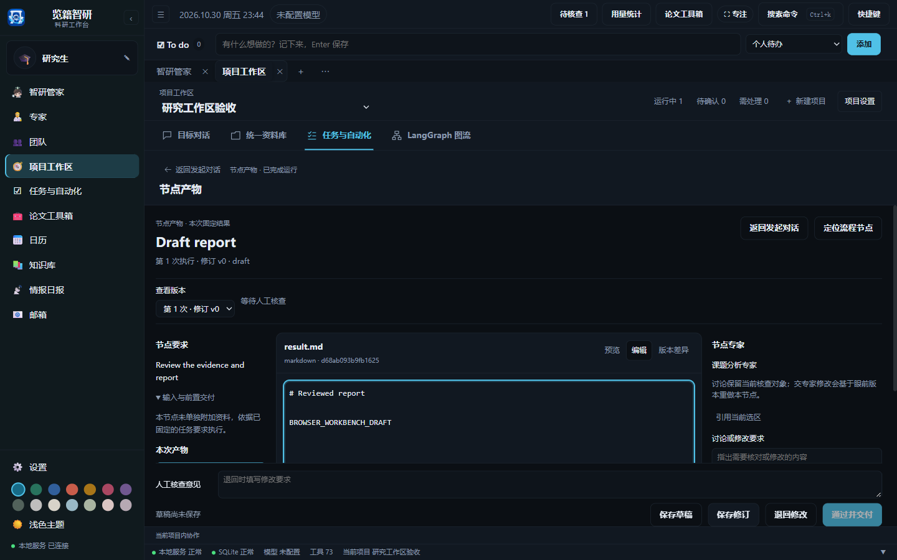

# 使用项目工作区

项目工作区围绕目标对话、统一资料库、任务与自动化、LangGraph 工作流组织研究。任务、核查和自动化只保留项目内入口；智研管家可以跨项目查询和调度。

顶部主视图依次为“目标对话”“统一资料库”“产物工作台”“任务与自动化”“LangGraph 图流”和“概览”。每个主视图保留自己的次级导航和当前内容。项目选择与项目设置始终在工作区顶部。完整入口见[界面导航](interface-overview.md)。

## 创建和管理项目

打开“项目工作区”，在顶部选择项目，点击旁边的“＋ 新建项目”直接创建。名称和研究目标填写后即可进入；展开“关键词与保存位置”可以选择本地目录。“项目设置 → 编辑项目信息”修改已有名称、目标和关键词。

未选择保存位置时，新项目默认以项目名创建文件夹。Windows 不支持的文件名字符会清洗，重名目录追加“(2)”等序号；已有目录不被新项目接管。项目 ID 继续用于内部关联。旧版本创建的 `项目ID` 默认目录会在保存项目信息时迁到项目名目录，原 UUID 路径保留为兼容入口；用户指定的目录不会自动改名。

点击“删除项目记录”可先查看项目目录和删除范围。确认后，应用删除该项目的任务、执行记录和资料索引，普通会话解除项目关联，可在智研管家的历史记录中查找。项目有任务运行或排队时，先停止任务。项目文件、PDF、附件和备份保留在原位置，可从“设置 → 数据管理”打开项目文件夹，在资源管理器中核对和清理。

也可以直接对智研管家说：“调研全固态电解质的离子传输机制，创建项目，安排专家团队并开始开题研究。”管家根据可用 Skill 装配项目、专家、团队和 LangGraph 流程，保存研究计划，再启动真实任务。回复中的“进入项目工作区”按钮可打开流程画布。仅需配置时说明“先装配，暂不执行”。已有项目可以直接指定名称或 ID，不必先手工切换对话绑定。

自动装配可组合自定义节点与依赖，也可使用开题、文献研究或论文写作模板。已存在的专家优先复用，原有职责、模型和停用设置保留。重试相同装配请求会复用配置与运行，不重复立项；明确要求另建才创建另一份。配置完成、已排队、等待核查和研究交付分别显示。

所有已启用的专家和团队默认可在各项目调用，无需逐个加入。“项目设置 → 项目执行者与模式”可以单独停用某个执行者、限制工具或调整本项目新任务的默认交付模式。跨项目调用团队时，共享职责和模型配置，运行成员、对话、任务和文件归属调用项目。

## 对话与执行设置

目标对话内容左侧的编号节点用于定位当前会话的用户发言，每次提问对应一个节点。展开导航、悬停或用键盘聚焦可查看提问摘要与时间，点击或按 Enter 跳到原消息并短暂高亮。节点之间可用上下方向键移动焦点，Home 和 End 分别移到第一个和最后一个节点。相同问题在收到回复后再次发送，也会保留为单独一轮。

专家回复以正文展示，连续工具调用和过程摘要归入“执行过程”。默认收起过程，展开后可查看每项工具的参数、结果及耗时，并分别复制。工具失败时展开相关过程；相同操作重试成功后，先前记录会标明“重试成功”。节点审查和工具产生的后续操作仍保留在相关记录中。

执行时状态行说明当前正在准备上下文、等待模型、调用工具或生成回复，并显示本轮和当前阶段耗时。单次工具耗时在工具记录中查看，整轮耗时按实际经过时间显示。任务停止、失败或进入人工核查后，该次节点或对话执行的计时与动态指示停止；工作流总耗时包含依赖及核查等待，结束后固定。切换会话或刷新工作流对话后，执行耗时根据已保存的时间恢复。

当前对话有工作流时，消息区上方持续显示工作流状态卡。右侧 DAG 打开或收起、管家回复结束后，卡片仍显示活动节点、等待模型或工具的阶段、阶段耗时、已交付数量和总耗时；产物等待核查时可直接打开核查入口。后台心跳与最近业务进展分开记录；心跳正常表示执行进程仍在工作，不代表已经生成新成果。心跳失联或读取失败时显示状态待确认。

准备工作流时，研究要求填写在目标中，材料输入使用项目资产 ID 或项目相对路径。需要全文证据的节点会在准备阶段检查证据工具是否齐备，避免启动后才因缺少登记工具失败。单次节点执行最多进行 32 轮模型交互；达到上限会保留已保存工具结果与检查点，可核对后继续，已交付的其他节点不重复执行。

同一对话创建或恢复新运行后，卡片默认跟随需要执行或处理的运行。展开“详情”可以手动选择历史运行，选择会随该对话保存；查看旧运行时，“另有运行需关注”入口可以返回当前活动运行。切换到没有关联工作流的对话后，卡片隐藏。

失败节点会说明恢复方式。“从检查点继续”复用已保存的工具结果；没有安全模型检查点时会说明从本节点起点重试，并保留其他分支成果。模型流中断后可能需要重新请求该轮响应；工具结果未确认时，需先核对再明确重启。待核查属于交付门禁，不能通过失败重试跳过。

停留在对话底部时，新增回复自动跟随；向上阅读或点击发言节点后，页面保持当前位置。下方出现“回到最新”入口，有新增内容时显示“有新回复”。点击后回到对话底部并恢复跟随，输入框中尚未发送的草稿会保留。

项目内可以创建多段独立对话。每段对话分别保存消息、草稿、引用、模型、推理强度和工具权限。智研管家的全局对话使用相同的会话设置；切换会话模型不会修改系统默认模型。

普通项目目录可以包含 `Zotero` 名称；实际 Zotero 数据目录和已配置的链接附件目录仍为只读。若项目确实位于托管目录内，请在独立目录建立项目并导入文献副本。创建对话失败时会保留输入草稿，不会留下未绑定的空对话。

对话列表支持右键或更多菜单进行置顶、重命名、导出、归档和删除。删除先进入可恢复的“最近删除”；正在运行的会话须先停止。详见[对话历史与论文工具箱](conversations-and-toolbox.md)。

“目标对话”左侧也会列出当前项目的任务、工作流及其节点和论文工具记录。点击记录可打开原对话，查看已保存的输入和回复。论文工具记录会打开该次处理的输入和结果。归档后可在同一列表的“已归档”中查看。

输入框下方可选择模型、推理强度、工具权限、发送范围和执行者。权限包括跟随专家、只读、项目内读写和完全访问。配置在下一次发送时生效，运行中的请求使用开始时固定的配置。

默认发送给项目专家，适合讨论目标和协调工作。在“当前项目”范围选择专家、团队或成员后，发送按钮直接开始对话；选择团队时由负责人接收。需要任务记录和人工核查时，点击独立的“准备任务”，进入该任务的专属对话，核对要求后点击“开始任务”。派发时选择的执行模式会随任务保留。切到“当前工作流”并选择节点后，发送仍用于准备该节点任务。专家对话使用所选执行者的身份及工具范围，并保留本次会话的模型选项。

发送目标按“团队”和“专家”分组，每个只列一次。同一专家加入多个团队，也不会在主列表中重复展开。选中团队后，可在“团队成员”中指定执行者，或交由负责人安排。旧版各项目中的同名内置团队合并显示，默认使用当前项目配置；已有明确指定的团队和成员仍沿用原绑定。同名但不同的自定义对象会显示来源标识，方便区分。

准备正式团队任务或将工作流节点交给整个团队时，负责人可动态拆分研究，安排最多 3 个成员任务并行执行，再依据固定交付版本汇总。子任务及交接记录在负责人任务中展开；明确指定成员则保持单人成员执行。内部查询和分析结果自动进入汇总，最终交付及强制人工核查仍遵循本次任务的模式。团队研讨室的详细操作见[专家与团队](other-pages-data-and-help.md)。

在资料中打开文件，可使用“引用到对话”或“引用选区”附加材料；点击引用标签可临时预览原文。文件、文献、笔记和星图集中在统一资料库中。

## 工作流节点产物预览与专用产物工作台

在项目工作区打开“产物工作台”，选择一次运行，再选择节点查看执行状态和产物。旧的“科研工作台”书签会打开当前项目的产物工作台。

项目工作区深度整合了对话与执行产物：

- **专用「产物工作台」界面**：产物预览与在线编辑拥有专属视图（在项目工作区顶部一级标签导航中清晰呈现为“产物工作台”，与“任务与自动化”完全解耦）。点击工作流卡片或流程图中的“查看并编辑产物”时，直接切入专用的节点产物工作台，不再降级或混入普通任务看板。
- **全屏沉浸模式（Fullscreen）**：工作台右上角提供“全屏模式”按钮，支持一键切换至 100% 视口全屏沉浸视图，大屏畅读文献题录、内嵌渲染 PDF 与编辑报告；支持使用 `F11` 或 `Esc` 快捷键随时进入或退出全屏。
- **大规模产物秒级极速载入**：对大批量文献检索列表（如上千篇论文记录）、多篇长文本与 PDF 资产进行了轻量化快照与按需解析优化，消除数据转换阻塞，毫秒级快速呈现预览与分页筛选。
- **同屏分栏（Split View）**：在目标对话中查看工作流执行、子任务或点击节点卡片时，系统也可在右侧抽屉分栏直接展开节点产物预览与编辑工作台，左侧完整保留主对话与当前讨论，无需在页面间反复跳转。点击分栏顶部的“收起分栏”即可平滑恢复全宽对话。
- **节点工作台**。从项目图流或产物工作台的运行清单打开节点，可查看执行状态、前置依赖和已保存的产物。在人工核查阶段，可修订产物、比较版本、通过或退回。节点等待前置交付时，工作台会显示原因。
- **下载与精读**：下载节点按文献显示原文 PDF、摘要和页级证据。精读节点将原文、译文和笔记放在同一篇文献下。点击“原文与译文对照”可并排阅读，有页码映射时可选择对照页。编辑模式只开放笔记正文，保存后可在版本差异中核对并交付。
- 大纲预览的章节目录可以跳到对应位置，编辑区提供 Markdown 正文。图谱中的页级证据显示登记的 PDF 文件名、页码和摘录。
- 在“统一资料库 → 目录与文件”中浏览项目目录、预览 PDF 或编辑支持的文本文件。
- 成稿支持预览和修订。谱系成稿的证据底稿保留原文，可在“作者修订”区域补充内容。审阅节点按问题展示原稿位置，可更新问题描述和处理状态。
- 英译节点按段对照源文和译文，可逐段修订译文。格式转换节点可修改源稿和输出格式，保存修订会生成一个新的成品版本。
- **对话文本选中与工具参数复制**：对话区域与思考内容全面支持鼠标划词选中，工具调用的“输入参数”与“执行结果”区块右上角均配有精致的“复制”按钮，方便一键复制完整的 JSON 或运行摘要。
- **界面缩放（Ctrl + 滚轮与快捷键）**：支持使用 `Ctrl + 鼠标滚轮` 随意放大或缩小界面（范围 0.6x - 2.5x），也可使用 `Ctrl + =`（放大）、`Ctrl + -`（缩小）、`Ctrl + 0`（恢复 100%）。缩放级别自动保存在本地，下次启动或刷新时保持不变。

## 统一资料库

打开“统一资料库 → 全部资料”，可查看项目资料总数和当前结果数。在同一工具栏搜索标题、路径或标签，并按资料类型和核查状态筛选。列表显示资料路径和当前状态，可打开资料，也可将符合条件的文件引用到对话或交给执行者处理。同一文件在不同视图保留原路径和版本。

打开“目录与文件”，左侧选择目录，右侧筛选当前目录或打开文件。预览或编辑完成后，点“返回文件列表”回到文件所在目录。需要更多阅读空间时，可点“收起目录”或“专注阅读”。

打开“文献”，可搜索标题、作者、DOI 或 Zotero Key，并按 PDF 和 Zotero 关联筛选。展开“管理 Zotero”后，可在“来源与选文”保存 Collection 和勾选文献，在“同步设置”查看同步预览，在“移除与恢复”查看和恢复移除批次。

| 资料 | 保存与关联方式 |
| --- | --- |
| 文献 | 题录元数据关联项目 PDF；未下载的记录仍可管理，精读证据保留论文及页码来源 |
| 笔记、实验记录 | 统一保存为 `笔记/` 下的 Markdown，实验记录使用实验分析分类；通过同一个编辑、版本和搜索服务维护 |
| 论文稿件 | 保存在 `论文正文/`，可由写作工具或管家生成，仍是可以打开和编辑的本地文件 |
| 交付产物 | 任务记录关联实际文件；`.tasks/` 保存当次输入和交付快照，核查与人工修订使用固定版本 |
| 数据和其他文件 | 保留原目录，通过“目录与文件”浏览；整理索引后，支持的文件类型进入统一资料列表 |

新生成的资料自动登记。已有文件可点击“整理索引”纳入目录，它只更新索引，不搬移或删除原文件。提示词模板和目录说明仍可在笔记管理、文件目录中查看。不同资料的专业操作保留在对应视图，例如文献同步与 PDF 管理、笔记标签与模板。

## 执行时间线

项目对话右侧的工作流、节点审查、节点专家和文件预览跟随当前对话。新建空对话后，右侧保持空白；切回原对话会恢复上次打开的内容。切换对话不会停止后台任务，返回后可继续查看离开期间保存的调用记录。一个对话关联多次运行时，右栏只在这些运行中选择，不会自动载入项目中其他对话的工作流。

在没有关联运行的对话中打开工作流栏，只显示“当前对话暂无工作流运行”，以及“向管家描述目标”“打开工作流工作台”两个入口。描述目标仅填入可编辑草稿，需要手动发送。读取上下文失败时显示重试提示，不会将错误当作空对话。

在“节点专家”中切到“执行轨迹”，可以展开模型请求、工具参数、工具结果、异常和重试记录，并选择不同执行尝试。运行期间持续更新，重新打开轨迹不会重新执行工具。执行进程的存活报告与最后一次进展分别显示；等待模型响应时没有新输出，不表示任务已经失败。没有记录的耗时或用量仍显示为未记录。

点击对话正文中的 Markdown、CSV 链接，或节点专家消息下方的文件标签，会切到右侧“文件预览”，主对话保留在原处。Markdown 显示排版正文；CSV 按表格显示，支持横向滚动和分页，单元格中的逗号、引号与换行会保留。预览默认只读，节点文件显示所属尝试和修订版本，项目普通文件显示当前内容。需要修改受控产物时，从“节点审查”进入现有产物工作台。

文件不存在、超出项目目录或超过预览大小限制时，预览区会显示原因。Markdown 当前最多预览 2 MB，CSV 最多 8 MB，每页默认显示 100 行。

项目对话的“执行轨迹”和智研管家的“轨迹”按时间展示模型请求、工具调用、思考摘要及执行结果。点击节点可展开输入参数、输出结果和执行信息。可切换运行轮次、搜索或仅查看异常，也可复制调用详情。

时间线来自已保存的运行事件，重新打开不会执行工具。未保存的耗时会显示为“未记录”，长结果标明预览范围，凭据字段会隐藏。运行中的节点显示活动状态；返回对话可继续输入。

## 任务、核查和自动化

界面中的计划入口标为“To-do 计划”，与“实时任务看板”“自动化规则”一起位于同一个“任务与自动化”主视图。

“任务与自动化”在项目工作区提供待办计划、实时任务看板和自动化规则。普通专家任务、团队任务、LangGraph 节点和定时触发结果使用同一套任务与交付记录。旧的外层任务或定时任务链接会打开项目内相应视图。

打开任务可查看执行者、输入、运行记录及固定产物版本。待核查任务支持通过交付或填写意见后退回修改；重试带入修改要求。文本产物支持人工修订，修订后仍需核查。下游只读取已交付版本，旧窗口不能批准新版本。

在“自动化”中设置项目、执行专家或 LangGraph 流程、目标、频率和输出目录。触发结果进入所属项目的任务记录，运行历史可直接打开任务及产物核查。规则仅在应用运行期间调度，重新打开后按已有补跑策略处理。等待人工核查不等于执行完成。

顶部 To do 用于随手记，与项目中的“待办计划”共用记录。一条计划可关联多个执行任务，关联任务全部交付后完成计划。详见[项目任务与日历](tasks-and-calendar.md)。

## LangGraph 工作流

工作区只保留一个工作流画布。选择模板，点击节点配置名称、步骤、要求、执行者、团队成员、前置依赖、工具范围及人工审查要求。模板也可在“设置 → 工作流”中管理。

独立的“工作流工作台”可管理模板。重复保存同名且业务定义相同的流程会复用已有模板；提示词、工具参数、执行角色或审查要求不同时保留不同定义。编辑已有模板时保留其 ID，与另一份模板完全重复的编辑会提示改用已有模板。

所有内置模板、自定义模板和最后一个模板都可删除。确认前会显示受影响的项目选择、定时任务及子工作流引用数量。删除后项目回到“未选择模板”，相关定时任务和子工作流需要重新选择模板；历史运行快照、已交付产物和项目文件保留。已删除的预设不会在刷新或重启后自动重新出现，模板库清空后仍可创建新模板。

节点类型可选“专家 / 团队”“固定工具”和“子工作流”。固定工具填写工具 ID 与 JSON 参数，直接调用工具，使用所选执行者的权限；子工作流选择已有模板，准备运行时固定其节点、依赖与执行者。子节点在本次运行中按“父节点.子节点”定位，仍可逐个审查。递归引用与超过五层的嵌套会被拒绝。

“保存节点”将配置保存到当前项目，不改变其他项目使用的模板。快速切换节点会保留最后一次选择；离开前若配置保存失败，会保留编辑内容并提示处理。

点击“发布为全局模板”可让所有跟随该模板的项目复用当前配置。项目的单独覆盖仍保留，已开始的运行使用原有快照。工作流模板中的团队引用共享配置，各项目执行时解析为自己的运行成员。

点击“准备 / 查看运行”检查节点任务，准备不调用模型。开始后由 LangGraph 调度节点，执行、文件写入和交付均使用项目任务。运行中的配置保持固定，修改节点只用于后续新运行。“本次运行”展示冻结版本，选中节点后可查看同一份任务产物与人工核查。

在对话里编排工作流时，先检查预览中的节点和依赖。当前运行不会被新计划自动替换。相互独立且已满足依赖的节点可以同时执行；汇总节点仍需等待上游产物通过核查。主动停止的运行不能恢复；服务中断时可在工作区从已有检查点继续，已有成果不会重新生成。

运行图用红色实线框和“✗ 失败”标出失败节点，并展示对应错误；绿色实线框和“✓ 100% 已交付”表示产物已通过交付。黄色框表示“待核查”，执行完成但尚未接受的结果不会计入已交付进度。执行中不显示估算百分比。

存在失败或中断节点时，点击顶栏“从断点恢复执行”，或选中节点后点击“重试此节点”。恢复保留本次运行 ID、已交付分支和待核查产物，只重试可恢复的节点；依赖满足后继续下游。重复点击不会增加额外尝试。其他分支仍在执行时需要等待其安全结束。人工节点、等待团队成员和待核查节点按原入口处理。工具结果不确定时会提示核对，不会自动重放可能已经完成的操作。

在项目对话中让专家调用工作流后，工具结果卡片会显示实际运行状态和每个节点。节点生成产物后可直接点击“查看并编辑产物”进入产物工作台；“打开核查 · 节点名称”打开任务核查详情，“打开 LangGraph”定位该次运行的节点。刷新页面后仍可从原调用卡片进入审查。

文档通过“人工修订”编辑；证据链节点通过“编辑节点证据链”选择图中节点，修改标题、证据说明、来源和连线。保存修订会保留原始产物，生成新的待审查版本，同时更新项目中的图谱。图谱已在其他页面发生变化时会阻止覆盖。保存后点击“通过交付”才会继续下游，下游使用确认后的版本。

“退回修改”保存意见并暂停；“退回并重做”将意见带入当前节点的新尝试，完成后再次等待审查。已经交付的前序节点不会重新调用模型。这一闭环由每次人工决定推进，不会无限自动重试。

“交给此节点”返回对话并选中对应执行者，补充目标后准备任务。存在前置交付的通用节点需要先准备完整流程。检索、精读、翻译、写作、评审等能力通过专家、团队和流程节点调用；结果在资料库和任务中查看，不再提供单独的研究阶段表单。

监督模式在需要审查的节点等待人工决定。Full access 自动推进模式使用已授权的执行范围，在真实产物、依赖和版本校验通过后记录“策略通过”。节点勾选“强制人工核查”后，即使使用 Full access 或切换模式，也会等待人工决定。交付模式与工具权限分别配置，专家不能自行提升权限或代替人工核查。

### 内置 LangGraph 科研节点

内置的 `research_proposal`、`literature_study` 和 `paper_writing` 模板使用科研阶段节点，不再把所有节点降级成通用任务。例如，开题流程包含创新点审查、文献搜索、方法设计和方案写作；文献研读流程包含搜索、精读、证据图谱和综述写作。阶段语义会决定可用的专业工具和产物捕获逻辑。

每个节点可以绑定专家或团队：选择专家时由该专家执行；选择团队时由团队负责人执行或再派给指定成员。自定义 LangGraph 节点可使用 `execution_mode: "assistant"` 或 `execution_mode: "team"` 声明执行者类型，运行时仍由项目执行绑定进行权限校验。

### 节点完成后的产物预览与编辑

在项目对话中请专家调用工作流。节点准备后，从项目图流或产物工作台的运行清单打开节点。尚未运行的节点可查看前置条件并开始执行，运行中的节点显示状态和已保存的中间产物。节点成功后可在同一工作台预览和编辑产物。未准备运行的节点可在项目图流中配置。节点失败、中断或取消时，工作台显示执行记录及可用的恢复操作。

在 LangGraph 图流中切换工作流模板，会切换节点配置和对应运行快照；在“产物工作台”的运行选择框中切换历史运行，可查看不同工作流运行下各节点的独立状态和产物。节点入口按运行快照中的工作流 ID 与节点 ID 定位，不会因另一条工作流较新而打开同名节点。

打开节点产物工作页后，可以依次核对左侧的节点要求和输入，在中间查看本次文件或结构化结果。文档支持预览、编辑与版本差异；图谱、检索表、译文对照和审查清单使用相应编辑方式。文献调研节点只展示本次执行命中的题录，支持筛选、排序、纳入或排除及人工理由；来源字段保持只读，修订作为当前节点的新版本保存。PDF 与图片可直接预览，固定工具保留真实输出，通过修改参数重新执行。最终导出节点同时提供排版源稿编辑入口，保存源稿会生成新的 Word、PDF、HTML 或 Markdown 成品并保留旧版本。

节点执行中、失败、中断或取消时，已经由本次尝试实际保存的检索记录和文件也会出现在工作台。点击“固定已保存产物，进入编辑核查”后可将它们冻结为人工核查版本；未保存的模型叙述不会被当作产物。失败任务的原始输入只留在执行记录中，不会再次填回对话输入框。

工作流按前置依赖调度节点，最多同时执行三个节点。一个分支完成后，满足依赖的后继即可开始，不必等待其他独立分支。需要人工核查的节点仍会等待确认，其下游保持等待；不依赖该节点的分支可以继续。模型服务的并发限制可能使已就绪节点排队。

- “保存草稿”将尚未提交的文字、修订说明、核查意见和专家修改要求保存在本机。刷新后可继续编辑，不同窗口分别保留草稿。
- “保存修订”生成新的候选产物版本，原始文件与历史结果保留。选择旧版本时以只读方式查看；出现新版本时，页面提示重新载入。
- “讨论当前内容”将所选版本和引用选区发到节点专家对话，用于核对与建议，保留当前审核对象。
- “交专家修改”将当前产物、修改要求及选区交给原节点执行者，创建同一节点的新尝试。结果完成后再次核查，重做期间可明确查看上一尝试的历史结果。
- “通过并交付”记录对当前版本的人工确认，并推进后续流程；“退回修改”须填写意见。未保存的产物修改需要先保存为修订。
- “另建关联任务”用于独立处理新要求，结果不会自动代替原节点交付。

统一资料库的“交付产物”默认显示已交付结果，可切换查看待核查、已退回及历史产物。自动化和专家默认采用已交付的受控产物；原始文献与用户资料仍可正常引用。节点页出现文件冲突或同步提示时，先保留草稿并处理提示，再继续核查。

对话中同一条用户输入只显示一次。任务失败后刷新恢复时，保留失败记录和执行轨迹，不重播已提交的输入。任务看板的执行项目都保留与可定位的任务或工作流对话的关联。

停止或失败后保留已生成文件及运行记录。项目任务的输入和产物快照位于项目目录 `.tasks`，应随项目备份。旧实验图流的历史和关联产物继续保留，后续研究统一从工作流画布准备新运行。

工作流检查点保存在本地数据库，包含执行位置与待审查节点。关闭应用后重新打开，可从同一次运行继续。备份时应同时备份应用数据库和项目目录；执行工具时发生中断，仍需核对实际结果再重试。专家可查询可用模板、准备、启动、查询与停止工作流，人工修订和批准仅由界面操作。

### 综述工作流的指定文件交付

综述预设将候选池、证据抽取、方法比较、综合评述和规范审查分别保存到项目目录 `outputs/wf_review/` 下。节点的 `output_contract.required_files` 声明必须交付的相对路径；用计划的 `outputs` 字段或“目标产出文件：…”指定路径时，系统会将其登记为文件验收条件。目录由写入工具创建，无需预先手工建目录。

执行专家使用 `project_artifact_write` 保存当前任务约定的文本文件。该工具需要项目内读写权限；只读专家、被禁用的工具或不包含该工具的节点范围会给出明确错误。工具不会替代笔记保存功能，也不能写入其他项目或 `.tasks` 内部快照目录。更新已有用户文件时须使用读取时取得的 `expected_hash`，避免覆盖其他修改。

指定文件缺失、为空、CSV 字段不齐或 JSON 无法解析时，节点不会进入成功交付状态。产物工作台提供本次文件的预览、修订和核查；下游读取通过核查的固定版本。综述预设的证据抽取节点还要求登记并引用可核验的全文证据 ID；只收集题名或摘要时会保留阶段成果和缺口，不能直接作为完整证据交付。

新的研究装配默认按运行组织纯文件名产物：中间文件保存在“研究过程 / 本次运行 / 节点”，终端文件保存在“最终产物 / 本次运行”。显式填写的目录路径沿用原约定。文件保留来源节点、执行尝试、工作版本和固定核查版本；在统一资料库的条目中可查看归属，点击“来源流程”返回对应节点。“最终产物”中的候选文件仍按实际待核查或已交付状态使用。

需要明确质量门槛时，在节点输出约定中为对应文件设置 `file_rules`。正文支持 `min_chars`，候选 CSV 支持 `min_rows` 和 `required_columns`，BibTeX 支持 `min_entries` 和 `require_title_and_locator`。例如要求至少 2500 字和 8 条带题名及 DOI/稳定链接的参考条目时，篇幅不足或占位条目会在写入和提交时被拒绝。来源存在、原文支持与结论强度继续在核查阶段检查。

CSV 和 JSON 在工具写入时即校验。CSV 字段数量不一致会返回具体行号、表头列数和实际列数，专家可在同次执行中修正后重新保存；提交产物时仍会再次校验。更新工作文件发生版本冲突时，专家先通过 `workflow_context_read` 的 `artifacts` 部分读取当前内容和哈希，合并后带 `expected_hash` 保存。系统不会为修正格式而覆盖其他人刚修改的版本。

下游节点看到的摘要节选会附带逐文件读取入口。专家可按来源节点和文件名分页读取已交付原文，直到读完，并核对交付 ID 和哈希；没有读完的部分不能登记成“来源缺失”。检索题录会提供下载步骤，精读使用下载成功后返回的论文 ID。CSV 工作台显示原始字段并保留全部列，缺失值留空。

文献方法指标表使用已验收候选池中的完整题名与 DOI 或稳定链接，不能用检索编号占位。系统会核对候选覆盖范围；同一文献的不同条件或指标可以分行记录。全文证据引用必须能回到原 PDF 的物理页码和连续原文，摘要级条目继续明确标注，不补造缺失的数值和条件。

从检查点继续时，已保存的工具结果和原模型上下文保留。其他并行节点交付或更新项目共享记忆不影响本节点的恢复资格；实际输入文件、前置交付版本、目标、执行范围或模型配置变化时，仍需核对后重新执行。

## 拖放上传与图片对话

将文件拖到项目对话区，或点击输入框中的“上传”。图片会成为视觉输入，其他文件保存到当前项目“其余 / 上传文件”并引用到草稿。也可拖入资料区，只上传、不发送消息；资料区提供同样的上传按钮。同名文件自动编号另存，原文件保留。每批最多 20 个文件，普通文件每个不超过 50 MB；视觉图片每个最多 20 MB，每条对话最多 5 个文件、合计 10 页。

点击“图片”可选择图片或 PDF 作为视觉输入。发送前确认模型支持图片，账号客户端的纯文本调用暂不支持。图片只在发送时提交给所选模型；上传本身不调用模型。批量图注和转换请用[论文工具箱](conversations-and-toolbox.md)。

每个可写项目首次打开模板库时补充“图片图注与润色”和“学术文本润色”模板；已有内容不会被覆盖。模板按钮可选择、预览并应用项目模板。

工作流图的搜索框可按节点名称、ID 或已绑定执行者定位节点，选择结果后打开该节点的配置或运行快照。编辑中的内容会按原有保存规则保留。

[返回使用指南](../使用指南.md)

## 编辑谱系图并生成证据底稿

在谱系图中选择节点，可调整上级、同级顺序和连线关系，并把证据挂到对应论点下。保存谱系图后，在文章撰写步骤选择按谱系图生成底稿。程序按已保存的层级和顺序生成正文结构，用图中已挂接的证据填写来源和页码。缺少或失效的证据会在底稿中标出。谱系图、来源或底稿发生变化时，系统会要求重新生成并核查后再交付。
