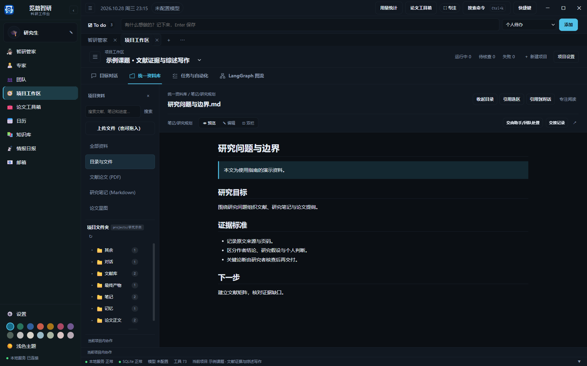
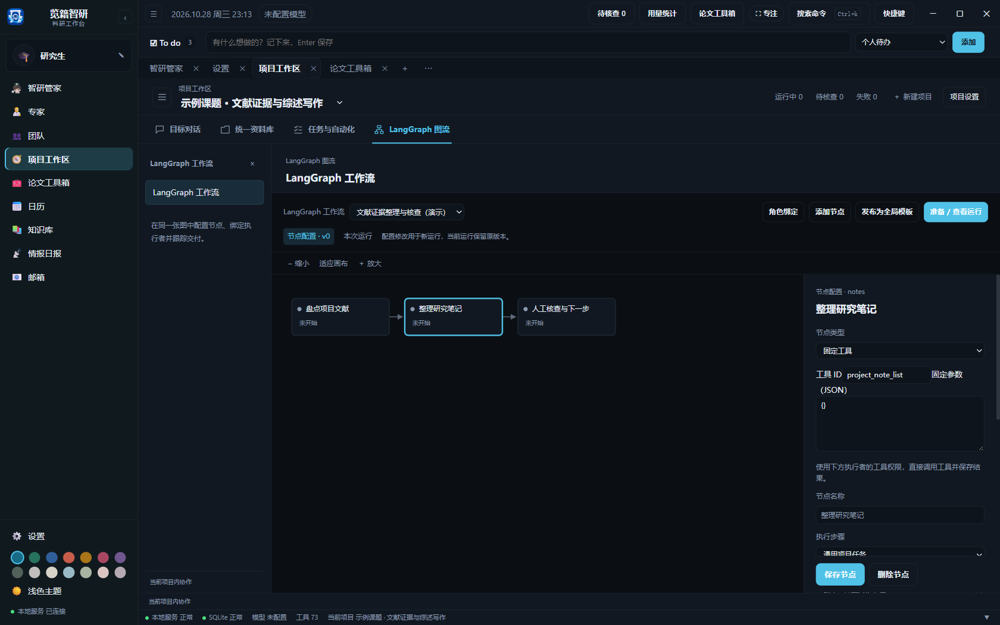
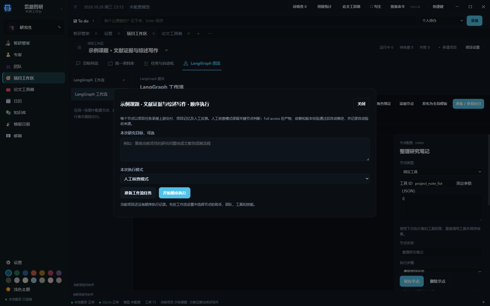

# 使用项目工作区

项目工作区围绕目标对话、统一资料库、任务与自动化、LangGraph 工作流组织研究。任务、核查和自动化只保留项目内入口；智研管家可以跨项目查询和调度。

顶部四个主视图分别是“目标对话”“统一资料库”“任务与自动化”“LangGraph 图流”。每个主视图保留自己的次级导航和当前内容；项目选择与项目设置始终在工作区顶部。完整入口见[界面导航](interface-overview.md)。

## 创建和管理项目

打开“项目工作区”，在顶部选择项目，点击旁边的“＋ 新建项目”直接创建。名称和研究目标填写后即可进入；展开“关键词与保存位置”可以选择本地目录。“项目设置 → 编辑项目信息”修改已有名称、目标和关键词，修改名称不会移动目录。删除项目记录需要单独确认。

也可以直接对智研管家说：“调研全固态电解质的离子传输机制，创建项目，安排专家团队并开始开题研究。”管家根据可用 Skill 装配项目、专家、团队和 LangGraph 流程，保存研究计划，再启动真实任务。回复中的“进入项目工作区”按钮可打开流程画布。仅需配置时说明“先装配，暂不执行”。已有项目可以直接指定名称或 ID，不必先手工切换对话绑定。

自动装配可组合自定义节点与依赖，也可使用开题、文献研究或论文写作模板。已存在的专家优先复用，原有职责、模型和停用设置保留。重试相同装配请求会复用配置与运行，不重复立项；明确要求另建才创建另一份。配置完成、已排队、等待核查和研究交付分别显示。

所有已启用的专家和团队默认可在各项目调用，无需逐个加入。“项目设置 → 项目执行者与模式”可以单独停用某个执行者、限制工具或调整本项目新任务的默认交付模式。跨项目调用团队时，共享职责和模型配置，运行成员、对话、任务和文件归属调用项目。

## 对话与执行设置

项目内可以创建多段独立对话。每段对话分别保存消息、草稿、引用、模型、推理强度和工具权限。智研管家的全局对话使用相同的会话设置；切换会话模型不会修改系统默认模型。

普通项目目录可以包含 `Zotero` 名称；实际 Zotero 数据目录和已配置的链接附件目录仍为只读。若项目确实位于托管目录内，请在独立目录建立项目并导入文献副本。创建对话失败时会保留输入草稿，不会留下未绑定的空对话。

对话列表支持右键或更多菜单进行置顶、重命名、导出、归档和删除。删除先进入可恢复的“最近删除”；正在运行的会话须先停止。详见[对话历史与论文工具箱](conversations-and-toolbox.md)。

输入框下方可选择模型、推理强度、工具权限、发送范围和执行者。权限包括跟随专家、只读、项目内读写和完全访问。配置在下一次发送时生效，运行中的请求使用开始时固定的配置。

默认发送给项目专家，适合讨论目标和协调工作。在“当前项目”范围选择专家、团队或成员后，发送按钮直接开始对话；选择团队时由负责人接收。需要任务记录和人工核查时，点击独立的“准备任务”，进入该任务的专属对话，核对要求后点击“开始任务”。派发时选择的执行模式会随任务保留。切到“当前工作流”并选择节点后，发送仍用于准备该节点任务。专家对话使用所选执行者的身份及工具范围，并保留本次会话的模型选项。

发送目标按“团队”和“专家”分组，每个只列一次。同一专家加入多个团队，也不会在主列表中重复展开。选中团队后，可在“团队成员”中指定执行者，或交由负责人安排。旧版各项目中的同名内置团队合并显示，默认使用当前项目配置；已有明确指定的团队和成员仍沿用原绑定。同名但不同的自定义对象会显示来源标识，方便区分。

在资料中打开文件，可使用“引用到对话”或“引用选区”附加材料；点击引用标签可临时预览原文。文件、文献、笔记和星图集中在统一资料库中。

## 统一资料库

“全部资料”按文献、研究笔记、论文稿件、实验记录、交付产物和其他文件筛选，也可搜索标题、路径或标签。同一文件在不同视图中引用原路径和版本，不为展示另存副本。

| 资料 | 保存与关联方式 |
| --- | --- |
| 文献 | 题录元数据关联项目 PDF；未下载的记录仍可管理，精读证据保留论文及页码来源 |
| 笔记、实验记录 | 统一保存为 `笔记/` 下的 Markdown，实验记录使用实验分析分类；通过同一个编辑、版本和搜索服务维护 |
| 论文稿件 | 保存在 `论文正文/`，可由写作工具或管家生成，仍是可以打开和编辑的本地文件 |
| 交付产物 | 任务记录关联实际文件；`.tasks/` 保存当次输入和交付快照，核查与人工修订使用固定版本 |
| 数据和其他文件 | 保留原目录，通过“目录与文件”浏览；整理索引后，支持的文件类型进入统一资料列表 |

新生成的资料自动登记。已有文件可点击“整理索引”纳入目录，它只更新索引，不搬移或删除原文件。提示词模板和目录说明仍可在笔记管理、文件目录中查看。不同资料的专业操作保留在对应视图，例如文献同步与 PDF 管理、笔记标签与模板。

## 执行时间线

项目对话的“执行轨迹”和智研管家的“轨迹”按时间展示模型请求、工具调用、思考摘要及执行结果。点击节点可展开输入参数、输出结果和执行信息。可切换运行轮次、搜索或仅查看异常，也可复制调用详情。

时间线来自已保存的运行事件，重新打开不会执行工具。未保存的耗时会显示为“未记录”，长结果标明预览范围，凭据字段会隐藏。运行中的节点显示活动状态；返回对话可继续输入。

## 任务、核查和自动化

界面中的计划入口标为“To-do 计划”，与“实时任务看板”“自动化规则”一起位于同一个“任务与自动化”主视图。

“任务与自动化”在项目工作区提供待办计划、实时任务看板和自动化规则。普通专家任务、团队任务、LangGraph 节点和定时触发结果使用同一套任务与交付记录。旧的外层任务或定时任务链接会打开项目内相应视图。

打开任务可查看执行者、输入、运行记录及固定产物版本。待核查任务支持通过交付或填写意见后退回修改；重试带入修改要求。文本产物支持人工修订，修订后仍需核查。下游只读取已交付版本，旧窗口不能批准新版本。

在“自动化”中设置项目、执行专家或 LangGraph 流程、目标、频率和输出目录。触发结果进入所属项目的任务记录，运行历史可直接打开任务及产物核查。规则仅在应用运行期间调度，重新打开后按已有补跑策略处理。等待人工核查不等于执行完成。

顶部 To do 用于随手记，与项目中的“待办计划”共用记录。一条计划可关联多个执行任务，关联任务全部交付后完成计划。详见[项目任务与日历](tasks-and-calendar.md)。

## LangGraph 工作流

工作区只保留一个工作流画布。选择模板，点击节点配置名称、步骤、要求、执行者、团队成员、前置依赖、工具范围及人工审查要求。模板也可在“设置 → 工作流”中管理。

节点类型可选“专家 / 团队”“固定工具”和“子工作流”。固定工具填写工具 ID 与 JSON 参数，直接调用工具，使用所选执行者的权限；子工作流选择已有模板，准备运行时固定其节点、依赖与执行者。子节点在本次运行中按“父节点.子节点”定位，仍可逐个审查。递归引用与超过五层的嵌套会被拒绝。

“保存节点”将配置保存到当前项目，不改变其他项目使用的模板。快速切换节点会保留最后一次选择；离开前若配置保存失败，会保留编辑内容并提示处理。

点击“发布为全局模板”可让所有跟随该模板的项目复用当前配置。项目的单独覆盖仍保留，已开始的运行使用原有快照。工作流模板中的团队引用共享配置，各项目执行时解析为自己的运行成员。

点击“准备 / 查看运行”检查节点任务，准备不调用模型。开始后由 LangGraph 调度节点，执行、文件写入和交付均使用项目任务。运行中的配置保持固定，修改节点只用于后续新运行。“本次运行”展示冻结版本，选中节点后可查看同一份任务产物与人工核查。

在项目对话中让专家调用工作流后，工具结果卡片会显示“查看运行”，到达人工审查节点时显示“审查 · 节点名称”。点击即可打开对应任务；“定位工作流节点”打开该次运行的节点，“返回发起对话”回到原会话。刷新页面后仍可从原调用卡片进入审查。

文档通过“人工修订”编辑；证据链节点通过“编辑节点证据链”选择图中节点，修改标题、证据说明、来源和连线。保存修订会保留原始产物，生成新的待审查版本，同时更新项目中的图谱。图谱已在其他页面发生变化时会阻止覆盖。保存后点击“通过交付”才会继续下游，下游使用确认后的版本。

“退回修改”保存意见并暂停；“退回并重做”将意见带入当前节点的新尝试，完成后再次等待审查。已经交付的前序节点不会重新调用模型。这一闭环由每次人工决定推进，不会无限自动重试。

“交给此节点”返回对话并选中对应执行者，补充目标后准备任务。存在前置交付的通用节点需要先准备完整流程。检索、精读、翻译、写作、评审等能力通过专家、团队和流程节点调用；结果在资料库和任务中查看，不再提供单独的研究阶段表单。

监督模式在需要审查的节点等待人工决定。Full access 自动推进模式使用已授权的执行范围，在真实产物、依赖和版本校验通过后记录“策略通过”。交付模式与工具权限分别配置，专家不能自行提升权限或代替人工核查。

停止或失败后保留已生成文件及运行记录。项目任务的输入和产物快照位于项目目录 `.tasks`，应随项目备份。旧实验图流的历史和关联产物继续保留，后续研究统一从工作流画布准备新运行。

工作流检查点保存在本地数据库，包含执行位置与待审查节点。关闭应用后重新打开，可从同一次运行继续。备份时应同时备份应用数据库和项目目录；执行工具时发生中断，仍需核对实际结果再重试。专家可查询可用模板、准备、启动、查询与停止工作流，人工修订和批准仅由界面操作。

## 拖放上传与图片对话

将文件拖到项目对话区，或点击输入框中的“上传”。图片会成为视觉输入，其他文件保存到当前项目“其余 / 上传文件”并引用到草稿。也可拖入资料区，只上传、不发送消息；资料区提供同样的上传按钮。同名文件自动编号另存，原文件保留。每批最多 20 个文件，普通文件每个不超过 50 MB；视觉图片每个最多 20 MB，每条对话最多 5 个文件、合计 10 页。

点击“图片”可选择图片或 PDF 作为视觉输入。发送前确认模型支持图片，账号客户端的纯文本调用暂不支持。图片只在发送时提交给所选模型；上传本身不调用模型。批量图注和转换请用[论文工具箱](conversations-and-toolbox.md)。

每个可写项目首次打开模板库时补充“图片图注与润色”和“学术文本润色”模板；已有内容不会被覆盖。模板按钮可选择、预览并应用项目模板。

工作流图的搜索框可按节点名称、ID 或已绑定执行者定位节点，选择结果后打开该节点的配置或运行快照。编辑中的内容会按原有保存规则保留。

[返回使用指南](../使用指南.md)
