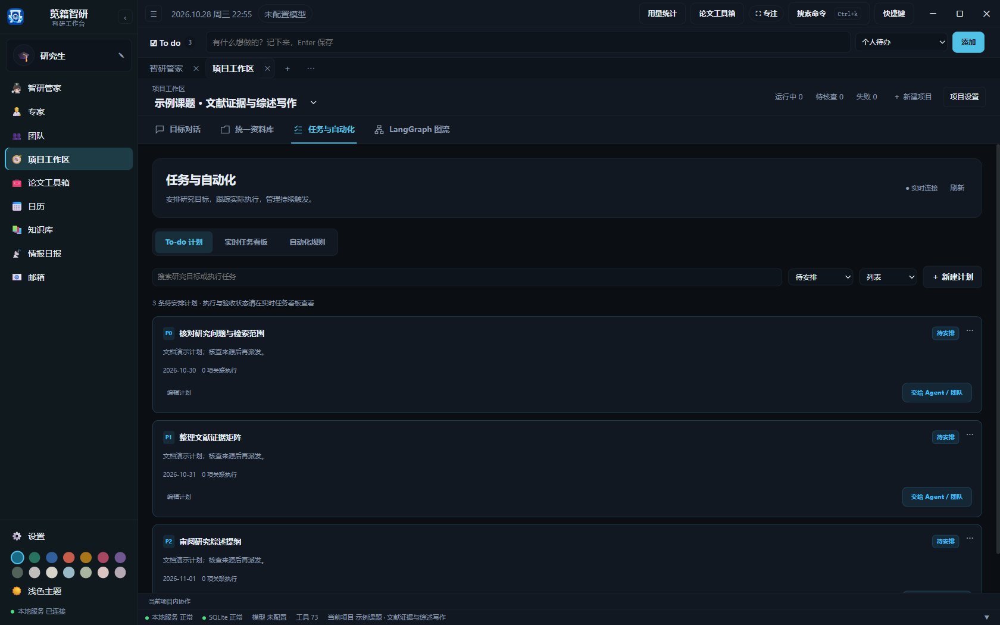
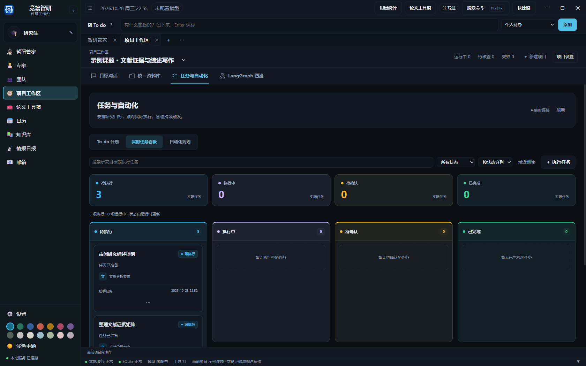
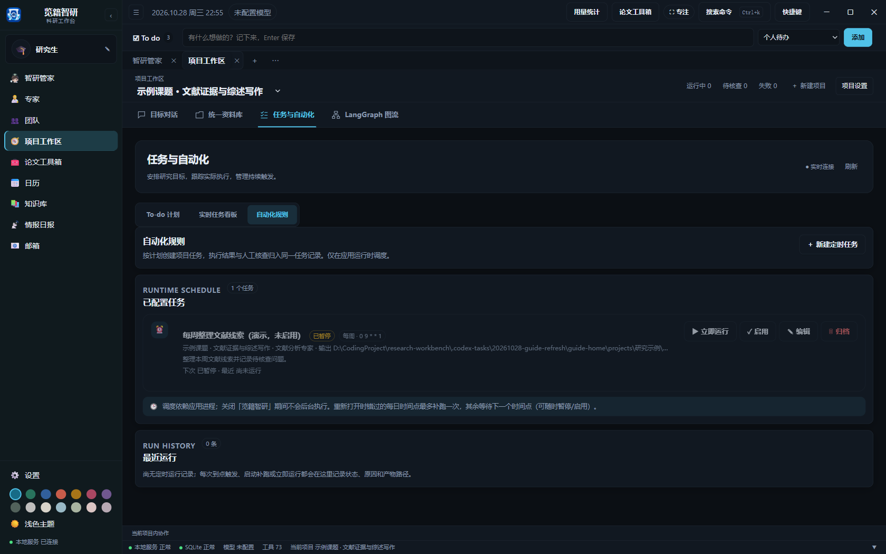

# 待办计划、实时任务与自动化

左侧一级导航“任务与自动化”提供“To-do 计划”“实时任务看板”“自动化规则”，默认打开所有项目的实时任务看板。右上角“项目范围”可筛选单个项目，卡片标明所属项目。它们分别回答要做什么、现在做到哪里、什么时候自动开始。

项目工作区内也保留同名入口，只展示当前项目。两个入口共用计划、执行记录和自动化规则；从全局看板双击任务，会自动切换到所属项目的原执行对话。在“所有项目”范围新建计划或执行任务时，先选择所属项目；从已有计划派发时直接使用该计划的项目。

## To-do 计划

只列出尚未派发的待安排目标，可记录优先级、截止日期、验收要求和前置计划，按列表或截止日期查看。顶部 To do 的项目待办与这里使用同一份记录。

点击“交给 Agent / 团队”选择已启用的专家或团队，计划的验收要求会进入任务说明。每次派发会建立独立的任务对话，准备完成后直接进入该对话；点击“开始任务”后执行。创建执行任务后，原计划保留在“已派发与历史”，运行和核查状态统一到实时任务看板查看，不再在 To-do 中维护一套运行状态。一条计划可以关联多个执行任务；关联任务全部交付后，计划自动完成。没有关联执行的普通待办可以归档。

前置计划尚未完成时，依赖它的任务无法开始。删除计划不会停止已派发的任务，也不会删除产物。

右键计划可编辑目标、优先级和截止日期、复制内容、交给 Agent / 团队或删除。顶部 To do 的右键菜单还提供复制为新待办、完成与重新打开；与工作流关联的待办状态由实际交付更新。列表搜索可以快速筛选目标。

## 实时任务看板

看板读取实际专家运行、团队任务、LangGraph 工作流和定时执行记录，显示排队、执行中、等待核查、已交付、失败和停止等状态。默认按状态分列，也可按工作流或协作任务分组。一个会话对应一张主看板卡片；同一任务重试、继续追问或普通会话多轮交流不会增加重复卡片。工作流使用总对话卡片，节点进度和节点对话在总对话内展开。连接标记表示实时事件通道状态，断线会自动重连并恢复已保存记录。

默认按状态显示彩色列和任务卡片：蓝色为待执行、紫色为进行中、橙色为待确认、绿色为已完成、红色为异常或阻塞、灰色为停止。每项任务仍显示具体状态文字。点击顶部同色统计卡片可筛选该类任务，再次点击恢复全部；分组菜单也可切换到按工作流或协作任务分组。

单击选中任务卡，双击直接进入对应的执行对话，查看专家回复、工具调用、当前活动、尝试次数和错误。也可以点击卡片上的“打开对话”，或选中后按 Enter。右键“查看执行详情”打开侧边详情与事件时间线。对话中的“任务与产物”可查看输入、固定产物版本、核查、重试和反馈。卡片状态跟随真实运行更新，不提供拖动卡片来伪造完成状态。

执行对话与看板共用当前状态：专家运行时进入“进行中”，需要人工审查时进入“待确认”，普通对话结束或任务交付后进入“已完成”。在已交付任务中继续追问，会暂时显示“进行中”，追问结束后回到原交付状态；停止追问不会撤销已有交付。尚未启动的任务继续显示“待执行”，讨论结束不会代替任务执行或人工审查。自动化启动失败会显示原因并进入“需处理”，检查配置后可从原对话继续执行。

看板在打开时每三秒核对一次实际状态，也会响应实时事件；连接恢复、切回窗口或点击刷新都会重新读取记录。

“已执行”和“已交付”有区别。需要人工核查的任务生成产物后暂停，研究者阅读后批准或退回；退回意见进入后续尝试。文本产物也可人工修订，修订后仍需核查。下游只使用已交付版本。

项目默认采用人工核查模式。用户可在项目执行者设置或单次任务中选择 Full access 自动推进，符合产物、依赖和版本要求时记录策略验收。此设置不会扩大工具权限或项目文件范围。

## 自动化规则

自动化规则持续保留，可配置项目、执行专家或 LangGraph 流程、目标、频率和输出位置。每次触发生成独立执行记录，在同一个实时看板中跟踪，产物归属目标项目。规则页保留启停、手动运行、下次触发时间和历史记录。

可搜索规则与运行记录，右键规则可立即运行一次、启用或暂停、编辑和归档。暂停的规则也可以手动运行一次，运行后仍保持暂停。

应用运行期间才会调度。应用关闭期间不会准时执行，重新打开后最多补跑一次。等待人工核查的运行不算完成，也不会因规则再次触发而绕过核查。

## 日历

日历集中查看手动日程、计划截止日期、定时触发和待审节点。点击关联记录可进入任务或资料。完成普通日历事项不会代替科研产物验收。

顶部搜索可按日程名称、日期或项目查找全部已加载日程，点击结果跳转到对应日期。

## 任务菜单与最近删除

在实时任务看板右键点击任务卡，或使用卡片“更多”按钮，可打开审查、重命名、设置优先级和起止日期、置顶、复制链接、复制工作目录、在新窗口打开以及复制为新任务。运行状态由执行与审查更新，不能用菜单手动伪装为完成。

每张卡片的右键菜单、更多菜单和详情面板均提供“从看板删除”，删除后可在“最近删除”中恢复。顶部各状态统计卡片的“清理”和对应列的“清理本列”可批量移除所选项目范围中该状态下的记录，确认框会显示记录数量。在“所有项目”范围会同时清理多个项目；只想清理一个项目时，先切换项目范围。

清理看板只移除展示记录，保留对应会话、任务、产物及运行历史。执行中和等待确认的记录也可清理，执行仍会继续；如需结束执行，请先停止。

对话运行记录与真实会话关联。删除会话会同步移除它在看板中的全部运行记录，包括失败记录；恢复会话后，关联记录重新显示，曾单独从看板删除的记录仍留在“最近删除”。永久删除会话后，其对话运行记录不再显示。

自动化规则默认使用独立的“定时任务专家”。旧规则中未选择执行者或使用系统管家的配置会切换到该专家，个人管家继续用于日常对话。仍可为具体规则选择其他专家或工作流。

[返回使用指南](../使用指南.md)
