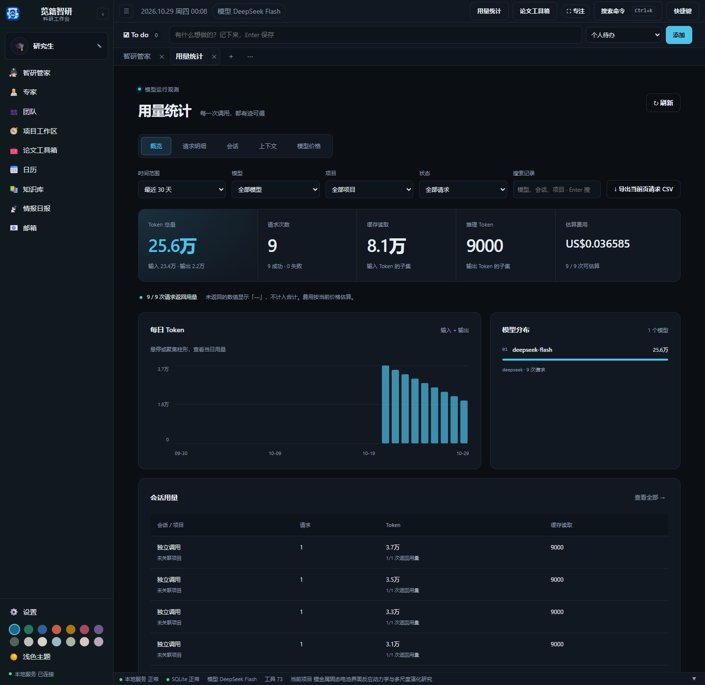
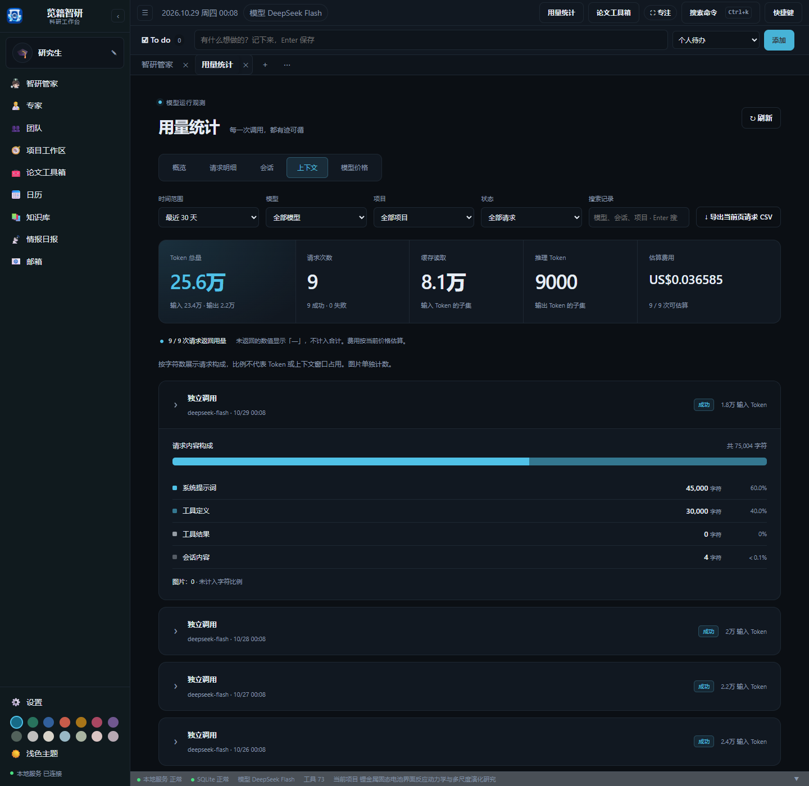
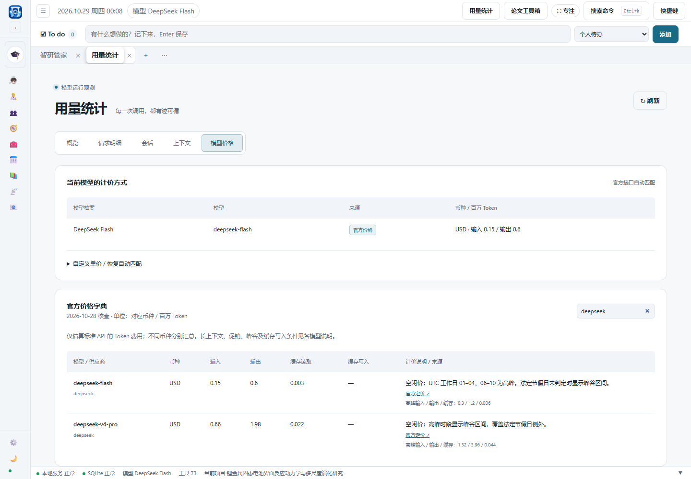

# 用量统计

点击最顶层的“用量统计”。从启用此功能后的模型请求开始累计，刷新或重启不会清空；旧调用不会补造数据。

- **概览**：查看输入、输出、缓存读取、推理 token、请求与失败数，以及每日趋势和会话用量排行。
- **请求**：按时间范围、项目、模型与状态筛选，查看每次请求的耗时、首字时间、token 和估算费用，可导出当前页 CSV。重试是独立请求。
- **会话**：汇总会话请求、token、缓存读取与调用累计耗时。累计耗时不等同于用户活跃时长。
- **上下文**：按字符数观察系统提示词、工具定义、工具结果和会话内容，图片单独计张数。不保存提示词正文或密钥，不推测模型未提供的上下文窗口容量。
- **模型价格**：查看已配置模型是否匹配官方单价；搜索内置价格字典，查看输入、输出、缓存单价、计价条件、核查日期及官方来源。可设置自定义单价或恢复自动匹配。

供应商未返回的 token 或首字时间显示横线，不计入用量合计；全部请求都没有返回用量时，概览显示“尚未收到 Token 用量”，不会画出虚假的零值柱形。缓存读取属于输入 token 的子集，推理属于输出 token 的子集，请勿重复相加。上下文构成显示完整字符数和占比，零值不占据色条；不足 0.1% 的内容仍在明细中列出。

价格字典于 2026-10-28 核查，包含 DeepSeek、OpenAI、Anthropic、Google、Z.AI、MiniMax 国际站和百炼北京地域的 46 个模型条目及已核实别名。按实际官方接口地址及模型匹配；第三方转发、订阅服务、未知模型版本与其他地域需要设置相应单价。未核实的缓存价格留空，不能视为免费。

在“模型价格”展开“自定义单价 / 恢复自动匹配”，选择模型档案，填写 **USD 或 CNY / 百万 Token** 的输入、输出、缓存读取和缓存写入单价。手动单价优先；输入和输出必填，未知缓存单价可留空。清除手动设置后恢复官方价格匹配。不同币种分别汇总，不自动换汇。

长上下文按字典中已核实的输入量分档估算；已公布的促销结束日期会切换相应单价。DeepSeek 工作日高峰时间遇到未判定的中国法定节假日时显示峰谷价格区间，缓存写入未记录 TTL 时也显示可能的费用区间。OpenAI 当前自动估算范围为标准接口、输入不超过 128K 的短上下文；超过范围可自行设置单价。

费用使用当前价格字典或手动单价重新计算历史显示，不是供应商账单、余额或订阅额度；不含搜索、缓存存储、音视频专属计费、地区附加费及税费。缺少计费数据的请求不估算费用，并在请求明细中说明原因。CSV 导出当前筛选下当前页最多 100 条请求，包含币种、估算上下限及缺失原因。

价格来源：[DeepSeek](https://api-docs.deepseek.com/quick_start/pricing/)、[OpenAI](https://developers.openai.com/api/docs/pricing)、[Anthropic](https://platform.claude.com/docs/en/about-claude/pricing)、[Google](https://ai.google.dev/gemini-api/docs/pricing)、[Z.AI](https://docs.z.ai/guides/overview/pricing)、[MiniMax](https://platform.minimax.io/subscribe/token-plan?tab=api-enterprise)、[百炼](https://help.aliyun.com/zh/model-studio/model-pricing)。

搜索框支持模型、供应商、会话、项目与状态关键词，按 Enter 应用。搜索会同时筛选统计合计、趋势与记录，清空后恢复当前时间范围内的数据。

[返回使用指南](../使用指南.md)
