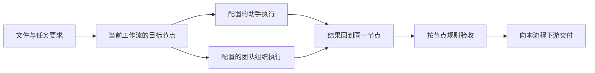

# 文件交接与动态快捷入口设计

状态：已实现单文件交接及固定 / 最近目标、历史与产物回执。使用方式和运行边界见 [文件交接说明](../file-handoff.md)。适用范围：科研平台文件区、笔记列表及文件右键菜单。

实现约定：补充已有任务另建关联的处理记录，保留旧任务与输入快照；当前版本对项目内的工作流运行串行处理，等待上游或已有运行时保留草稿，由用户再次启动。目标查询只读，展示配置的依赖；真正开始前验证实际交付与产物版本。

范围约束：只能交给当前项目正在使用的工作流所配置的团队、助手和节点。所有交接最终归属该工作流的一个具体节点；助手和团队入口用于从执行者反查节点。项目内其他团队、全局其他助手及其他工作流均不属于可选目标。

## 要解决的问题

文件区的 `flHand` 当前只是把“把某个文件交给写作助手”填入右侧输入框。它没有绑定接收对象，也没有表达文件、任务与项目的关系。实际助手、团队和工作流节点都可以变化，因此交接应基于对象 ID 和当前配置，而不是在提示词中匹配名称。

## 入口和操作流程

将文件预览区右上角的箭头改成有文字的 **「交给…」** 按钮，文件右键菜单使用相同入口。未选中文件时按钮禁用，提示“先选择文件”；右键入口使用右键所在文件，不使用之前预览的文件。

拟新增 `Alt+Shift+H`：文件列表或文件编辑区获得焦点时，打开交接面板。快捷键调用统一操作，接收对象在面板中选择；帮助页提供说明及关闭方式。

面板布局：

```text
交给…                                      ×
当前项目 › 当前工作流 › 实验记录.md          已保存

搜索助手、团队或工作流步骤…
按节点   按团队   按助手

最近使用
  [节点 → 执行者]      仅当前工作流 · 当前状态

当前工作流
  [节点名称]          绑定的执行者 · 可执行 / 等待上游

本流程配置的团队
  [团队名称]          团队用途 · 成员数量 · 当前状态

本流程可执行的助手
  [助手名称]          关联节点 · 用途 / 角色

选中后：
归属节点：[节点名称]    执行者：[助手 / 团队 / 成员]
文件：实验记录.md       当前节点状态：[可执行 / 等待上游]
任务要求：[希望它帮你做什么？                    ]
接收方式：[新建节点任务 / 补充本节点已有任务    ]

                            [准备任务] [发送并开始]
```

点击一个目标只选中它。Enter 选择搜索结果；Tab 进入任务说明；“发送并开始”是明确的执行按钮，选中目标或按列表 Enter 都不会触发执行。

常用目标可以固定。文件工具栏最多显示 2 个固定目标，其余保留在面板里；点击固定目标打开已选好节点和执行者的同一个面板。最近使用最多展示 3 项，按项目与工作流保存；切换工作流后不会带入另一工作流的快捷目标。

## 节点、团队与助手如何协作

节点负责阶段目标、输入、产物、依赖与验收；助手负责执行；团队负责在节点允许范围内组织成员协作。每个节点有一个明确的主执行方式：助手执行，或团队执行。团队内部可配置协调人、执行成员和审核人，不额外创建一套与节点脱离的任务进度。

三个入口最终汇合到同一个节点任务：

| 入口 | 用户先选择什么 | 后续如何确定交接 |
| --- | --- | --- |
| 按节点（默认） | 本流程中的节点 | 自动显示该节点配置的助手或团队，不另选流程外执行者 |
| 按团队 | 本流程配置的团队 | 只有一个可接收任务的关联节点时自动选中；多个时由用户选择归属节点 |
| 按助手 | 本流程中有执行资格的助手 | 只有一个可接收任务的关联节点时自动选中；多个时由用户选择归属节点 |

同一助手参与多个节点时，任务必须注明是哪个节点的工作，不按名称或当前选中的页面猜测。某个助手通过团队参与节点时，选择它仍形成该团队在该节点内的任务，保留协调、审核和产物归属。仅有审核角色的成员不能作为执行任务的接收人。

节点固定了执行成员时，交接入口保持该绑定；团队节点允许内部委派时，成员选择范围才包含允许委派的成员。更换节点执行者属于修改工作流配置，不在发送文件时隐式覆盖。



“准备任务”保存节点、执行者、文件与要求，打开节点任务草稿；已有输入和附件不得被覆盖。“发送并开始”仅启动该节点任务，不默认启动整个工作流。任务交接、团队子任务和实际运行共用关联标识，文件面板、团队页与节点面板展示同一份状态来源。

对节点状态的处理：

- 等待上游：可以存为待处理材料，依赖满足后允许执行；添加文件不能绕过依赖。
- 正在运行：新文件先保存为下一次处理的材料，不修改当前运行已经采用的输入快照。
- 待验收：新增文件不代表原任务已通过；需要纳入处理时创建新的处理记录。
- 已交付：允许发起新的节点任务；是否影响下游交付按已有产物版本与失效规则处理，不静默撤销或覆盖历史结果。

团队完成一个子任务只更新该子任务。节点是否完成由节点验收规则决定；验收后才把正式产物交给本流程的下游。多个来源不能各自把节点标成完成。

第一阶段只提供引用项目内已保存文件的交接。需要改写文件时在任务中声明输出要求，并走应用已有的文件编辑及权限规则；“创建副本后修改”需要相应复制和追踪功能落地后再提供。

## 动态目标来源

前端使用统一的目标描述，渲染逻辑不判断特定助手名、团队名或步骤序号：

```text
Target
  kind                 assistant | team | workflow_node
  id                   稳定 ID
  project_id           当前项目
  layout_id            当前绑定工作流
  node_ids             该执行者在本流程有接收资格的节点
  member_id            通过团队参与时的具体成员（如适用）
  title, description   展示信息
  executor             当前绑定的助手或团队成员
  actions              当前实际支持的 prepare / start 等操作
  availability         可准备、可执行及不可执行原因
  revision             相关配置版本
```

目标集合来源与排序：

1. 本项目、本工作流的有效固定目标与最近使用目标。
2. 当前项目实际绑定工作流的节点，按工作流当前顺序显示。
3. 从这些节点的团队绑定中去重得到的有效团队。
4. 从这些节点的助手绑定及允许执行的团队成员绑定中得到的有效助手。

助手或团队必须在至少一个当前节点拥有接收资格。对象存在于项目或全局目录中、曾经使用过或具有相似技能，都不能成为入选理由。团队成员资格还需结合节点是否固定成员、角色和委派规则判断，不能把团队全员自动当成每个节点的可选执行者。

不根据名称中的“写作”“文献”推断能力。可用操作由目标配置、文件类型与现有工具能力决定；第一阶段能力信息不足时展示用途说明，不给未经验证的“智能推荐”。

首次打开面板时取当前已保存工作流的目标，搜索仅覆盖该集合。配置保存、切换项目 / 工作流或重新打开面板时刷新；发送前服务端再次验证项目当前绑定、流程版本、节点存在性以及执行者在该节点的资格。目标被停用、删除或节点绑定发生变化时保留任务说明，展示变化并要求重新选择或确认当前执行者。

如果正在运行的任务使用旧版流程快照，追加到该任务时须显式进入该运行记录；当前文件面板不会把新版流程交接自动塞进旧运行。缺少有效工作流绑定时显示配置入口，不自动回退到全局助手或另一套默认流程。

收藏和历史保存 `project_id + layout_id + node_id + kind + id`，必要时附带团队成员 ID，不保存数组下标或显示名称。改名更新显示；移出流程后从有效快捷入口移除，不自动替换为同名对象。

## 文件与任务的关联

每次交接保存以下信息：

- 文件所属项目、资产 ID（已有时）、项目相对路径、提交时内容版本。
- 每次交接都必须保存工作流 ID、版本、节点 ID；另存助手 / 团队 / 成员的稳定 ID。
- 用户任务说明、节点任务 ID，以及关联会话；继续已有任务时校验相同项目、工作流和节点。
- 提交时执行者配置快照、交接状态，以及实际生成的会话 / 任务 / 运行 ID。
- 结果文件或其他产物引用。

应用内部形成一个结构化的 `Handoff` 记录，先交给节点任务服务，再按该节点的执行配置调用助手或团队。三个入口共用这条流程，不能分别调用全局聊天、团队聊天和工作流执行接口而失去节点关联。提示词中的文件路径只是任务上下文的一部分，不能承担识别目标或记录状态的职责。

面板打开时冻结文件所属项目、当前工作流和目标文件。随后切换项目或工作流时，旧面板保留草稿但不可继续提交，需按当前上下文重新选择。文件未保存时显示“有未保存修改”，支持“保存后准备 / 发送”；保存失败保留编辑内容并停止交接。文件被移动、删除或版本改变时应重新解析，避免发送陈旧引用。

## 文件区的反馈

文件预览区显示最近一次交接摘要，例如“[节点] · 已准备给 [目标]”“[节点] · [目标] 正在处理”“[节点] · 待验收 · 2 个产物”。点击进入对应节点任务，可以继续沟通或打开产物。

右键增加“查看交接记录”。任务完成以实际运行结果为准；完成创建会话、写入草稿或提交请求只显示相应状态。重复点击发送使用同一个提交标识，避免创建两份任务。

## 与现有代码的连接点

| 现有代码 / 接口 | 使用方式 |
| --- | --- |
| `workflow-view.js` 的 `flHand`、`flSel`、`flCurrentFile` | 改成统一交接入口，接入当前文件和保存状态 |
| `interactions.js` 的文件菜单 | 追加“交给…”与“查看交接记录”，调用同一面板 |
| `WorkflowDB.assistants()`、助手启用状态 | 仅补充工作流绑定助手的信息与可用状态；不能自动启用停用助手 |
| 团队及成员、Leader 数据 | 仅解析当前节点引用的团队，判断节点内成员资格 |
| `workflow_layout.state()` 与节点配置 | 以当前有效绑定为边界，获取节点、顺序、执行者及依赖状态 |
| 现有聊天、团队任务和工作流执行服务 | 由统一节点任务服务调用，回执与产物均关联同一节点任务 |
| `/api/file/location`、已有资产索引 | 解析真实文件位置及资产关联，服务端验证项目范围 |

建议新增只读的 `/api/handoff/targets` 聚合入口，以及统一的节点交接准备、执行和查询接口。服务端自行读取当前绑定工作流，校验客户端传来的版本及目标归属，不能只依赖前端过滤。当前团队列表读取逻辑会初始化默认团队和 Leader，工作流状态读取也有默认绑定回退；交接目标查询应使用无初始化副作用的读取路径，避免打开菜单就创建或切换配置。

当前 `useAssistant()` 会自动启用停用助手并创建新会话，不宜直接作为交接动作复用。交接应验证助手在目标节点的可执行资格，按项目、工作流和节点绑定任务及会话。

当前节点结构允许同时保存 `assistant_id`、`team_id` 和 `member_id`，执行器还有默认助手与成员选择回退。实现此设计时需明确节点的主执行方式，统一界面与服务端的解析规则；缺失绑定应提示配置，不能在文件交接时静默指派其他对象。成员缺失、团队解散或主执行方式不明确时，保留材料草稿并禁止发起执行。

## 实施顺序及验收

第一批完成统一面板、动态目标、单文件交接、任务说明、草稿保护和实际执行回执。第二批增加固定 / 最近目标、文件交接历史、产物跳转。多文件、文件夹批量处理和副本编辑在前两批稳定后扩展，保持同一目标与交接模型。

验收重点：未纳入当前工作流的助手和团队不可见且直接请求也被拒绝；同一助手跨多个节点时必须确定归属；团队成员执行不会绕过该节点的团队配置；新增、改名、停用、删除和移出流程后菜单随之变化；流程重排和执行者更换不误投；跨项目 / 工作流切换不串文件；未保存文件和原有草稿不丢；节点依赖不能绕过；执行结果和验收状态只有一个事实来源；重复提交只有一条任务；键盘能完成选择、准备和退出，并返回文件原焦点。
