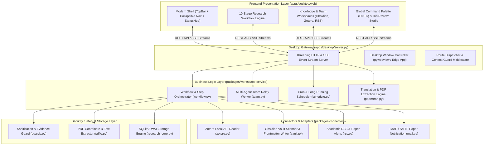

# 科研工作台 (Research Workbench) v1.2.0 系统演进方案规范

**版本标识**: `v1.2.0-PLAN`  
**基准环境**: Python 3.10+ / 3.13, SQLite3 WAL, Edge WebView2 / Modern Chromium  
**适用模块**: `apps/desktop`, `packages/{database, workspace-core, workspace-service, connectors, contracts, ai-runtime}`

---

## 1. 架构全景 (System Architecture)



---

## 2. 功能规划方案 (Functional Architecture & Enhancements)

### 2.1 十步全流程增强闭环
1. **创新点审查 (Idea Review)**
   - 引入动态博导评审矩阵（F1 理论突破度、F2 逻辑闭环度、F3 实验完备性、F4 数据可达性、F5 领域紧迫性）。
   - 增加**反向证伪模式**：主动生成 3 种潜在质疑与 Reject 风险清单，并产出针对性的防御实验设计。
2. **论文搜索 (Paper Search)**
   - 聚合检索源扩展：OpenAlex + Crossref + arXiv + Semantic Scholar 动态权重混合检索。
   - 智能筛选器：支持多维度过滤（CC-BY 协议、顶会/JCR 分区、开源代码仓库链接、机构排名）。
3. **下载精读 (Download & Deep Read)**
   - OA 全文下载引擎：多节点镜像并发嗅探，遇到 403/付费墙自动归档至「待手动导入清单」。
   - 精读沉淀卡片：自动抽取研究问题、核心假说、基线对比方法、关键公式、作者结论局限性。
4. **论文双语研读 (Paper Translation & Annotation)**
   - 双栏流式对齐阅读器：左侧原生 PDF 文字/排版渲染，右侧高精度学术中英对照。
   - 荧光笔批注与笔记锚定：支持划选任意段落生成带坐标与页码的批注锚点，实时同步至个人笔记。
5. **确认大纲 (Outline Studio)**
   - 支持多级论文骨架就地直编（Title, Abstract, Section, Subsection, Bullet points）。
   - 结合知识库论文库一键反向插桩：自动计算章节证据支撑度（已满足/待补充证据）。
6. **梳理精读谱系 (Literature Lineage Map)**
   - 知识拓扑脑图与引用网络可视化：以章节为根节点，挂载支撑文献、实验数据切片与争议证据。
   - 数据拖拽投喂：支持将实验图表（CSV、PNG、TIFF）直接拖入节点建立证据链接。
7. **正文撰写 (Manuscript Drafting)**
   - 模块化分段撰写模式：支持按小标题独立调起专用 Writing Agent，输出内容遵循学术规范。
   - 待补证据占位符系统：未有明确数据支撑时自动生成标准化 `[TODO: Require Evidence #ID]` 标记。
8. **稿件审查 (Manuscript Review)**
   - 审稿人视角的严格评审模拟器：从 Reviewer 1 (严谨派)、Reviewer 2 (创新挑剔派)、Reviewer 3 (应用落地派) 三维度给出逐项打分与逐段修改意见。
   - 荧光笔直推 Agent：在正文直接框选有疑问的段落，一键发起定向修改对话。
9. **学术中译英 (Polishing & Translation)**
   - 学术微调润色链：基于 Nature/Cell 经典句式库进行语法增强，提供多样性句式候选项（Concise / Formal / Impactful）。
10. **多格式编译投递 (Format Conversion)**
    - Markdown / Typst / LaTeX / Word 双向或单向转码。
    - 集成本地 MiKTeX / Typst 编译器，实现即时 PDF 排版预览与编译报错定位。

### 2.2 证据优先与事实核验链 (Evidence & Provenance Ledger)
- **零盲目采信原则**：模型生成的任何事实引用必须绑定 `PaperID`、`PageNo`、`SentenceQuote` 三元组。
- **引用台账 (Citation Ledger)**：在 `<Project>/论文正文/引用台账.md` 动态追踪引用状态，支持一键定位原文高亮。

---

## 3. 后端系统架构设计 (Backend System & Architecture Design)

### 3.1 架构分层规范
```
packages/
  ├── database/           # SQLite 核心层，数据模型与迁移脚本
  ├── workspace-core/     # 证据核验、脱敏拦截、PDF 解析基础设施
  ├── workspace-service/  # 业务编排：工作流引擎、团队协同、调度器
  ├── connectors/         # 外部服务适配器：Zotero、Obsidian、RSS、Mail
  ├── contracts/          # 模型目录、接口契约与 Prompt 规范定义
  └── ai-runtime/         # 模型调用适配层、Token 监控与流式缓冲
apps/
  └── desktop/            # HTTP/SSE 服务网关与 WebView2 宿主环境
```

### 3.2 存储与并发机制
1. **SQLite WAL 模式与并发隔离**
   - 开启 `PRAGMA journal_mode=WAL;` 与 `PRAGMA busy_timeout=5000;`，确保多线程读取不阻塞写入。
   - 所有数据库变更走单例事务管理器，杜绝 `database is locked`。
2. **异步后台任务引擎 (TaskQueue)**
   - 长时间操作（文献下载、PDF 全文精读、全库嵌入）放入独立工作线程池。
   - 状态落盘：状态持久化到 `tasks` 表，支持进程重启后的断点恢复与任务中断清理。
3. **SSE (Server-Sent Events) 通信总线**
   - 统一事件格式：
     ```json
     event: step | chunk | error | done
     data: {"taskId": "...", "content": "...", "meta": {}}
     ```
   - 支持心跳保持（每 15 秒发送 ping 事件）与断线自动重连补偿机制。

### 3.3 安全与沙箱机制
1. **凭证脱敏与零明文传输**
   - API 密钥仅保存在本地安全数据库中，前端查询接口仅返回 `{"provider": "openai", "key_present": true}`。
2. **路径安全防护**
   - 所有文件读写操作强制校验 `os.path.commonpath([ROOT, target]) == ROOT`，防范目录遍历（Path Traversal）。
3. **出站脱敏审查器 (Guards)**
   - 在向云端模型发送上下文前，对用户本地路径、邮箱地址、IP 地址与私有变量名执行动态脱敏置换。

---

## 4. 前端美化方案 (Frontend Visual Styling & UI Modernization)

### 4.1 设计语言与视觉层级
- **风格定位**：深色工业极简质感（Dark Obsidian）结合高可读性亮色模式（Paper White），兼顾长时间科研阅读舒适度。
- **色彩规范**：
  - **Dark Base**: 页面底色 `#0b0f14`，卡片面板 `#111821`，悬浮面板 `#16202c`，分界线 `#1e2833`。
  - **Light Base**: 页面底色 `#f6f8fa`，卡片面板 `#ffffff`，悬浮面板 `#f1f4f8`，分界线 `#dfe5ec`。
  - **Accent Colors**: 科研青 `#2dd4bf`（主焦点/主要操作）、极客蓝 `#38bdf8`（Agent 轨迹/流程节点）、验证绿 `#34d399`（证据核验通过）、警示橙 `#fbbf24`（待补证据）。
  - **对比度达标**：严格符合 WCAG 2.1 AA 标准，文本与背景对比度 $\ge 4.5:1$。

### 4.2 排版与布局体系
1. **响应式三栏与工作流双栏动态伸缩**
   - 左侧全局导航（支持 64px 极窄图标态与 232px 完整信息态一键切换）。
   - 中间内容编辑/展示区，弹性自适应宽度并保留学术阅读最优行宽（68-75 字符）。
   - 右侧 Agent 助手与证据核验抽屉，支持平滑滑入与折叠。
2. **学术排版优化**
   - 引入高质量衬线/无衬线双字体系统：UI 控件采用 `Inter` / `Segoe UI`，正文与公式预览采用 `Charter` / `Source Serif Pro` 配合 KaTeX。

### 4.3 组件现代化升级
- **Glassmorphism 状态浮层**：全局状态栏、控制面板采用轻量毛玻璃效果（`backdrop-filter: blur(12px)`）。
- **Pipeline Tracker (步骤追踪器)**：10 步流程以线性节点进度轴展示，状态包含：`Not Started`（灰色线框）、`In Progress`（青色流动光感）、`Completed`（翡翠绿高亮）。
- **Evidence Card (证据卡片)**：以高识别度的左侧状态边框区分信度等级，附带原文片段折叠和 DOI 一键外链。

---

## 5. 交互体验方案 (Interaction & UX Experience Design)

### 5.1 全局控制中心与键盘友好设计
1. **全局命令面板 (Command Palette - `Ctrl + K` / `Cmd + K`)**
   - 快速检索项目、文献、笔记、设置选项及跨步骤功能跳转。
   - 支持常用命令简写（如 `> search attention`, `> review abstract`, `> theme dark`）。
2. **键盘流快捷操作**
   - `Ctrl + Enter`：提交当前 Agent 审查或正文生成提示。
   - `Alt + 1` ~ `Alt + 0`：无缝切换十步工作流。
   - `J` / `K` 列表导航与 `Space` 展开详情预览。

### 5.2 人机协同与即时反馈体验
1. **Diff 对比与双向合并面板**
   - 针对 Agent 生成的正文草稿，提供分栏视图展示当前正文与建议修改的 Side-by-Side 差异对比。
   - 支持逐段“接受变更 (Accept)”或“拒绝并指导 (Reject with Note)”。
2. **非阻塞式状态流与骨架屏 (Skeleton UI)**
   - 在模型推理、网络检索和 PDF 解析过程中，全面采用脉冲骨架屏替代全屏 Loading，保障页面交互连贯性。
   - 异步后台任务（如文献批量下载）在右下角以浮动微型卡片显示进度，支持后台静默运行与完成通知。
3. **草稿自动暂存与时光机回退**
   - 输入框与正文编辑器集成防抖（Debounced 800ms）本地存储机制，意外关窗或刷新后数据零丢失。
   - 提供按步骤的版本历史记录，可随时恢复至任意历史生成快照。

---

## 6. 实施路线图 (Implementation Roadmap)

| 阶段 | 周期 | 核心交付成果 | 验收指标 |
|---|---|---|---|
| **Phase 1: 基础底座与环境验证** | 交付即日 | 修复启动脚本路径异常；补齐 Python 依赖；服务在 8765 端口平稳运行 | 114 项单元测试全部通过；HTTP 200 返回；无边框窗正常唤起 |
| **Phase 2: 交互与视觉现代升级** | 迭代第 1 周 | 引入 Command Palette (`Ctrl+K`)；重构主题配色体系与 WCAG 认证；步骤进度轴组件化 | 视觉对比度 $\ge 6.0$；操作延迟 $< 50\text{ms}$ |
| **Phase 3: 后端引擎与流式健壮化** | 迭代第 2 周 | SQLite WAL 性能调优；TaskQueue 任务断点恢复；SSE 重连自愈机制 | 50 篇文献并发入库无锁冲突；网络中断自动重连 |
| **Phase 4: 证据核验与协同工作流** | 迭代第 3 周 | 自动引用台账；PDF 划词高亮锚定；审稿人多重视角评估矩阵 | 引用三元组核验覆盖率 $100\%$；审稿反馈结构化输出 |
