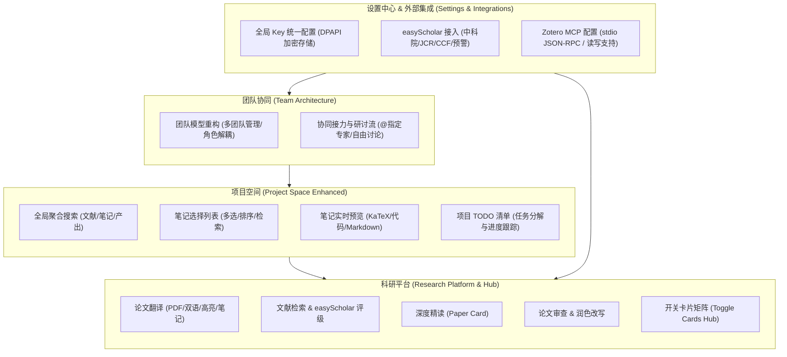

# 览籍智研 (Research Workbench) v1.3.0 系统演化与功能规划方案

**版本标识**: `v1.3.0-PLAN`  
**基准环境**: Python 3.10+ / 3.13, SQLite3 WAL, Edge WebView2 / Modern Chromium  
**适用模块**: `apps/desktop`, `packages/{database, workspace-core, workspace-service, connectors, contracts, ai-runtime}`

---

## 1. 需求背景与演进全景 (Requirements & Evolution Overview)

本版本针对手写需求草案（7 项核心改进）与 Zotero MCP 配置进行系统化工程落地规划，打通从文献检索、期刊评级、团队协同、项目空间聚合到本地科研待办的全链路体验：



---

## 2. 核心功能规范设计 (Functional Specifications)

### 2.1 需求 1：团队模块重构 (Team Architecture Refactoring)
* **目标**：打破原有单一串行锁限制，实现更灵活的专家团队编排与任务研讨。
* **架构设计**：
  * **多团队实例解耦**：支持基于研究课题/任务类型建立专属团队（如“选题论证团队”、“综述撰写团队”、“同行评议预审组”），每个团队独立保存成员名单与会话历史。
  * **角色与调度机制**：
    * 统筹 Leader（智研管家）：负责需求拆解、分派任务与研讨总结。
    * 专家成员（Partner Agents）：支持从助手库灵活挑选，配置不同的模型档案、推理档位与系统设定。
    * 协作模式：支持“串行接力”（按轮次依次发言）、“针对指派”（在输入框 `@专家` 指定作答）与“自由辩论”（多专家并行发表见解由 Leader 汇总）。
  * **交互与界面呈现**：
    * 顶部团队切换选择器 + 成员状态胶囊条（显示空闲/思考中/已发言/当前轮次）。
    * 左侧会话历史抽屉，支持新建会话、切换历史会话与一键导出研讨纪要。

### 2.2 需求 2：任务管理与待办增强 (Task & TODO Enhancement)
* **目标**：将科研工作流与阶段目标拆解为可操作、可跟踪的清单。
* **架构设计**：
  * **项目级任务清单**：在各项目中引入独立任务管理看板（状态流转：`TODO` → `IN_PROGRESS` → `DONE`）。
  * **工作流任务插桩**：支持将十步工作流（如“检索 20 篇顶会论文”、“完成 Method 章节初稿”、“核对参考文献 DOI”）一键生成结构化待办。
  * **属性定义**：包含任务标题、所属阶段、截止日期、优先级（P0/P1/P2）、执行专家指派与关联产出路径。
  * **日历与桌面联动**：与现有的日历视图打通，今日待办在日历、项目空间与智研管家输入栏处形成轻量提醒。

### 2.3 需求 3：项目空间增加全局搜索 (Project Space Global Search)
* **目标**：在项目空间实现跨文献、笔记、产出文件的秒级响应聚合检索。
* **架构设计**：
  * **搜索入口**：项目空间顶部工具栏常驻全局搜索框，支持快捷键 `Ctrl+F` 快速聚焦。
  * **多源索引与匹配**：
    * 文献源：检索题录标题、第一作者、发表年份、DOI、关键词、摘要及提取的证据片段。
    * 笔记源：检索项目绑定的 Markdown 笔记标题与正文段落。
    * 产出源：检索论文提纲、谱系脑图节点、正文草稿段落与审稿意见。
  * **搜索交互**：
    * 键入即搜（防抖 250ms），下拉弹窗分类展示匹配结果。
    * 点击搜索结果直达对应 Tab 并自动展开高亮对应条目。

### 2.4 需求 4：项目空间笔记选择与实时预览 (Notes Selection & Instant Preview)
* **目标**：替代原有整体嵌入外部 Obsidian 知识库的方式，提供清晰的项目专属笔记管理与分栏阅读体验。
* **架构设计**：
  * **双栏分流布局**：
    * **左栏（笔记选择器）**：
      * 展示当前项目下的全部 Markdown 笔记卡片。
      * 包含复选框（支持单选与批量多选）、标题、字数、修改时间、标签。
      * 顶部工具栏支持快速新建笔记、排序切换与局部过滤。
    * **右栏（实时渲染预览器）**：
      * 单击左栏笔记即在右栏快速渲染 Markdown 预览视图。
      * 内置 KaTeX 数学公式渲染、代码高亮、表格自适应与双语折叠展示。
      * 顶部工具栏：提供“就地编辑（打开 Markdown 编辑器）”、“复制正文”、“导出”按钮。
  * **多选批处理操作**：
    * 多选笔记后激活浮动操作条：支持批量删除、合并导出为参考资料、一键投递给写作 Agent 作为正文参考上下文。

### 2.5 需求 5：科研平台升级（论文翻译 + 扩展工具集）
* **目标**：从线性单一流水线升级为能力聚合型科研平台。
* **架构设计**：
  * **入口与定位**：将“工作流”正式重塑为“科研平台（Research Platform）”，保留十步流水线向导的同时，将各项核心科研工具原子化为可独立调用的功能工作台。
  * **核心工具矩阵**：
    * **论文翻译工作台 (Paper Translator)**：高精度 PDF 文字层解析、双栏中英对照流式显示、荧光笔批注与划选内容一键存笔记。
    * **文献检索与分析 (Literature Search & easyScholar)**：集成三源检索与期刊等级展示。
    * **深度精读生成器 (Paper Reader / Paper Card)**：一键提炼核心假设、技术路线与证据链。
    * **学术写作与润色 (Academic Writing & Polishing)**：支持 Nature/CNS 风格句式改写、多方案润色与 LaTeX 排版。
    * **格式编译工作台 (Format Studio)**：Word / LaTeX / Typst / Markdown 多向编译与即时 PDF 预览。

### 2.6 需求 6：开关卡片组件规范 (Toggle / Switch Cards)
* **目标**：建立系统统一的卡片化开关交互规范。
* **设计规范**：
  * **卡片视觉标准**：
    * 边框：`1px solid var(--line)`，背景：`var(--panel)`，悬浮发光高亮。
    * 左侧：功能/插件图标（Emoji 或 SVG）、名称、版本/状态指示灯。
    * 中间：功能简介与依赖状态（如“需要 SecretKey”或“运行中”）。
    * 右侧：高交互性的 Switch 开关按钮（开启显示 Accent 主题色，关闭显示 Muted 灰色）。
  * **应用场景**：
    * 科研平台工具矩阵导航卡片（自由开启或隐藏某科研工具）。
    * 设置中心各类集成服务（easyScholar、Zotero、飞书机器人、定时抓取等）。
    * 专家能力矩阵（Skills / Tools / MCP 快速启闭）。

### 2.7 需求 7：接入 easyScholar（期刊等级与 SCI 分区）
* **目标**：根据官方接口文档接入 easyScholar 期刊等级查询能力，并在文献全流程直观展示。
* **接口与协议标准**：
  * **接口 URL**：`GET https://www.easyscholar.cc/open/getPublicationRank`
  * **核心入参**：
    * `secretKey`：用户身份凭证（不可逆，防篡改）。
    * `publicationName`：期刊全称或标准缩写（执行 `encodeURIComponent()` 编码）。
  * **流控与本地缓存**：
    * 遵循官方规范：每秒并发限制 $\le 2$ 次。服务端构建带令牌桶的异步请求队列。
    * 本地 SQLite 缓存表：`easyscholar_cache(publication_name PRIMARY KEY, official_rank, custom_rank, updated_at)`，TTL 设定为 30 天，杜绝无效重复请求。
  * **指标解析与展示**：
    * 中科院分区：`sciUp`（升级版大类分区）、`sciUpTop`（Top 期刊）、`sciUpSmall`（小类分区）、`sciwarn`（预警标记）。
    * JCR 分区：`sci`（JCR 分区）、`sciif`（影响因子）、`sciif5`（五年影响因子）。
    * 国内核心：`pku`（北大核心）、`cssci`（南大核心）、`cscd`（CSCD）。
    * 学会/联盟：`ccf`（中国计算机学会等级 A/B/C）、`fms`、`ajg` 等。
  * **UI 标签样式**：
    * 1区/Top 期刊以亮青/金色 Tag 标识，预警期刊以高亮醒目警示红 Tag 标识。

### 2.8 需求 8：Zotero MCP 服务与统一密钥配置 (Zotero MCP & Key Management)
* **目标**：彻底解决 Zotero MCP 服务与所有 API Key 的无缝配置与持久化保护。
* **Zotero MCP 架构**：
  * **底层服务**：基于已有 `packages/connectors/zotero_mcp.py` 实现的 stdio JSON-RPC 服务。
  * **自动注册机制**：在 `capabilities.py` 中将 Zotero 预置为官方内置 MCP 服务，提供一键初始化写入 `capability_mcp_config`：
    ```json
    {
      "mcpServers": {
        "zotero": {
          "command": "python",
          "args": ["packages/connectors/zotero_mcp.py"],
          "cwd": ".",
          "transport": "stdio",
          "enabled": true,
          "description": "Zotero 本地题录检索、PDF 直读与 Web API 文献写入"
        }
      }
    }
    ```
  * **工具导出覆盖**：
    * `zotero_status`（检查本地 23119 端口连接与写入鉴权）。
    * `zotero_search`（本地分类与关键词极速检索）。
    * `zotero_item`（条目完整元数据解析）。
    * `zotero_pdf`（本地附件绝对路径定位）。
    * `zotero_create_item` / `zotero_create_note`（云端 Web API 写入）。
* **设置中心（Settings）密钥管理体系**：
  * **统一安全面板**：在「设置」中建立集中的「API 密钥与服务集成」管理区。
  * **开关卡片形态**：每一个接入的服务（easyScholar、Zotero Web、OpenAI、Anthropic、飞书等）均以独立的“开关卡片”呈现。
  * **核心操作项**：
    * 启用/停用开关。
    * 密钥输入框（密文展示、小眼睛切换明文、粘贴自动清除首尾空格）。
    * 「测试连接」按钮（实时发送轻量探针测试有效性并回显响应耗时与剩余额度/调用数）。
  * **安全保障**：所有持久化 Key 使用 Windows DPAPI (`securestore.protect`) 加密写入数据库，前端通信严格脱敏。

---

## 3. 数据库与存储设计 (Database & Storage Schema)

```sql
-- easyScholar 期刊等级缓存表
CREATE TABLE IF NOT EXISTS easyscholar_cache (
    publication_name TEXT PRIMARY KEY,
    official_rank TEXT NOT NULL DEFAULT '{}',
    custom_rank TEXT NOT NULL DEFAULT '{}',
    updated_at TEXT NOT NULL
);

-- 项目空间任务待办表 (TODO List)
CREATE TABLE IF NOT EXISTS project_todos (
    id TEXT PRIMARY KEY,
    task_id TEXT NOT NULL,
    title TEXT NOT NULL,
    description TEXT NOT NULL DEFAULT '',
    status TEXT NOT NULL DEFAULT 'TODO', -- TODO, IN_PROGRESS, DONE
    priority TEXT NOT NULL DEFAULT 'P1', -- P0, P1, P2
    assigned_assistant TEXT NOT NULL DEFAULT '',
    due_date TEXT,
    created_at TEXT NOT NULL,
    updated_at TEXT NOT NULL
);

-- 外部服务密钥与集成配置表 (安全凭据走 securestore 加密保护)
CREATE TABLE IF NOT EXISTS integration_settings (
    service_id TEXT PRIMARY KEY,
    enabled INTEGER NOT NULL DEFAULT 0,
    credentials_protected TEXT NOT NULL DEFAULT '',
    options TEXT NOT NULL DEFAULT '{}',
    updated_at TEXT NOT NULL
);
```

---

## 4. 实施阶段与排期路线图 (Roadmap & Milestones)

| 阶段 | 核心任务 | 交付成果与验收标准 |
|---|---|---|
| **Phase 1: 基础设施与密钥体系** | 数据库迁移脚本、`integration_settings`、DPAPI 凭据存取、设置中心统一开关卡片 | 支持在「设置」中配置 easyScholar 与 Zotero Key，加密落盘，测试连接通过 |
| **Phase 2: easyScholar & Zotero MCP** | 接入 easyScholar 客户端（限流与缓存）、配置并激活 Zotero stdio MCP 服务 | 文献检索与项目文献列表显示期刊等级色彩标签；Agent 工具可调用 Zotero 6 大工具 |
| **Phase 3: 项目空间搜索与笔记预览** | 项目空间顶部聚合搜索框、笔记左侧多选列表 + 右侧实时渲染 Markdown 预览 | 跨文献/笔记秒级搜索高亮；无需跳出项目空间直接阅读笔记与公式 |
| **Phase 4: 任务 TODO 与团队重构** | 项目任务看板（TODO 清单）、团队多实例管理与协同模式切换 | 可在项目空间创建与跟踪任务；团队支持指派与自由研讨 |
| **Phase 5: 科研平台整合与回归自检** | 科研平台工具矩阵整合、开关卡片样式统合、执行单元测试与全量自检 | `tools\check.bat` 全部通过；无边框桌面端运行稳定 |
