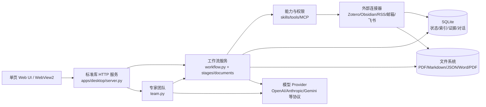

# 览籍智研：资产协同、笔记存储与专家团队架构调研及升级方案

## 0. 文档说明

- 调研日期：2026-10-20
- 调研对象：当前仓库 `D:\CodingProject\research-workbench`
- 当前版本基线：`VERSION` / v0.1.0
- 调研方法：以实际 Python、SQLite schema、迁移脚本、服务端路由、工作流模块、团队模块和测试为准；规划文档只作为设计背景，不把尚未实现的内容当成现状。
- 结论性质：本文是当前架构的事实盘点、问题诊断和可渐进落地的 v2 升级方案，不要求一次性重写。

---

## 1. 执行结论

### 1.1 你现在的架构是什么

当前系统本质上是一个**本地优先、SQLite + 文件系统双存储、模块化单体、工具调用型 Agent 工作台**：



### 1.2 资产是怎样协同工作的

资产协同不是靠一个统一的“资产对象”完成，而是靠 `task_id`（项目 ID）把多个表和目录串起来：

```text
研究项目 research_tasks
  ├─ 检索候选 search_cache
  ├─ OA PDF papers + paper_pages
  ├─ 页码级证据 evidence
  ├─ 精读/审查/结论 notes
  ├─ 可编辑大笔记 md_notes
  ├─ 项目长期/短期记忆 project_memory + 记忆/*.md
  ├─ 工作流步骤 steps
  ├─ 对话 chat / chats
  ├─ 工作流文件 论文正文/框架.md、正文.md、谱系.json、引用台账.md
  ├─ 运行与审计 runs / tasks / run_events / audit_events
  └─ 团队 team_members / team_tasks / team_events / team_sessions
```

其中，`task_id` 是当前架构里最重要的协同键；`paper_id` 负责把论文、页文本、证据和阅读笔记关联起来；路径和文件名则承担了较多“人工可读的外部接口”职责。

### 1.3 笔记现在如何存储

当前实际上有三种笔记，不是一个统一笔记系统：

1. **工作流项目笔记 `notes`**：精读、创新点审查、稿件审查等自动产物存 SQLite 的 `markdown` 字段，同时复制一份 `.md` 到项目的“笔记”目录。
2. **笔记页大笔记 `md_notes`**：编辑器直接把完整 Markdown 存在 SQLite 的 `content` 字段，支持绑定项目和论文，但当前不是所有修改都同步为外部 `.md` 文件。
3. **Obsidian Vault 笔记**：仍由外部 Vault 文件作为实际内容，系统只扫描 Markdown，并严格只改指定 frontmatter 字段；不碰 `.obsidian/`，不负责把正文完整导入本地笔记表。

所以当前笔记的核心风险是：**内容有多个事实来源，且 `notes` 与 `md_notes` 的名称相近但生命周期不同。**

### 1.4 当前专家团队如何工作

专家团队不是一个真正的并行 Agent 集群，而是三套机制叠加：

- **助手层**：`assistants` 保存专家身份、规则、模型绑定和能力绑定。
- **项目 Partner Agent 层**：项目内对话绑定项目，使用项目资料、项目记忆和专属 scope。
- **团队层**：`team.py` 负责 Leader、成员、派活、串行队列、团队群聊接力和固定/机动办公室。

当前真实执行模型是：**一个 Python 服务进程、多个 SQLite 连接、模型调用阻塞、团队任务串行执行**。代码中有子 Agent 的线程池并行委派，但子 Agent 只读且只把摘要返回父 Agent；这与团队主队列的“成员逐个执行”不是同一种并行。

### 1.5 最重要的升级方向

不建议直接重写现有系统。应优先做四件事：

1. 建立统一的 `asset / revision / relation / provenance` 资产层，消除笔记和产物的双重事实源。
2. 把工作流从“步骤日志 + 文件副作用”升级为“有输入、输出、版本、验收门和来源的可恢复运行图”。
3. 把团队从“成员轮流调用模型”升级为“任务 DAG + 产物契约 + Leader 规划 / 专家执行 / Reviewer 验收”。
4. 保留 SQLite + 本地文件的本地优先路线，但用 FTS5、原子写入、事件日志和同步游标解决规模、恢复和冲突问题。

---

## 2. 当前系统的分层与职责

### 2.1 入口层：桌面窗口 + 本地 HTTP

`apps/desktop/server.py` 同时承担以下职责：

- 启动本地 ThreadingHTTPServer；
- 提供单页静态资源和 JSON API；
- 处理 Agent SSE 事件流；
- 初始化路径、数据库、定时任务和团队 worker；
- 汇总大量模块路由；
- 在 Windows 上管理无边框 Edge/WebView2 窗口。

这使应用启动简单、部署简单、无远程后端依赖，但也意味着服务端入口承担了较多编排职责。后续应将 HTTP 路由与领域服务拆开，而不是先拆成分布式服务。

### 2.2 路径层：代码和数据分离

`packages/workspace-core/paths.py` 是当前唯一的路径来源。默认布局是：

```text
%LOCALAPPDATA%\览籍智研\
  app/                 程序与只读资源（源码运行时为仓库根）
  data/                SQLite、PDF、笔记镜像、产物、上传、备份
  user/                用户资料、加密凭据、邮箱等
  executors/           agents/、skills/、tools/
```

数据目录包括：

```text
data/
  research.sqlite3
  papers/              全文 PDF 或入库后的 PDF 路径
  notes/               工作流笔记镜像
  out/                 未绑定项目位置时的产物和按项目 ID 分名文件
  uploads/             用户上传的实验数据等
  ref/                 参考资源
  cache/               缓存
  _backup/             数据库/文件写入前快照、审计文件
```

用户可以给项目配置 `research_tasks.base_dir`。一旦设置，工作流会在该目录下使用固定子目录：

```text
<项目目录>/
  记忆/
  文献库/
  笔记/
  论文正文/
  对话/
  最终产物/
  其余/
```

这套设计的优点是可读、可备份、可直接交给用户；缺点是项目目录中的文件没有完整地注册为一等资产，很多文件只能靠约定文件名被重新发现。

### 2.3 数据库层：一个主 SQLite 库，多领域表

数据库由 `migrations/001_core_schema.sql` 至 `004_v130_features.sql` 和 `WorkflowDB` 的兼容补列共同维护。当前表可以按领域分为：

| 领域 | 主要表 | 作用 |
|---|---|---|
| 项目 | `research_tasks` | 研究项目、问题、材料体系、阶段、可选项目目录 |
| 对话 | `chats`、`chat`、`team_sessions` | 首页对话、项目对话、步骤 scope、团队会话 |
| 文献 | `search_cache`、`papers`、`paper_pages`、`paper_meta` | 检索候选、入库 PDF、逐页文本、元数据 |
| 证据 | `evidence` | 字段、数值、页码、原文摘录、候选/事实类型 |
| 笔记 | `notes`、`md_notes`、`project_memory` | 工作流笔记、编辑器笔记、项目记忆 |
| 工作流 | `steps`、`artifacts`、`runs`、`paper_graph`、`kb_graph` | 步骤记录、产物登记、运行记录、图谱缓存 |
| Agent | `assistants`、`providers`、`model_profiles`、`capability_*` | 专家身份、模型、技能、工具和 MCP 权限 |
| 团队 | `teams`、`team_members`、`team_tasks`、`team_events` | 团队、成员、派活、事件流水 |
| 可靠性 | `tasks`、`task_attempts`、`run_events`、`background_jobs`、`audit_events` | 异步任务、尝试、SSE 回放、后台任务和审计 |
| 外部集成 | `integration_settings`、RSS、easyScholar、Zotero 相关表 | 外部服务配置与缓存 |

当前系统已经有可靠性表和审计表，这是升级时可复用的基础；但不同模块仍在直接操作各自表，尚未形成统一领域接口。

---

## 3. 资产协同的完整链路

### 3.1 项目是协同根节点

项目创建由 `ResearchDB.create_task()` 完成，项目记录包含：

- `id`：全链路关联键；
- `title`：项目名称；
- `question`：研究问题；
- `material_system`：关键词/材料体系；
- `stage`：粗粒度阶段；
- `base_dir`：用户选择的外部项目目录；
- `created_at` / `updated_at`：时间信息。

没有项目绑定的首页对话仍可工作，但它只能通过项目名或项目 ID 明确指向项目，避免把跨项目写操作误落到错误项目。

### 3.2 文献从候选变成可验证知识

文献链路如下：

```text
OpenAlex / Crossref / arXiv / Zotero
  -> search_cache（候选题录、摘要、DOI、OA URL）
  -> dl_queue（用户勾选与下载状态）
  -> papers（SHA256 去重的 PDF 入库记录）
  -> paper_pages（逐页文本）
  -> stage_read（逐段发送模型，生成精读笔记）
  -> evidence（页码 + 原文摘录的严格证据记录）
  -> notes / md_notes / 写作正文 / 审查
```

关键事实：

- `ingest_pdf()` 以 SHA256 做去重，并把 PDF 的逐页文本写入 `paper_pages`；
- 论文 PDF 的 `source_path` 可能指向用户文件或项目“文献库”中的副本；删除项目时只删除位于应用论文目录白名单下的副本，不删除用户原始文件；
- `evidence` 写入时会验证页码范围和摘录是否实际出现在该页文本中；
- 模型抽取的证据不是自动事实，系统明确把它视为候选，后续需要人工审查；
- `paper_graph` 与 `kb_graph` 是编译结果，不是每次打开项目都重算的实时图。

这条链路已经具备“证据优先”的产品骨架，但证据还没有成为所有下游产物的统一父节点：正文引用台账、笔记、谱系节点和审查意见之间仍主要靠文件、文本和 prompt 约定连接。

### 3.3 文献、笔记和正文的当前协同方式

当前协同主要有四种方式：

1. **数据库外键式协同**：`notes.paper_id`、`md_notes.paper_id`、`papers.task_id`。
2. **项目 ID 过滤式协同**：项目空间搜索和 Agent 的 `knowledge_query` 按 `task_id` 查询笔记/证据。
3. **固定路径式协同**：`<项目>/论文正文/框架.md`、`正文.md`、`谱系.json`、`引用台账.md`。
4. **模型上下文式协同**：`run_agent()` 把项目简介、记忆块、当前步骤文件和工具结果拼入上下文。

这使用户可以从检索一路走到写作，但系统还缺少一张明确的“为什么这段正文由哪条证据支持、由哪个 Agent 在哪次运行生成、用户何时确认”的关系图。

### 3.4 记忆是跨轮次的软状态

项目记忆存于 `project_memory`：

- `long`：项目要点、重要结论、约束和偏好；
- `short`：早期对话摘要和细节。

有项目目录时，`dump_memory()` 会生成：

- `记忆/长期记忆.md`；
- `记忆/短期记忆.md`。

Agent 每次运行通过 `memory_block()` 注入长期记忆和较早对话摘要，最近若干轮则直接从 `chat` 读取。该机制成本低且有效，但“数据库内容”和“记忆 Markdown”之间目前没有冲突检测，也没有明确人工编辑后如何回写数据库的机制。

---

## 4. 笔记存储的详细审计

### 4.1 类型一：工作流自动笔记 `notes`

表结构核心字段：

```sql
notes(
  id, task_id, paper_id, title, markdown, created_at
)
```

写入方式是 `WorkflowDB.add_note()`：

1. 先写 SQLite `notes`；
2. 再把同一段 Markdown 写到 `db.pdir(task_id, "笔记") / <note_id>.md`；
3. 返回数据库中的笔记记录。

典型来源：

- 创新点审查：审查结论写入项目笔记；
- 论文精读：逐篇生成精读 Markdown；
- 知识库整理：把精读内容和证据表合成知识库笔记；
- 稿件审查：生成审稿意见笔记。

优点：自动产物既能被 Agent 查询，又能在文件系统中查看和备份。

问题：

- 表中没有 `path`、`content_hash`、`revision`、`source_run_id`；
- `add_note()` 是追加式，后续编辑没有统一的更新 API；
- 数据库和 `.md` 是双写，但不是同一事务，写库成功、写文件失败时会分叉；
- 文件名只有 ID，人工在项目目录中不容易理解笔记主题；
- 其他模块可能直接读表或读目录，缺少唯一规范。

### 4.2 类型二：编辑器大笔记 `md_notes`

表结构核心字段：

```sql
md_notes(
  id, title, content, task_id, paper_id, created_at, updated_at
)
```

`save_md_note()` 直接更新 SQLite 内容，支持：

- 不绑定项目的全局笔记；
- 绑定项目的项目笔记；
- 绑定某篇论文的阅读笔记；
- `None` 表示保持绑定，空串表示解绑。

项目空间的 `list_project_notes()` 和 `get_project_note_detail()` 会同时查询 `md_notes` 与传统 `notes`，前端因此可以把两类内容放进一个列表。

问题：

- `md_notes.content` 是数据库内容，不天然落成项目 Markdown 文件；
- 与 `notes` 具有相似的“笔记”语义，但字段、生命周期和读写方式不同；
- `md_notes` 绑定 `paper_id` 不代表它一定有严格证据；
- 项目空间搜索是 Python 逐条扫描，不是全文索引。

### 4.3 类型三：Obsidian Vault

`packages/connectors/vault.py` 将 Obsidian 视为用户授权的外部知识库：

- 只接受绝对路径；
- 防止越过 Vault 根目录；
- 跳过 `.obsidian`、`.trash`、`.git`、`node_modules` 和隐藏目录；
- 只处理 `.md`；
- 扫描 frontmatter、标签、阅读状态、吸收状态、项目字段和字数；
- 写回时只改允许字段，正文原样保留；
- 不执行任意 YAML，不碰插件配置和 Vault 结构。

这是一个合理的安全边界，但它目前更像“受控看板/状态写回连接器”，不是和本地项目笔记统一的双向同步系统。项目空间的项目笔记列表主要来自 `notes` / `md_notes`，而不是完整的 Vault 内容索引。

### 4.4 当前笔记事实源结论

| 笔记类型 | 当前事实源 | 是否有文件镜像 | 是否有项目绑定 | 是否有论文绑定 | 是否有版本/血缘 |
|---|---|---:|---:|---:|---:|
| 精读/审查/创新点自动笔记 | `notes.markdown` | 是，但非事务双写 | 是 | 可选 | 否 |
| 编辑器大笔记 | `md_notes.content` | 通常否 | 可选 | 可选 | 否 |
| Obsidian 笔记 | Vault `.md` | 文件本身 | frontmatter 可选 | 目前主要是外部字段 | 文件修改时间，非系统版本 |
| 长期/短期记忆 | `project_memory.text` | 有项目目录时有镜像 | 是 | 否 | 否 |
| 大纲/正文/谱系/引用台账 | 项目目录文件 | 是 | 路径隐含 | 通过引用和节点文本关联 | 文件级，无统一 revision |

升级的首要原则应是：**一个资产只有一个权威内容源，其他位置只能是索引、缓存、发布副本或外部同步副本。**

---

## 5. 十步工作流如何工作

当前 `workflow.STAGES` 是十步：

| 顺序 | stage | 主要输入 | 主要产物/状态 | 当前 Agent 形态 |
|---:|---|---|---|---|
| 1 | `idea` 创新点审查 | 用户创新点、项目问题、硬约束 | `notes`、`project_memory`、`steps` | 受限工具 + 博导 skill |
| 2 | `search` 论文搜索 | 查询、数据源、条数 | `search_cache`、`steps` | 搜索工具/三源连接器 |
| 3 | `download` 下载精读 | 候选结果、OA 链接或 Zotero | `dl_queue`、`papers`、`paper_pages` | 下载/导入工具 |
| 4 | `notes` 论文翻译/精读 | PDF、页文本、高亮 | 翻译状态、高亮、精读 `notes`、证据 | 读论文/整理工具 |
| 5 | `outline` 确认大纲 | 项目问题、用户修改 | `论文正文/框架.md` | 只允许读写框架的 Agent |
| 6 | `map` 梳理精读 | 大纲、精读笔记、实验数据 | `论文正文/谱系.json` | 结构整理 Agent |
| 7 | `write` 文章撰写 | 框架、证据、笔记、记忆 | `论文正文/正文.md`、引用台账 | 素材官 → 写手 → 审查 → 定稿 |
| 8 | `review` 稿件审查 | 正文、证据、引用状态 | 审查笔记、正文修改建议 | 审稿 Agent |
| 9 | `entrans` 中译英 | 中文 Markdown | `正文_en.md` 或指定英文 Markdown | 分片并发翻译 |
| 10 | `convert` 格式转换 | Markdown/正文 | docx/html/md/LaTeX PDF | 本地转换器/编译器 |

### 5.1 工作流的实际执行模式

工作流不是一个持久化 DAG，而是：

1. HTTP 路由接收当前步骤请求；
2. `workflow.py` 或 `workflow_stages.py` 执行阶段逻辑；
3. Agent 步骤进入 `run_agent()` 工具调用循环；
4. 工具修改数据库或项目文件；
5. 通过 SSE 发出 `user`、`assistant`、`tool_call`、`tool_result`、`usage`、`done` 事件；
6. 关键事件写入 `chat.events`、`run_events` 或团队事件表；
7. 前端刷新项目状态和产物。

论文撰写已经有一个较完整的内部流水线：素材官整理证据 → 写手覆盖正文 → 引用核验 → 审查 Agent → 写手按审查意见再次覆盖正文。这是当前最接近“多 Agent 工作流”的实现，但它仍依赖 prompt 和文件覆盖，而不是显式的阶段产物契约。

### 5.2 工作流的边界控制

不同步骤通过专用 system prompt 和工具集合限制范围：

- 创新点审查只开放 `idea_review`、`memory_save`；
- 大纲只开放框架读写、引用登记、附件读取等工具；
- 谱系步骤只开放谱系读写和来源查看；
- 写作步骤要求整份 `正文.md` 覆盖写；
- Agent 还可以通过 skills、工具绑定和 MCP 缓存发现动态能力。

这种“按步骤收窄工具”的方式比让所有 Agent 都拥有全量工具安全，但当前是运行时策略，数据库没有完整记录每次运行实际使用的工具清单、版本和输入快照。

---

## 6. 当前专家团队架构

### 6.1 专家身份、模型和能力

当前专家配置由三层组成：

```text
Provider
  -> model_profiles
  -> assistant.model_id
  -> team_member.assistant_id
  -> run_agent(profile + rules + permissions + tools)
```

- `providers`：供应商目录、地址、协议、密钥、采用的模型；
- `model_profiles`：实际可选模型档案；密钥使用 DPAPI 保护；
- `assistants`：专家名称、头像、描述、规则、提示词、模型绑定、推理强度、权限模式；
- `capability_bindings`：按助手控制 skill/tool/MCP 能力；
- `executors/agents` 与 `executors/skills`：本地可编辑的执行器和技能目录；
- `capability_mcp_config`：整体加密的 MCP 配置；MCP 工具必须先显式发现，再进入缓存和工具列表。

因此，“专家”不是一个独立进程，而是**一套规则 + 一个模型档案 + 一组工具权限 + 一个会话/项目上下文**。

### 6.2 智研管家与 Partner Agent

- 首页没有项目绑定的对话使用“智研管家”身份，具备全局项目简报，可以查项目、日程、文献和团队；
- 绑定项目的对话使用 Partner Agent 语义：对话历史独立，但文献、笔记、记忆和产出都落在该项目；
- 专家助手可以从全局助手库选择，再绑定到项目团队成员；
- `agent_profile()` 和 `agent_settings.runtime_config()` 决定本轮使用哪个模型。

这是一个重要的架构选择：**身份、模型、项目上下文和工具权限被拆开了**，允许同一个专家在不同项目中复用，也允许不同专家使用不同模型。

### 6.3 团队的两种协作模式

#### A. 派活队列模式

入口是 `team_assign` 或团队页派活：

```text
Leader / 用户
  -> team_tasks(status=queued)
  -> team.tick() 每 3 秒轮询
  -> _run_one() 标记 running
  -> workflow.run_agent(... publish=False)
  -> 团队/成员-时间.md
  -> team_tasks(done/failed) + team_events
```

特征：

- 成员从 `team_members` 解析；
- 成员的规则和助手模型被注入 Agent 上下文；
- 任务状态和流水落库；
- 任务产物写入项目“其余/团队”目录；
- **同一进程中一次只跑一个成员任务**；
- 当前不能可靠中断阻塞中的模型调用。

#### B. 团队群聊接力模式

入口是团队页群聊：

```text
用户发言
  -> team_sessions + chat(scope=team:<session>)
  -> kick()
  -> _round() 选择下一个成员
  -> 成员继续调用 run_agent
  -> 根据 @成员 或“完成/收工”决定下一位
```

特征：

- 成员按顺序发言；
- `@某人` 可以改变下一位；
- `TEAM_RUNS` 保存当前轮次，但该状态在内存中，重启即丢；
- 临时团队执行结束后会释放成员，保留团队记录/会话。

### 6.4 固定团队和机动团队

当前 v3 设计是每个项目：

- 2 间固定办公室：文献抽取、文件撰写；
- 最多 3 间临时办公室：由智研管家按目的组建，完成后回收；
- 固定团队成员从助手库按名字播种；临时团队由 `team_form` 按助手名字拉人。

这让 UI 有“办公室/团队”的产品隐喻，也解决了助手复用和临时编组问题。但它仍然是成员集合，不是具有依赖关系、交付标准和验收状态的执行图。

---

## 7. 现有架构的优点

1. **本地优先和数据可迁移**：不依赖云端数据库，用户可以备份 SQLite 与项目目录。
2. **证据闸门明确**：页码和原文摘录校验是非常好的科研产品底座。
3. **路径安全边界较完整**：项目目录、数据目录、Vault、附件读取和外部打开均有白名单/越界校验。
4. **模型与专家解耦**：同一助手可以换模型，不同助手可以使用不同模型，Provider 也可扩展协议。
5. **能力可控**：工具、Skill、MCP 都有显式配置和助手绑定，不是无条件暴露全系统能力。
6. **已经有可恢复基础设施**：`tasks`、`task_attempts`、`run_events`、`background_jobs`、`audit_events` 为后续持久化调度提供了基础。
7. **产物对人友好**：大纲、正文、谱系、引用台账都是用户能直接打开和编辑的文件，而不是只能在数据库里看的黑盒。

---

## 8. 关键问题与风险诊断

以下按对科研可信度和数据安全的影响排序。

### P0：笔记和产物没有单一事实源

`notes`、`md_notes`、项目 Markdown、Obsidian Vault 都能承载“笔记”，但没有统一的资产 ID、版本号、内容哈希、来源和冲突状态。

后果：

- 用户修改文件后，数据库可能仍是旧内容；
- Agent 查询到的内容可能不是用户刚刚看到的内容；
- 同一篇精读内容可能同时存在于 `notes`、`md_notes` 和 Vault；
- 无法回答“正文这句话来自哪一版笔记”。

### P0：工作流产物与证据之间的血缘不完整

当前有 `paper_id`、页码和引用台账，但正文、谱系节点、审查意见和 Agent 运行没有统一的关系表。

后果：

- 引用台账可以检查锚句是否仍在正文，但不能完整证明锚句支持了什么 claim；
- 谱系图的 `ref` 是文本路径或 paper ID，不是稳定资产引用；
- 审查后的正文覆盖写会丢失“改前/改后/依据哪条审查意见”的结构化记录。

### P1：数据库写入和文件写入不是原子操作

例如自动笔记先写 `notes` 再写 `.md`，正文和谱系是直接覆盖文件。进程中断、磁盘异常或杀进程时可能出现一边成功、一边失败。

### P1：团队是串行队列，不是可恢复的多 Agent 编排

`team.tick()` 依靠进程内线程和集合防重入；`TEAM_RUNS` 也是内存状态。进程重启后：

- 正在运行的团队轮次没有完整恢复点；
- `running` 任务可能需要人工判断；
- 一个模型调用阻塞时，整个团队队列被拖住；
- 派活结果只是 Markdown 文本，没有统一的结构化交付契约。

### P1：工作流状态是“日志化”的，不是“状态机化”的

`steps` 记录每次发生了什么，但没有明确的：

- 输入资产版本；
- 输出资产版本；
- 前置条件；
- 验收人/验收时间；
- 失败重试策略；
- 阶段是否允许回退和重新运行。

因此目前更像“十个功能区”，还不是严格的可恢复研究流水线。

### P1：搜索和项目空间检索的扩展性有限

项目空间搜索主要在 Python 中逐条拼接标题、摘要、笔记和证据；没有统一 FTS5 索引，也没有按段落/页码建立命中位置。文献增长后，搜索延迟和上下文选择质量都会下降。

### P1：权限模式的执行语义还不够细

当前 `read_only` 会过滤只读工具，但 `workspace_write` 与 `full_access` 的差异主要进入 prompt/外部集成策略，未形成覆盖所有工具的统一策略引擎。未来应把“数据库写入、文件写入、外部网络写入、执行本地程序、发送外部消息”拆成独立风险等级。

### P1：可靠性基础设施尚未贯穿所有调用

仓库已有 `packages/ai-runtime/runtime.py` 的重试、预算和 telemetry 类型，但现有 `workflow.chat_raw()` 可以直接调用运行时，而多数路径没有把预算、取消检查和持久化 telemetry 贯穿到每个 Agent 运行。

### P2：外部集成的同步边界不统一

Zotero、Obsidian、RSS、邮箱、飞书的读写模型不同，当前主要靠各自连接器和路由拼接，缺少统一的外部引用、同步游标、失败重试和冲突记录。

### P2：迁移和兼容逻辑分散

一部分 schema 在 SQL migrations，一部分在 `WorkflowDB.__init__()`，另一部分在 `agent_settings.migrate()` 等模块内动态补列。兼容旧库很实用，但长期会使“当前真实 schema”难以审计。

### P2：本地服务默认信任同机 HTTP 客户端

系统目标是本机应用，这个取舍可以接受，但本地端口、MCP 子进程、外部工具和同一 Windows 用户下的其他进程仍是安全边界。发布版应增加本地会话 token、来源校验和高风险操作确认日志。

---

## 9. 建议的目标架构：Asset Graph + Run Graph

### 9.1 总体目标

保留本地优先，不立即引入微服务；将当前架构演进为：

```text
本地 UI
  -> API / 应用服务
     -> 领域层：Project / Asset / Workflow / Agent / Team / Integration
        -> Run Orchestrator：可恢复运行图
           -> Worker：模型、检索、PDF、转换、MCP
        -> Asset Store：SQLite 元数据 + 文件内容
        -> Indexer：FTS5 + 关系索引
        -> Policy Engine：工具/文件/网络/外发权限
        -> Event Log：可回放、可审计、可同步
```

### 9.2 统一资产模型

新增一个渐进式兼容层，不马上删除旧表：

```sql
CREATE TABLE assets (
  id TEXT PRIMARY KEY,
  project_id TEXT NOT NULL DEFAULT '',
  kind TEXT NOT NULL,                 -- paper/note/evidence/document/dataset/run/output
  title TEXT NOT NULL DEFAULT '',
  canonical_uri TEXT NOT NULL,        -- file://、db:// 或外部引用
  storage TEXT NOT NULL,              -- sqlite/file/external
  mime TEXT NOT NULL DEFAULT '',
  content_hash TEXT NOT NULL DEFAULT '',
  current_revision_id TEXT NOT NULL DEFAULT '',
  source TEXT NOT NULL DEFAULT 'local',
  status TEXT NOT NULL DEFAULT 'active',
  created_at TEXT NOT NULL,
  updated_at TEXT NOT NULL
);

CREATE TABLE asset_revisions (
  id TEXT PRIMARY KEY,
  asset_id TEXT NOT NULL,
  revision INTEGER NOT NULL,
  content_uri TEXT NOT NULL,
  content_hash TEXT NOT NULL,
  created_by TEXT NOT NULL,
  run_id TEXT NOT NULL DEFAULT '',
  message TEXT NOT NULL DEFAULT '',
  created_at TEXT NOT NULL,
  UNIQUE(asset_id, revision)
);

CREATE TABLE asset_relations (
  from_asset_id TEXT NOT NULL,
  relation TEXT NOT NULL,              -- supports/derived_from/mentions/produces/depends_on
  to_asset_id TEXT NOT NULL,
  metadata TEXT NOT NULL DEFAULT '{}',
  created_at TEXT NOT NULL,
  PRIMARY KEY(from_asset_id, relation, to_asset_id)
);

CREATE TABLE asset_provenance (
  id TEXT PRIMARY KEY,
  asset_id TEXT NOT NULL,
  run_id TEXT NOT NULL,
  actor TEXT NOT NULL,
  operation TEXT NOT NULL,
  input_snapshot TEXT NOT NULL DEFAULT '{}',
  created_at TEXT NOT NULL
);
```

迁移映射：

| 现有对象 | 目标资产 kind | 迁移策略 |
|---|---|---|
| `papers` | `paper` | 每篇论文建立一个 asset，`paper_pages` 作为子资产或内容索引 |
| `evidence` | `evidence` | 关联 `paper`，保留 page/excerpt/field/value |
| `notes` | `note` | 记录原表 ID 和原文件路径，生成第一版 revision |
| `md_notes` | `note` | 同上，标记 `storage=sqlite`，后续迁移为文件主存储 |
| `框架.md` / `正文.md` | `document` | 文件路径注册为 canonical URI |
| `谱系.json` | `document` | 节点中的 ref 改为资产关系 |
| `引用台账.*` | `document` + `citation` 元数据 | 保留 Markdown 展示，同时结构化引用记录 |
| `team_tasks` | `run` 或 `work_item` | 绑定输入资产、输出资产和成员 |

### 9.3 笔记 v2：统一模型、文件主存储、数据库索引

推荐将“用户可编辑的 Markdown”统一成以下规则：

1. **项目笔记的 canonical content 是 `.md` 文件**，因为用户需要备份、版本控制、Obsidian 和外部编辑器可读。
2. SQLite 保存标题、项目/论文绑定、路径、hash、revision、来源、同步状态和 FTS 索引，不再把同一正文长期存两份。
3. 自动生成的精读/审查/创新点笔记也落成文件，但标记 `source=generated`、`run_id`、`generated_by`，用户编辑后变成新的 revision。
4. `md_notes` 作为兼容表继续读写一段时间；新增统一 NoteService，旧 API 全部转发到 NoteService。
5. Obsidian 只通过 `external_ref` 接入：扫描得到外部资产，按 hash 判断 unchanged / changed / conflict，不再默认把外部文件静默覆盖。
6. 每次保存都使用临时文件 → flush/fsync → 原子替换，再更新索引；索引失败时把状态记为 `index_pending`，下次启动补偿。

建议的项目笔记目录：

```text
<项目>/笔记/
  papers/<paper-id>-精读.md
  evidence/<paper-id>-证据.md
  reviews/<run-id>-稿件审查.md
  notes/<note-id>-标题.md
  index.json                 # 可选的人类可读索引，不是事实源
```

### 9.4 工作流 v2：显式运行图和阶段契约

新增概念：

```sql
CREATE TABLE workflow_runs (
  id TEXT PRIMARY KEY,
  project_id TEXT NOT NULL,
  workflow TEXT NOT NULL,
  status TEXT NOT NULL,                -- queued/running/paused/failed/succeeded/cancelled
  current_node TEXT NOT NULL DEFAULT '',
  idempotency_key TEXT NOT NULL DEFAULT '',
  started_at TEXT NOT NULL,
  ended_at TEXT NOT NULL DEFAULT '',
  error TEXT NOT NULL DEFAULT ''
);

CREATE TABLE workflow_nodes (
  id TEXT PRIMARY KEY,
  run_id TEXT NOT NULL,
  stage TEXT NOT NULL,
  status TEXT NOT NULL,
  input_assets TEXT NOT NULL DEFAULT '[]',
  output_assets TEXT NOT NULL DEFAULT '[]',
  acceptance TEXT NOT NULL DEFAULT '{}',
  attempt INTEGER NOT NULL DEFAULT 0,
  started_at TEXT NOT NULL DEFAULT '',
  ended_at TEXT NOT NULL DEFAULT '',
  error TEXT NOT NULL DEFAULT ''
);
```

每一步不再只返回一段文本，而应返回一个阶段契约：

```json
{
  "stage": "paper_read",
  "status": "succeeded",
  "inputs": ["asset:paper-123"],
  "outputs": ["asset:note-456", "asset:evidence-789"],
  "claims": [
    {
      "text": "某条件下性能提升",
      "support": ["asset:evidence-789"],
      "confidence": "candidate",
      "needs_review": true
    }
  ],
  "warnings": ["PDF 第 4 页文本层质量较低"]
}
```

这样可以做到：

- 重跑只重跑受影响节点；
- 任何正文段落都能反查证据；
- 用户能暂停、批准、拒绝或回退一个节点；
- Agent 失败可以从 checkpoint 继续，而不是从头执行；
- 团队成员领取的是有输入和输出契约的 work item。

### 9.5 专家团队 v2：从成员轮流发言到任务 DAG

保留现有“办公室”和专家 UI，但后端改为四个角色：

```text
智研管家 / Planner
  -> 拆解目标、创建 work_items、设定依赖和验收标准

专家 Worker
  -> 只领取自己能力范围内的 work_item
  -> 读取指定资产快照
  -> 产出结构化结果和 Markdown 解释

Reviewer / Verifier
  -> 检查 schema、证据、数值、路径和引用
  -> 通过/退回/标记人工确认

Committer
  -> 将通过的产物注册为 asset revision
  -> 更新工作流节点和项目状态
```

`work_items` 至少包含：

- `id`、`project_id`、`run_id`；
- `kind`、`title`、`prompt`；
- `depends_on`；
- `assigned_assistant_id`；
- `input_asset_ids`；
- `output_contract`；
- `status`、`attempt`、`checkpoint`；
- `review_status`、`reviewer_id`；
- `created_at`、`started_at`、`ended_at`。

调度策略：

1. 默认仍可串行，保证单机稳定；
2. 互不依赖的只读检索/精读任务可以使用受控线程池并发；
3. 同一项目的文件写入必须按项目锁或资产锁串行；
4. 每个成员拥有独立上下文和输入快照，禁止把未声明的全局对话历史带入；
5. 任务完成后必须经过结构化校验，再写入 canonical asset；
6. `team_sessions` 只负责讨论记录，不再承担任务状态本身。

这会把“@下一个人”保留为交互体验，但执行本质变成可追踪的工作项图。

### 9.6 能力和权限 v2

把风险从当前两档/提示词约束细化成工具策略：

| 风险级别 | 示例 | 默认策略 |
|---|---|---|
| R0 只读 | 查项目、读笔记、读 PDF、查证据 | 自动允许 |
| R1 工作区写 | 写 Markdown、更新谱系、生成本地文件 | 可配置，记录 revision |
| R2 本地执行 | xelatex、脚本、MCP stdio 子进程 | 首次确认 + 白名单 |
| R3 网络读取 | OpenAlex、模型 API、RSS | Provider/域名白名单 |
| R4 外部写入 | Zotero 写入、飞书、邮件、远程 API | 每次明确确认或项目级授权 |

每次工具调用记录：工具版本、能力绑定、权限决策、输入哈希、输出资产、外部域名和耗时。

---

## 10. 分阶段升级路线

### Phase 0：基线和观测（1 周）

目标：不改变用户体验，先让系统可测量。

- 固化当前 schema 快照和旧表到新迁移说明；
- 为每次 Agent 运行生成 `run_id`，把 `run_id` 写入事件、产物和审计；
- 为 `notes`、`md_notes`、正文文件记录 content hash；
- 增加启动时的“孤儿资产/数据库文件不一致”诊断；
- 给团队 `running` 任务增加启动恢复扫描和明确的 `stale` 状态；
- 增加关键链路集成测试：检索 → 入库 → 精读 → 证据 → 写作 → 引用核验。

验收：任何一次模型调用、文件写入和团队任务都能回答“谁、何时、对哪个项目、读了什么、写了什么”。

### Phase 1：统一笔记服务（2 周）

- 新增 `NoteService` 和 `asset_revisions`；
- `notes`、`md_notes` 旧接口转发到统一服务；
- 自动笔记保存到项目文件，并把 DB 变为索引；
- 加入原子写和 hash 校验；
- 项目空间改用统一 NoteService，不再直接查询两张表；
- 保留旧数据读取，提供一次性迁移/重建索引命令；
- Obsidian 接入 external ref 和冲突提示，但先不做自动双向合并。

验收：同一篇笔记在数据库、项目目录和 UI 中只有一个 canonical revision；外部编辑后能显示“已变更/冲突”，不静默覆盖。

### Phase 2：资产索引和证据图（2-3 周）

- 新增 `assets`、`asset_relations`、`asset_provenance`；
- 将 paper、page、evidence、note、document 注册为资产；
- 对正文引用、谱系节点、审查意见写入结构化关系；
- 引入 SQLite FTS5：论文元数据、页文本、证据、笔记、正文统一索引；
- 项目空间搜索返回稳定资产 ID、命中段落、页码和来源路径。

验收：点击正文句子可以看到支持它的证据、原文页码、精读笔记、生成运行和最后修改人。

### Phase 3：工作流运行图（3 周）

- 新增 `workflow_runs` / `workflow_nodes`；
- 将十步工作流改为节点执行器，旧 `steps` 作为兼容投影；
- 阶段产物统一返回输入/输出资产和 warnings；
- 引入幂等键、checkpoint、重试、取消和人工批准状态；
- 论文撰写流水线改为显式四节点：evidence brief / draft / audit / revise；
- 每次正文覆盖写变成新 revision，而不是无历史覆盖。

验收：中断后可以继续；只修改一篇论文时不会无条件重跑整个项目；失败状态不伪装成成功。

### Phase 4：团队任务 DAG（3-4 周）

- 将 `team_tasks` 迁移/投影到 `work_items`；
- Leader 先生成任务图和输出契约；
- 专家成员领取节点并输出结构化结果；
- Reviewer 负责证据和格式验收；
- 同一项目按资产锁控制写入，并发只放开独立只读节点；
- 团队讨论和任务执行分离，群聊中显示任务状态而非用文本猜测状态；
- 增加队列持久化恢复、重试退避、取消检查和超时。

验收：至少支持“两个文献独立精读并行 → 汇总 Agent 合并 → Reviewer 验证 → 写入综述素材包”的完整可恢复流程。

### Phase 5：外部同步与发布质量（持续）

- Zotero、Obsidian、飞书、邮箱统一外部连接器协议；
- 每个连接器提供 status、pull、push、cursor、conflicts；
- 引入本地 HTTP 会话 token、高风险操作审计和更清晰的 MCP 执行确认；
- 将 `ai-runtime` 的预算、重试、取消和 telemetry 接入全部模型调用；
- 做大项目压力测试：论文 1,000 篇、笔记 10,000 篇、长期运行 30 天。

---

## 11. 数据迁移方案

### 11.1 迁移原则

- 不删除旧表，不在第一次启动时破坏性重写；
- 先备份 SQLite 和项目目录；
- 所有迁移可重复执行；
- 每条新资产保留 `legacy_table`、`legacy_id` 元数据；
- 新旧 API 并行一段时间，先迁移调用方再删除旧接口；
- 任何冲突都保留两份，不自动覆盖用户内容。

### 11.2 推荐迁移顺序

1. 创建 `assets`、`asset_revisions`、`asset_relations`、`asset_provenance`；
2. 扫描 `research_tasks` 建立项目资产；
3. 扫描 `papers` 和 `paper_pages` 建立文献/页面索引；
4. 将 `notes` 和 `md_notes` 转为 note 资产，并用 hash 判断内容是否一致；
5. 注册框架、正文、谱系和引用台账文件；
6. 对不一致的笔记生成 `conflict` 记录和人工选择列表；
7. 新 API 改为读取统一资产层；
8. 最后才停止旧模块的直接表查询。

### 11.3 对现有笔记冲突的处理规则

如果同一个逻辑笔记同时存在 DB 内容和文件内容：

- hash 相同：合并为同一个 revision；
- 只有一边存在：把存在的一边作为 revision 1；
- 两边都存在且 hash 不同：保留 `db-copy` 和 `file-copy` 两个候选，不自动判断谁是正确版本；
- 用户选择后，建立新的 canonical revision，并保留冲突记录。

---

## 12. 建议优先修改的代码边界

第一批不应大面积改前端，而应建立几个可测试的后端边界：

| 优先级 | 建议模块 | 改造职责 |
|---|---|---|
| 1 | `packages/workspace-service/note_service.py` | 统一 `notes` / `md_notes` / 文件笔记读写、hash、revision |
| 2 | `packages/workspace-service/asset_service.py` | asset、revision、relation、provenance |
| 3 | `packages/workspace-service/run_service.py` | workflow run/node、checkpoint、幂等、恢复 |
| 4 | `packages/workspace-service/team.py` | 保留现有 UI API，内部转为 work item 调度 |
| 5 | `packages/database/research_core.py` | 统一事务、外键策略、FTS 索引、迁移入口 |
| 6 | `packages/workspace-service/workflow_documents.py` | 文档写入改为 revision，不再裸覆盖 |
| 7 | `packages/workspace-service/workflow_stages.py` | 阶段返回统一 output contract 和 provenance |
| 8 | `apps/desktop/server.py` | 只保留路由和生命周期，业务逻辑下沉到 service |
| 9 | `apps/desktop/web/project-space.js` | 改读统一资产搜索和笔记接口 |
| 10 | `apps/desktop/web/team-office.js` / `workflow-view.js` | 显示 run/node/work item 状态和来源 |

建议新增测试文件：

- `tests/test_assets.py`：资产注册、关系、hash、孤儿检测；
- `tests/test_notes_service.py`：三类笔记迁移、冲突和原子写；
- `tests/test_workflow_runs.py`：幂等、checkpoint、恢复、取消；
- `tests/test_team_scheduler.py`：依赖图、串行锁、重试、崩溃恢复；
- `tests/test_provenance.py`：正文 claim → evidence → paper page 的回溯。

---

## 13. 可观测性与验收指标

升级不能只看“页面能不能点”，应增加以下指标：

### 数据可信度

- canonical 笔记 hash 与文件 hash 一致率：目标 100%；
- 无来源 claim 占比：目标在写作阶段可见并持续下降；
- 证据摘录页码校验失败数：必须显式显示，不允许静默丢弃；
- 资产孤儿数、冲突数、未索引文件数：每次启动可诊断。

### 工作流可靠性

- 运行可恢复率：服务重启后可继续的运行比例；
- 重复提交不产生重复产物：幂等测试 100% 通过；
- 取消响应时间：不超过当前节点超时窗口；
- 失败任务有明确错误码、尝试次数和最后 checkpoint。

### 团队效率

- 任务从创建到领取的排队时间；
- 每个专家的成功率、平均耗时、token 使用；
- Reviewer 退回率；
- 并行节点的实际加速比；
- 机动团队释放后的资源回收时间。

### 用户体验

- 项目空间搜索在 10,000 条资产下的 p95 延迟；
- 打开项目不触发重型图谱重算；
- 用户能从任意产物跳回来源；
- 任何自动生成内容都显示“草稿/候选/已人工确认”状态。

---

## 14. 最终判断：应该保留什么、重做什么

### 应保留

- 本地 SQLite + 文件系统的部署形态；
- `task_id` 项目隔离模型；
- PDF SHA256 去重和逐页文本；
- 页码 + 原文摘录证据闸门；
- 项目目录六子目录和人类可读 Markdown；
- Provider / Assistant / Skill / Tool / MCP 的解耦；
- 现有十步工作流 UI 和“用户确认交付”产品语义；
- 智研管家、Partner Agent、固定团队和机动团队的产品概念。

### 应重做

- `notes` 与 `md_notes` 的双轨笔记存储；
- 通过文件名和 prompt 维持的产物关系；
- 直接覆盖正文/谱系文件而无 revision 的方式；
- 依赖内存状态的团队运行控制；
- 只用 `steps` 表示工作流状态的方式；
- 项目空间 Python 扫描式搜索；
- 仅用 prompt 表达权限、验收和证据状态的方式。

### 目标架构的一句话定义

> 览籍智研应从“把科研功能放在同一个本地工作台里”升级为“以项目为边界、以资产为节点、以证据为关系、以可恢复运行图为流程、以专家任务 DAG 为协作为核心的本地科研操作系统”。

---

## 15. 近期最小可行行动清单

如果只做一轮最有价值的改进，建议按以下顺序：

1. 给每次 Agent 调用补一个持久化 `run_id`，把 `run_id` 贯穿事件和产物。
2. 新增 `NoteService`，先统一读路径，不改变前端视觉。
3. 为 `notes`、`md_notes` 和正文文件计算 hash，启动时报告分叉。
4. 给正文、框架、谱系、引用台账增加 revision 快照，停止不可逆覆盖。
5. 将项目空间搜索改为 SQLite FTS5，返回资产 ID、页码和命中片段。
6. 给团队任务增加 `attempt/checkpoint/stale/retry_at`，解决重启和失败恢复。
7. 将写作流水线的四个内部 Agent 节点写入统一 run/node 表。
8. 在此基础上再做团队 DAG 和受控并行，不要先做“多 Agent 并行”UI。

这条路线能在不破坏当前用户数据和 UI 的前提下，先解决可信度、可恢复性和笔记一致性三个根问题。


---


## 16. 本次升级已落地的增量（v1.5）

前文中的 v2 方案已经完成第一轮可运行实现。本节是以当前代码为准的交付状态，避免把规划误读成已实现能力。

### 16.1 资产与笔记协同

- `assets` 是跨纸张、证据、笔记、正文草稿和团队产物的规范资产目录；`asset_revisions` 记录内容版本，`asset_relations` 记录 `supports`、`derived_from` 等关系，`asset_provenance` 记录由哪个 run 和哪个 Agent 产生。
- 文件仍然是 Markdown/PDF/DOCX 等自然语言资产的可读副本，SQLite 保存索引、结构化状态、哈希和关联；两者通过 canonical URI、content hash 与 revision 对齐，不再依靠目录扫描推断身份。
- Markdown 写入使用临时文件 + 原子替换，并在写入后登记 revision；旧的 `notes`、`md_notes`、`evidence` 和项目文件可通过 `POST /api/assets/rebuild` 幂等重建资产索引。
- 搜索优先走 `asset_fts`，中文分词不适用时保留 CJK/LIKE 回退；因此升级不会以一次迁移破坏旧库内容。

### 16.2 工作流与可恢复执行

- `workflow_runs` 与 `workflow_nodes` 把一次检索、精读、写作或转换拆成可观察的 run/node；幂等键避免重复执行，checkpoint 和 stale recovery 支持进程重启后恢复。
- 团队任务现在保存 `run_id`、输入资产、输出资产、checkpoint、attempt 和失败原因；团队输出会自动登记为 `team_output`，并与输入资产建立 `derived_from` 关系。
- 工具在执行边界按 `read_only`、`workspace_write`、`local_execution`、`network_read` 和 `external_write` 分类，Agent 只能在当前项目和当前能力边界内操作。

### 16.3 专家团队的 DAG 与 Reviewer Gate

- `migrations/006_team_task_dag.sql` 为 `team_tasks` 增加 `depends_on`、`output_contract`、`reviewer_id`、`review_attempt`、`approved_at` 和 `review_feedback`。
- `team.assign()` 校验依赖必须属于同一项目，校验 Reviewer 必须是当前团队成员；队列只调度依赖已经完成且通过验收的任务。
- 带 Reviewer 的任务执行完后进入 `review`，不是直接 `done`；`POST /api/team/task/review` 可以通过或退回。退回会保留反馈和次数、回到 `queued`，通过后才成为下游 DAG 可依赖的 `done`。
- `output_contract` 会进入 Partner Agent 上下文，作为结构化交付约束；它与实际产物资产、运行记录和审查反馈一起形成闭环。

### 16.4 当前架构判断

当前系统仍是单机 WebView/HTTP + SQLite WAL + 文件系统 + 串行团队 worker，而不是分布式多 Agent 集群。这是有意保留的边界：先把资产身份、证据链、任务状态和恢复语义做正确，再把 worker 拆到独立进程或远端队列。当前架构适合个人研究和小型团队；若进入多人同时编辑、长时间批处理或云端协作，需要继续补充锁、租约、对象存储和权限服务。

### 16.5 已验证项与残余风险

- 已验证：迁移幂等、资产/修订/关系、FTS 搜索、run/node 幂等与恢复、团队依赖调度、Reviewer 退回/通过、Python 编译和核心路由。
- 现有浏览器回归中仍有若干目标分支原有 UI 选择器漂移（Agent 设置、能力页、项目卡片、工作流布局），不属于资产图和团队 DAG 的变更，但应在下一次 UI 对齐中单独修复。
- 直接推送到目标仓库需要该账号具备写权限；交付采用已推送分支与 Pull Request 流程。
- 编辑器笔记在更换项目绑定时复用同一 legacy asset，并迁移 Markdown 镜像；删除笔记会删除镜像、将资产标为 archived，并从搜索结果中排除，避免孤儿文件和孤儿索引。
